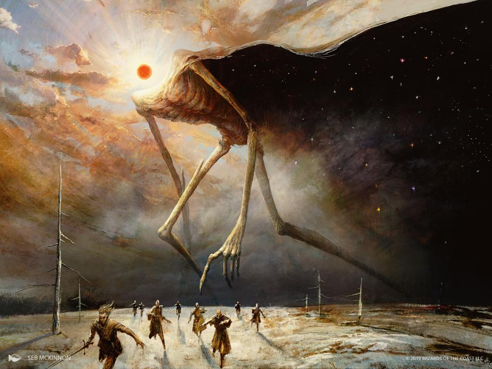

# Battle of the Lorem Ipsum

<h4>Battle of the test</h4>

<strong>Date</strong>1088

<strong>Location</strong>Lorem Ipsum

<strong>Result</strong>Lorem Victory

Belligerents

Kingdom of Test

Clans of Test

Commanders

King Lorem

Jarl Ipsum

Strength

12,000

9,500

Casualties

2,100

5,400

 

Lorem Ipsum

Lorem ipsum dolor sit amet, consectetur adipiscing elit. Maecenas a neque id mi mattis dignissim eget sit amet urna. Phasellus porta blandit ante sed congue. Class aptent taciti sociosqu ad litora torquent per conubia nostra, per inceptos himenaeos.

## Background

Lorem ipsum dolor sit amet, consectetur adipiscing elit. Maecenas a neque id mi mattis dignissim eget sit amet urna. Phasellus porta blandit ante sed congue. Class aptent taciti sociosqu ad litora torquent per conubia nostra, per inceptos himenaeos.
