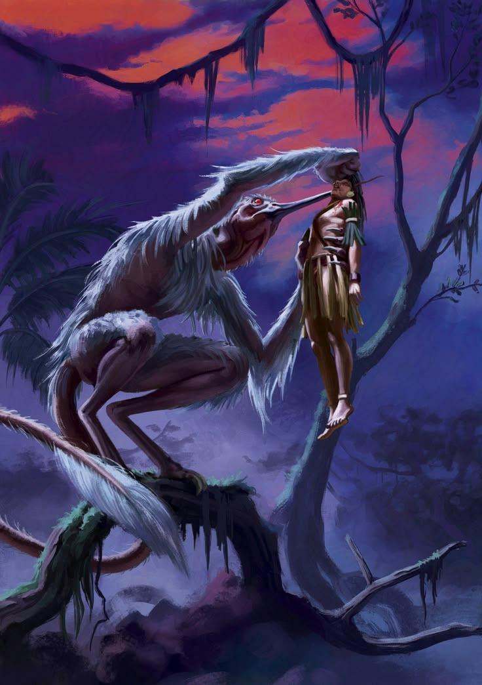

%%   
[[Ral]]   
[[Weaving]]   
[[Lycanthropy]]   
[[Aeldcult]]   
[[The Veilcurse]]   
[[Ruginë]]   
[[Rivid Tepor]]   
[[Sadizka Ovoletru]]   
%%  

  
<small><i>Geoli Shifter, western Behera</i></small>

Shifting is the transformation of a living body, wholly or in part, into the form of an animal. It is associated above all with the druidic traditions of Ilrakhan and with the shifters of Nirydia, the <a href="Ral" class="internal-link">Ral</a>. Where the druids of Ilrakhan practise it as one art among many, the Ral are more martially inclined and are capable of little or no other magic, so that among them Shifting is less a field of study than an inheritance passed down within their clans.
   

Scholars of Nirydia and Ilrakhan commonly count Shifting as a form of <a href="Weaving" class="internal-link">Weaving</a> rather than casting, although like Weaving itself it has received little serious attention from the major institutions of learning. In southern Nirydia it is the subject of countless myths and is widely feared, and tales of shifted beasts, such as the werewolves of the <a href="Blodrise Dark" class="internal-link">Blodrise Dark</a>, are told across the region.
  
<h2>The Art</h2>  

Shifters distinguish between taking a part of a beast and taking the whole of it. A partial shift lends the body a single feature, the eyes of an owl, the nose of a wolf or the strength of a bull, and leaves the shifter otherwise as they were; claws are said to be the first thing every young shifter learns. A full shift turns the whole body into the beast, and is far older in legend and far more dangerous in practice. No shifter can work the art on anyone but themselves.
  

Shifters nearly always take the animals their own people have revered for generations: the druids of the <a href="Aeldcult" class="internal-link">Aeldcult</a> favour the bear of Otso and the eagle of Yaalwe, and shifters themselves say they take the shape their forebears have always seen in the beast. Those who have watched them closely note that a shifted beast is never quite the right size. A shifter's wolf is larger and heavier than any wolf of the woods, while their bear is small for a bear, and the great owls and falcons of the Soki, said to be the largest birds ever seen, take wing only among the high winds of the Limsul Peaks. Every shift leaves the shifter ravenous and spent, and the Ral are known to eat like no other people after a hunt.
  
<h2>Tokens and the Way Back</h2>  

The druids of Ilrakhan never take a full form without a token to return by, most often a pelt, a cloak of feathers or a carved bone kept close at hand. Folk tales across the known world remember such tokens: the wolfskin belt of the werewolf, the seal skin of the sea-wife and the feather cloak of the swan maiden, each of which, once stolen or burned, leaves its owner trapped in the shape they last wore. The Ral carry no such token, and how they return remains their own secret.
  
<h2>Dangers</h2>  

Every tradition warns against staying too long in a beast's shape, for those who do find the way back harder each time, and some never return at all. A few scholars of <a href="The Veilcurse" class="internal-link">the Veilcurse</a> have noted that shifting and the curse alike leave a body that has forgotten its proper shape, but where the cursed lose their form unwilling, the shifter is said to give it up by choice and take it back by craft. Southern folk hold that the shifters of their lands come out more monstrous than those of the north, and that whatever a shifter loses in the beast may pass to those it wounds (see <a href="Lycanthropy" class="internal-link">Lycanthropy</a>).
  
<h2>Scholarship</h2>  

The first close account of the art was written by the Kheri traveller <a href="Rivid Tepor" class="internal-link">Rivid Tepor</a>, whose Between Fang and Finger of 763PA records his two decades among the Ral. The most ambitious attempt to explain it is that of <a href="Sadizka Ovoletru" class="internal-link">Sadizka Ovoletru</a> of Rivno, whose The Afterimage of the Beast of 912PA reads Shifting through <a href="The Anak" class="internal-link">the Anak</a> as a magic of afterimages, and which has done more than any other work to bring the art into the arcane discourse of southern Nirydia.
  
