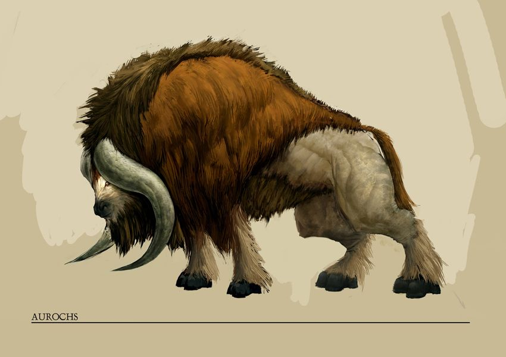

%%
[[Behera]]
[[Il Haena]]
[[Grevenna]]
[[Kherova]]
[[Nirydia]]
[[Hainach]]
[[Elbae]]
[[Ilonism]]
[[Hubert of Tanverley]]
%%

   
<small><i>An adult Beheran Auroch</i></small>

The Auroch is a large bovine herbivore found primarily in the northern deserts of <a href="Behera" class="internal-link">Behera</a>, on the island of <a href="Il Haena" class="internal-link">Il-Haena</a>, in Pilvia (modern day <a href="Grevenna" class="internal-link">Grevenna</a>), in <a href="Kherova" class="internal-link">Kherova</a> and on the grassy steppes of southern <a href="Nirydia" class="internal-link">Nirydia</a>, with smaller populations also present in <a href="Hainach" class="internal-link">Hainach</a>. It is among the largest beasts of burden kept on the Inaran continent and has been closely bound to the human cultures of these lands for as long as records of them exist.

Adult Aurochs reach a shoulder height of up to two metres and are of an exceptionally massive build, the weight of the animal carried largely in its broad, steeply humped forequarters. A thick shaggy coat of russet to dark brown hair covers the head, neck, shoulders and back, while the hindquarters are covered in a much shorter, pale coat that leaves the musculature of the haunches clearly visible. The head is carried low and is framed by a pair of long, pale grey horns that sweep outward and downward from the skull before curving forward to sharp points below the jaw. The lower legs are fringed with long pale hair that falls over dark, heavy hooves, and the tail ends in a long tuft. The Nirydian variant grows noticeably taller than its Beheran counterpart.

The Auroch is widely domesticated. Many of the desert caravans of the <a href="Elbae" class="internal-link">Elbae</a> Sultanate rely on the animal as a beast of burden, valuing its strength and its capacity to cross the open desert under heavy loads. On the steppes of southern Nirydia the Auroch is equally common, and the Niryd herds are the largest of the species. The Auroch is described in <a href="Hubert of Tanverley" class="internal-link">Hubert of Tanverleys</a> popular Bestiary series as part of his fifth volume concerning the lands of Rean and northern Behera.

Several Beheri human cultures, as well as certain strands of <a href="Ilonism" class="internal-link">Ilonism</a>, worshipped the Auroch in the past, though such veneration has largely fallen out of practice in the modern day. The animal nonetheless retains a strong presence in the visual culture of the regions it inhabits, where Auroch skulls and horns remain popular decorative elements.

