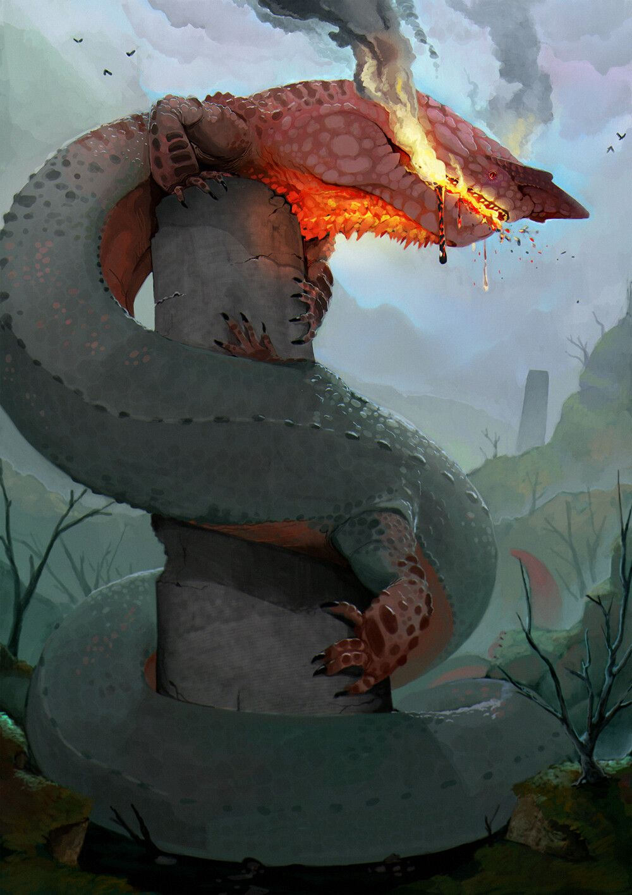

%%  
[[Niryd Steppe]]  
[[Steppe Bihra]]  
[[Bihra Shamanism]]  
[[Great Khaganates of the Steppe]]  
[[Dragon]]  
[[Auroch]]  
%%  

   
<small><i>A young Gnarlskin Salamander breathing fire</i></small>  

  

The Gnarlskin Salamander is a great reptile native to the <a href="Niryd Steppe" class="internal-link">Niryd Steppe</a> and the mount of the <a href="Steppe Bihra" class="internal-link">Steppe Bihra</a>. It has a long, serpentine body, powerful clawed forelegs and a rough, plated hide, and the young among them are able to breathe fire. A salamander can live for up to 220 years and keeps growing throughout its life, and the oldest and largest of them carry entire communities across the steppe on their backs. Scholars believe that the common tales of fire-breathing <a href="Dragon" class="internal-link">dragons</a> stem from sightings of these creatures, although true dragons, to which they are unrelated, are so rare that they are barely documented.
  
<h2>Description</h2>  

The body of the Gnarlskin Salamander is long and serpentine, and much of its length is made up of a heavy tail that the animal coils about itself when at rest. It is carried on short, powerful legs, of which the forelegs are the strongest, each ending in long dark claws with which the salamander can grip stone and climb. The head is long and narrow, with a heavy jaw lined with teeth.
  

Its name comes from its rough and knotted hide, which is covered in thick, rounded plates. In the young these are grey to green along the body and turn red and orange around the head, throat and forelegs. As the animal ages the plates grow out into long, overlapping scales of a dull brown that give the hide of the oldest salamanders a ragged, almost feathered look. Like the hide of the Steppe Bihra it is tough enough to endure the blades of the Aspira, and a salamander can move through the high grass of the central steppe without harm.
  
<h2>Life cycle</h2>  

A Gnarlskin Salamander never stops growing, and the oldest of them reach a size that dwarfs any other beast of the steppe. The young are able to spew fire, and the inside of their throats glows with it when they open their jaws. After around a century this ability fades, while the teeth of the salamander continue to grow, so that the oldest of them bear great teeth that jut out over their jaws. The oldest known salamanders have lived for up to 220 years.
  
<h2>Relationship with the Steppe Bihra</h2>  

The Steppe Bihra have ridden the Gnarlskin Salamanders for as long as their own records and those of their neighbours reach, and the salamanders have been the mounts of the hordes of every Khaganate of the steppe. Young salamanders, still able to breathe fire, serve as the war mounts of their warriors. The oldest and largest of them carry the walking cities of the Steppe Bihra, whole camps built on their backs that follow the herds of <a href="Auroch" class="internal-link">Aurochs</a> and the seasonal migrations of the Khaganates between the sacred sites of the shamans and the lands of their tributaries. Outsiders rarely cross the heart of the steppe without Bihra guides or the backs of their salamanders.
  

In <a href="Bihra Shamanism" class="internal-link">Bihra Shamanism</a> a rider and their salamander are believed to share a soul. Since a salamander can outlive its rider by more than a century, the shamans hold that the soul of the dead rider lives on in the animal, and the oldest salamanders, who have carried many generations, are honoured accordingly.
  
