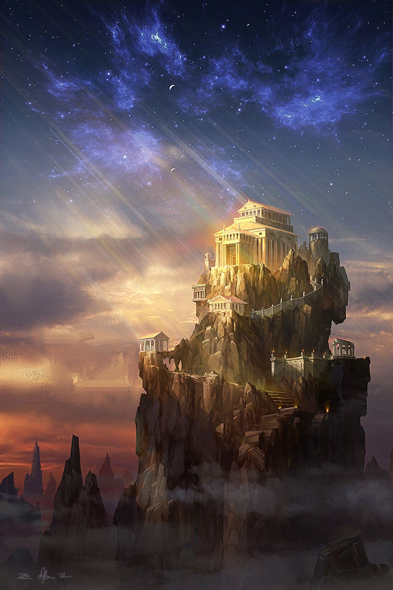
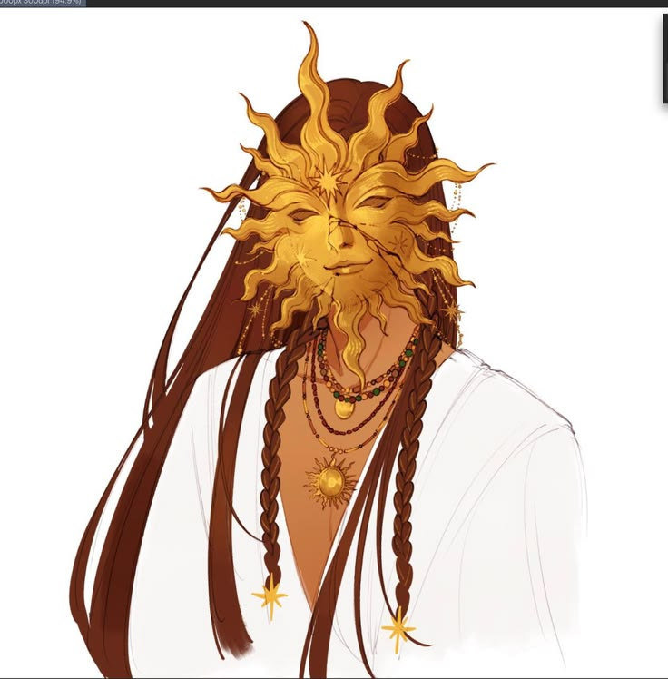

%%   
[[Zuhurism]]   
[[Gorat]]   
[[Gorati]]   
[[Amlija]]   
[[Suzana Dragović]]   
[[Calendars]]   
[[Vimgalab Monsis]]   
[[Xolor]]   
%%   

    
<small><i>Hastermon Temple atop Hastermon Mount</i></small>   

   

Hastermon Temple is a temple complex atop Hastermon Mount in the north of the Kingdom of <a href="Amlija" class="internal-link">Amlija</a> in <a href="Gorat" class="internal-link">Gorat</a>, on the spot where the prophet Hastermon is said to have reached communion with Pen Zuhur. It is one of the four great holy sites of <a href="Zuhurism" class="internal-link">Zuhurism</a> and the centre of the Gorati church, led by the high cleric known as the Arunča, and it draws pilgrims from all over the Zuhuri world.
   
<h2>The Vigil of Hastermon</h2>   

According to tradition the prophet Hastermon climbed the mount in the 4th century BA and stayed awake upon it for fourteen days and nights, praying without rest, until he reached communion with Pen Zuhur himself. At the end of his vigil his eyes opened as rays of light, which blessed the mount forever. The longest night of the year is kept throughout the Zuhuri world as a vigil in memory of his fourteen days (see <a href="Calendars" class="internal-link">Calendars</a>), and at Hastermon itself it is the holiest night of the year.
   
<h2>The Temple</h2>   

Hastermon Mount is a sheer pillar of rock that rises above the clouds among the jagged peaks of northern Amlija. The great temple crowns its summit, while lesser shrines, halls and colonnades cling to ledges on its flanks, and a long stair cut into the rock winds from the foot of the mount up to the summit. Pilgrims make the climb on foot, and the first light of dawn, which strikes the temple long before it reaches the valleys below, is held to be the light that once poured from Hastermon's eyes.
   
<h2>Priesthood</h2>   

    
<small><i>A Master of Hastermon, servant to Pen-Zuhur_</i></small>   

   

The temple is led by the Arunča, the highest cleric of the Gorati church. Its priests and monks guard the holy site fiercely, and its highest-ranking members wear masks of brass and gold in the shape of the face of the sun, for which the common folk call them the Maskers. It is rumoured that some of the highest clerics have burned away the flesh beneath their masks and fused them to their faces for good. Unlike some members of the Pagri church, who blind themselves in the service of the god, the clergy of Hastermon rarely practise ritual blinding, though blindness from staring into the sun is as common among them as elsewhere in the priesthood. In Gorat divination is almost entirely restricted to the shrines and temples of the Sunpriests, and Hastermon is foremost among them.
   
<h2>Pilgrimage</h2>   

Hastermon is one of the four holy sites of the classic tradition, together with the <a href="Vimgalab Monsis" class="internal-link">Vimgalab Monsis</a> in Nessos, the Spring of Light in the Templi Heights and the Pagale Monastery on Lonely Peak, and a pilgrim who has visited all four is honoured as having walked the Four Lights. The stream of pilgrims to the mount is a source of wealth and prestige for Amlija, and because the temple lies in their lands some of the Buzinci call themselves the first children of Zuhur.
   
<h2>History</h2>   

The mount has been bound to the faith since the vigil of Hastermon, and the temple is the oldest centre of Zuhurism among the <a href="Gorati" class="internal-link">Gorati</a>. During the wars of unification of <a href="Suzana Dragović" class="internal-link">Suzana Dragović</a> the Battle of Hastermon was fought nearby, and the betrayal of the House Dajateš there led Suzana to wipe out their entire bloodline. Under the Zeprian Empire, which elevated the priesthood and spread clerical education throughout Gorat, the temple grew into the undisputed centre of the Gorati church, and it has kept that standing among the Gorati realms that succeeded the Empire.
   

In 784PA the purges of the <a href="Xolor" class="internal-link">Xolor</a> were first proclaimed as the will of Pen Zuhur at Hastermon, from where the call spread quickly throughout Nirydia. When the plague known as the Dance of Husks ravaged Gorat in 846PA, many sought refuge on the mount.
   

In 852PA the temple came into conflict with the crown of Amlija in what became known as the Days of Ire. After being shunned by the Arunča of the time, the Ubrut Uroš of Amlija laid claim to Hastermon Mount itself and to the taxation of its pilgrims. In answer the temple denounced his rule, and almost all of his vassals refused him their service until he was reconciled with the church. The conflict was quickly resolved when Uroš begged for forgiveness and willingly submitted to ritual blinding before he was forgiven.
   
