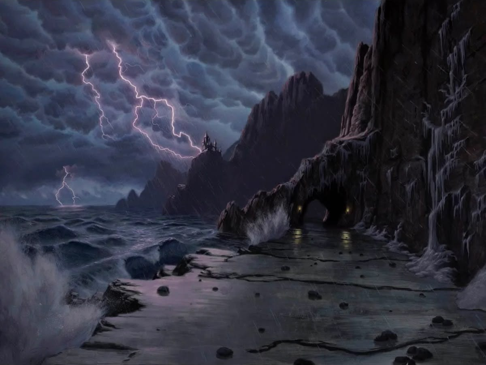

%%  
[[Vaergriff]]  
[[Trazlova]]  
[[Trazlov Consortium]]  
[[Black Tanya]]  
[[Thiar]]  
[[Espir]]  
[[Signa Nylldottr]]  
[[Cormian]]  
[[Ghant]]  
[[Rean]]  
%%  

  
 <h4 class="wiki-header">The Iron Hole</h4>  
 
  
 <strong>Location</strong>  
 South of Sydrow Isle, Torn Sea  
 
  
 
  
 <strong>Held by</strong>  
 <a href="Trazlova" class="internal-link">Vadcy zi Trazlova</a> (nominally)  
 
  
 
  
 <strong>Controlled by</strong>  
 <a href="Vaergriff" class="internal-link">The Vaergriff</a>  
 
  
 
  
 
  
 <strong>Built</strong>  
 4th century PA, as Syd Keep  
 
  
 
  
 <strong>Prison since</strong>  
 ca. 599PA  
 
  
 
  
   
 <small><i>The Iron Hole in the distance during a storm</i></small>  

  

The Iron Hole is a prison fortress on the southern coast of Sydrow Isle in the Torn Sea, north of Trazlov Bay. It is built over a sea cave on the ruins of Syd Keep, the castle of the old Gri of Sydrow and the seat of the witch <a href="Black Tanya" class="internal-link">Black Tanya</a>. The island belongs in name to the Vadcy of <a href="Trazlova" class="internal-link">Trazlova</a>, but the Iron Hole is in the hands of the <a href="Vaergriff" class="internal-link">Vaergriff</a>, and it is no prison for ordinary criminals. Those sent to it are high value political prisoners, dangerous individuals and others whom the Crown and its Secretariat want kept out of the world, and few of them ever leave it.
  
<h2>Geography</h2>  

Sydrow Isle is a poor and rugged island of moor, bog and rock. Its only town of any size, Sydrow, lies on the north coast, a port of call and a town of merchants that serves as the unofficial home of the fleet of the <a href="Trazlov Consortium" class="internal-link">Trazlov Consortium</a>. The Iron Hole stands far from it on the southern cape, where the cliffs fall straight into the Torn Sea. The fortress sits on the clifftop, and below it the sea has hollowed a great cave into the rock, in which the cells of the prison are cut. The interior of the island between the town and the prison is wild and largely empty. <a href="Cormian" class="internal-link">Cormians</a> haunt its bogs and pools, <a href="Ghant" class="internal-link">Ghants</a> are said to sleep in its moors, and the islanders hold that the dead walk there.
  
<h2>History</h2>  
<h3>Syd Keep</h3>  

Before the fourth century Sydrow was little more than a hamlet on a poor island, home to a native people who lived in the interior and kept to their old ways. After the Vihri victory over <a href="Rean" class="internal-link">Rean</a> in 306PA, the Crown rewarded Belia zi Syd for her services in the war by making her and her family Gri of the county of Sydrow. Belia built a castle on the southern cape, known as Syd Keep, and expanded the town on the north coast into a port.
  

Her daughter's daughter, Tanya zi Syd, came to rule the island around 362PA and became infamous as Black Tanya. For almost forty years she held court at Syd Keep with heathens, seers and shamans from the north, studied the forbidden grimoires of Wermia and practised blood magic and enchanting. Sailors, travellers and the native people of the interior disappeared into her keep to be sacrificed in her rituals. Around 400PA three heroes, the elf <a href="Thiar" class="internal-link">Thiar</a>, the Vihri knight <a href="Espir" class="internal-link">Sir Espir of the Oathhills</a> and the Jueli warrior <a href="Signa Nylldottr" class="internal-link">Signa Nylldottr</a>, came to Sydrow and killed her, and the tales give the killing blow to Thiar. They are remembered as the Heroes of Sydrow.
  

After Tanya's death the rule of Sydrow was offered to Sir Espir, who declined it, and the knights of the Ras took the island and Syd Keep for the Crown. The keep was left empty, and for about a hundred and fifty years it stood in ruins on the cape.
  
<h3>The Prison</h3>  

Around 599PA, in the reign of Miskomir I, Manus Orsaw, the first Sekretar of the Vaergriff, had the ruins of Syd Keep rebuilt as a prison. He chose it because it was far from the mainland, far from the town, and set on an island from which no one could easily escape. The Iron Hole has served the Secretariat ever since. The Vadcy of Trazlova holds Sydrow in name, and the town is governed in its name, but the Vars of Trazlova have no say over the prison and are not told who is kept in it.
  
<h2>The Prison Today</h2>  

The Iron Hole is governed by a Warden who answers to the Sekretar of the Realm, at present <a href="Tadeuz Pilsud" class="internal-link">Tadeuz Pilsud</a>, and it is guarded by men of the Vaergriff. Its prisoners are brought by ship from Trazlov or Sydrow town under guard and usually under a false name. They are kept in the cells of the sea cave below the fortress, which can only be reached through the keep above, while the mouth of the cave is closed against the sea by a great iron grate, from which the prison takes its name.
  

Few prisoners have ever escaped the Iron Hole, and fewer still have been heard of again. Most of those who got out of the cells died in the harsh waves of the Torn Sea. The rest fled into the interior of the island and were lost there forever, to Cormians, Ghants and ghosts.
  
<h2>Ghosts of Sydrow</h2>  

Sydrow is said to be haunted, and the Iron Hole most of all. Sailors, islanders and guards tell of voices in the sea cave, lights moving on the moors and figures seen on the cliffs at night, but the tales do not agree on who the ghosts are. Some say they are the prisoners who died in the cells and never left them. Others say they are the builders and workers who raised the prison, all of whom are said to have been killed when the work was done so that no one would know its secrets. Others again say they are the native people of Sydrow, who were killed hundreds of years ago during the Gethric missions to the island when they refused to convert, and the victims that Black Tanya took from among them before that.
  
<h2>People of Interest</h2>  

<a href="Tadeuz Pilsud" class="internal-link">Tadeuz Pilsud</a>, Sekretar of the Realm and Head of the Vaergriff Manus Orsaw, first Sekretar of the Vaergriff, who made Syd Keep a prison Belia zi Syd, first Gri of Sydrow, who built Syd Keep <a href="Black Tanya" class="internal-link">Black Tanya</a>, born Tanya zi Syd, witch and Gri of Sydrow
  
