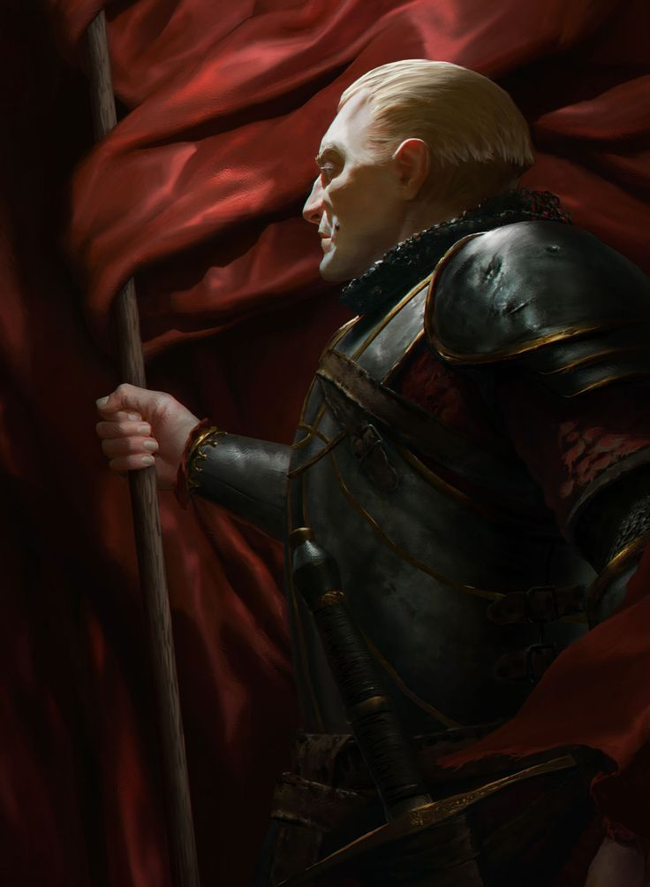

%%  
[[Selbia]]  
[[Selbia Brigade]]  
[[Brothers War]]  
[[Vormil II]]  
[[Third War of Elbae Aggression]]  
[[Halgrach]]  
[[Karelya Modriv]]  
[[Andre]]  
[[War of Horn and Fang]]  
[[Vihr]]  
%%  

  
<h4 class="wiki-header">Idrov zi Sribo</h4>  

  
<strong>Epithet</strong>  
Quick Idrov  

  

  
<strong>Occupation</strong>  
Var of <a href="Selbia" class="internal-link">Selbia</a>, Hetman of the <a href="Selbia Brigade" class="internal-link">Selbia Brigade</a>  

  

  
<strong>Culture</strong>  
<a href="Vihri" class="internal-link">Vihri</a> Human  

  

  
<strong>Born</strong>  
794PA, Ibozka  

  

  
<strong>Died</strong>  
866PA, Ibozka  

  

  
<strong>Cause of Death</strong>  
Old age and old wounds, 72 years of age  

  

  

  
<strong>House</strong>  
Sribo  

  

  
<strong>Parents</strong>  
<a href="Rezvyr zi Sribo" class="internal-link">Rezvyr zi Sribo</a>

  

  
<strong>Issue</strong>  
Feliks zi Sribo  

  

  
<strong>Honours</strong>  
Idrovstar (posthumous, 867PA)  

  

  
<strong>Allegiance</strong>  
<a href="Vihr" class="internal-link">Rascy zi Vihr</a>  

  

  
  

  

Idrov zi Sribo, called Quick Idrov, was Var of <a href="Selbia" class="internal-link">Selbia</a> from 819 to 849PA and Hetman of the <a href="Selbia Brigade" class="internal-link">Selbia Brigade</a> in the <a href="Brothers War" class="internal-link">Brothers War</a>. The younger son of Rezvyr zi Sribo, the coalition commander of the <a href="Third War of Elbae Aggression" class="internal-link">Third War of Elbae Aggression</a>, he took command of the Vihri armies after Ras <a href="Vormil II" class="internal-link">Vormil II</a> was wounded at the Battle under the Red Cloud in 830PA. At the Battle of Kanyak Keep in 831PA he killed Gri Volodmir zi Bryansk of <a href="Halgrach" class="internal-link">Halgrach</a> with his own hand, in the last great Vihri victory of the war, and he brought the army home across the Iron Claw when the war was lost. Ironically, he came out of a lost war as its hero, while the blame fell on the king. In his old age he was a senior figure of the realm during the <a href="War of Horn and Fang" class="internal-link">War of Horn and Fang</a> and a father to the young <a href="Andre" class="internal-link">Andre of Trydlew</a>, and the Idrovstar, the honour of Vihr for bravery against the odds, bears his name.
  
<h2>Early Life</h2>  

Idrov was born in 794PA at the Pearlywhite Palace in Ibozka, the second son of Rezvyr zi Sribo, and grew up in the years when his father's name was made. He joined the Selbia Brigade at sixteen and rode with its Banners in the last campaigns of the Third War. In 814PA his father sent him away from Danipol with dispatches a few days before the battle, and he was on the road when <a href="Jurahim al-Biad" class="internal-link">Jurahim al-Biad</a> sank the Isthmus and killed everyone who had stayed. He never spoke of it.
  

His elder brother Bogdan succeeded their father as Var, but he died of a fever in 819PA without sons, and Idrov became Var of Selbia at twenty-five. He was already known in the Brigade as Quick Idrov, for the speed at which he could move a column of riders and, as his enemies at court said, for the speed of his tongue.
  
<h2>Hetman of the Brigade</h2>  

The command of the Brigade had been held almost without exception by the Dibrevi of <a href="Breza" class="internal-link">Breza</a>, and the Var of Selbia rarely held it himself. In 826PA, when the Hetman's office fell vacant, Vormil, who was then governing the realm for his brother and soon to be king, gave it to Idrov. The Dibrevi never forgave the slight, but the Brigade, which had served under his father, accepted him gladly.
  
<h2>The Brothers War</h2>  

Idrov led the Brigade onto the Iron Claw in 828PA, while the royal fleet took Fidograd and the Vihri armies laid siege to Istrov. After the defeat at the Red Cloud in 830PA, with the Ras half-blind and cursed, command of the Vihri armies passed to him.
  

In 831PA Gri Volodmir zi Bryansk, one of the greatest warriors of Halgrach and one of its foremost nobles, laid siege to Kanyak Keep on the Iron Claw. Idrov rode through the night with the Brigade and fell on the Grachi from the march. He met Volodmir in the press of the fighting and killed him, and the Grachi broke. Kanyak Keep held, and it is held by a Vihri garrison to this day. It was the last great Vihri victory of the war. Idrov took a Grachi spear through the thigh in the same fight, and the wound never healed properly.
  

It did not save the war. The divinations of the Grachi mage Gasinik exposed the Vihri supply caravans in the Grachhyll, the contingents in the mountains fell apart, and Ras Oleksandr IV pushed the Vihri back across the peninsula. Idrov could not stop the retreat, but he kept it from becoming a rout, and the Brigade held the rear across the whole of the Iron Claw. When the white peace came in 835PA, he was one of the few men on the Vihri side whom no one blamed.
  

He never criticised the king in public, as the oath of the Brigade forbids, but a remark is attributed to him that went around the court for years. Asked what he thought of the name Axebreaker, he is said to have answered that the axe was broken, and that it was the Grachi who broke it.
  
<h2>The Hero of a Lost War</h2>  

The common folk and the nobility of Vihr, high and low, looked for someone to blame for the Brothers War, and they found him in the king. Vormil II shouldered nearly all of it. Idrov, by the same reckoning, became the hero of the war. His night ride to Kanyak Keep, the death of Volodmir and the rearguard on the Iron Claw were told in every tavern of the realm, and it became a commonplace that the war would have been won had Quick Idrov commanded it from the start. The irony was not lost on anyone at court, and least of all on the king, who had given Idrov the Brigade in the first place.
  
<h2>Later Life</h2>  

Idrov gave up the command of the Brigade after the war and governed Selbia from Ibozka, where he paid the pensions of its veterans out of the Vadcy's purse without complaint. The wound from Kanyak Keep grew worse with the years, and by 849PA he could no longer sit a horse. He handed the Vadcy to his son Feliks and withdrew to the Pearlywhite Palace, which he would not leave again.
  

He remained a figure of great seniority all the same. When the War of Horn and Fang broke out in 851PA, he was the most famous living soldier of the realm, and generals, lords and envoys of the crown came to Ibozka for his counsel. Among them was the young Gri of Trydlew, Andre, who had grown up on the tales of Kanyak Keep and to whom the old Var became something like a father. Andre visited him whenever the war allowed, wrote to him when it did not, and was said to value his judgement above that of any man at court. He lived long enough to receive the news of the 2nd Battle of Tears in 866PA, where his son Feliks led the Brigade against the Meadi convoys, and it is said that he then finally let go, and died at Ibozka at seventy-two before the news of the peace could reach him.
  
<h2>Legacy</h2>  
<h3>The Idrovstar</h3>  

In 867PA the crown created a new military honour, to be bestowed on knights and soldiers who had shown bravery in the face of unfavourable odds for court and country, and it was named the Idrovstar in his honour. It was first bestowed in the same year on Idrov himself, posthumously, together with the heroes of the War of Horn and Fang, Andre of Trydlew among them. It remains the most coveted military honour of Vihr.
  
<h3>The Gauntlet of Quick Idrov</h3>  

Idrov's personal gauntlet, which he is said to have worn at Kanyak Keep, passed to the Selbia Brigade after his death. The Brigade still carries it mounted upon a lance ahead of its cavalry, as a symbol of victory and pride. It is called the Gauntlet of Quick Idrov, and it is said to possess magical abilities. The riders of the Brigade say that no column which follows it has ever been caught on the march, and that the horses behind it tire more slowly than any others.
  

In Selbia Idrov is ranked second only to his father among the Var of House Sribo, and in the Brigade the night ride to Kanyak Keep is still told to every recruit. In the rest of Vihr he is remembered as the general who did what could be done in a war that was lost before he took it over.
  
