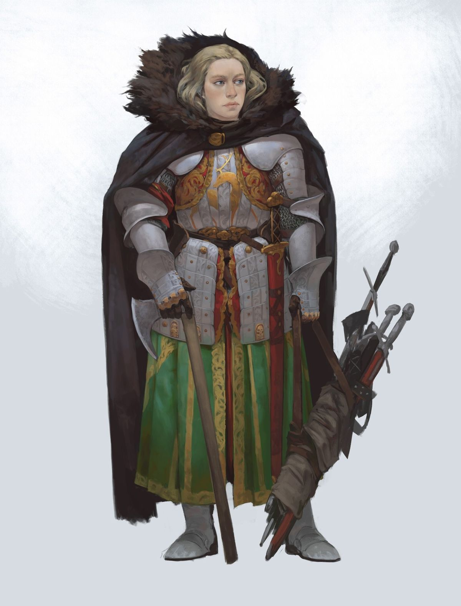

%%  
[[Grachy]]  
[[Halgrach]]  
[[Brothers War]]  
[[Oleksandr IV]]  
[[Levazci]]  
[[Idrov zi Sribo]]  
[[Gethricism]]  
%%  

  
<h4 class="wiki-header">Karelya Modriv of Izhevk</h4>  

  
<strong>Occupation</strong>  
Boyar of Izhevk, Gram of the Hyllpass Region  

  

  
<strong>Culture</strong>  
<a href="Grachy" class="internal-link">Grachi</a> Human  

  

  
<strong>Born</strong>  
801PA, Izhevk  

  

  
<strong>Died</strong>  
868PA, Tuskwatch  

  

  
<strong>Cause of Death</strong>  
Old age, 67 years of age  

  

  

  
<strong>House</strong>  
Modriv  

  

  
<strong>Arms</strong>  
Golden Stag on White  

  

  
<strong>Allegiance</strong>  
<a href="Halgrach" class="internal-link">Rascy zi Halgrach</a>, Republic of <a href="Grachy" class="internal-link">Grachy</a>  

  

  
  

  

Karelya Modriv of Izhevk was a Grachi Boyar and commander of the <a href="Brothers War" class="internal-link">Brothers War</a>, known as the Great Southern War in <a href="Grachy" class="internal-link">Grachy</a>. In the first weeks of the war she took Tuskwatch, the watch-town at the eastern end of the Hyllpass, and she held it for seven years through harsh mountain winters, on scant supply and against every attempt of the Vihri to retake it. Tuskwatch was the only ground that changed hands in the whole war. After the fall of the monarchy she became the first Gram of the Hyllpass Region in the new Republic, and her family has held the title ever since.
  
<h2>Early Life</h2>  

Karelya was born in 801PA at Izhevk, the seat of House Modriv in the Upper Hyll, the high valleys on the Grachi side of the Grachhyll. The Modriv were an old boyar family of no great wealth whose lands lay along the road to the Hyllpass, and they had lived with the trade and the quarrels of the pass for generations. Her father had no sons, and he raised her to ride, hunt and fight as an heir. She became head of the house in her early twenties, when he died, and she was known in the Hyll for her hard temper and her harder discipline before anyone in Halgrach had heard of her.
  
<h2>The Brothers War</h2>  
<h3>The Taking of Tuskwatch</h3>  

When Vihr went to war in 828PA, its armies and fleet were turned against the Iron Claw and the valleys of the Grachhyll, and the Hyllpass was thinly watched. Karelya gathered the levies of the Upper Hyll, crossed the mountains before the Vihri in <a href="Levazci" class="internal-link">Levazci</a> had mustered, and took Tuskwatch almost without a fight. Ras <a href="Oleksandr IV" class="internal-link">Oleksandr IV</a> confirmed her in command of it.
  
<h3>The Siege</h3>  

The Vihri could not leave the far end of their great trade road in Grachi hands, and Tuskwatch was besieged or assaulted in every year of the war. Its garrison was small, and the road behind it was closed by snow for months of every winter, so that supply came over the mountains by mule track when it came at all. Karelya held it regardless. She rationed the town herself, ate what the garrison ate, and hanged two of her own men for stealing from the stores in the first winter. In 830PA Tuskwatch was the base from which Oleksandr struck at the Hyllpass, and the Battle under the Red Cloud, in which Ras <a href="Vormil II" class="internal-link">Vormil II</a> lost his eye, was fought in sight of its walls.
  

Karelya is said to have kept the swords of the Vihri knights who died beneath her walls. She had them gathered after every assault and bound together, and the bundle grew so large over the years of the siege that it took two men to lift. It still hangs in the hall of Tuskwatch.
  
<h3>The Peace</h3>  

When the war ended in 835PA in a white peace, both sides kept what they held, and Karelya still held Tuskwatch. It has been Grachi ever since, and the Hyllpass has been the border between the two realms.
  
<h2>Gram of the Hyllpass</h2>  

Karelya had served Oleksandr loyally, and the end of the monarchy was no cause she would have chosen. But she accepted the Republic, and in 836PA the Ushkyn of the region made her the first Gram of the Hyllpass Region. She governed it for more than thirty years from Tuskwatch. The woman who had held the pass against Vihr spent the rest of her life dealing with Vihr across it, over tolls, patrols and the caravans that the peace had brought back to the road, and the Var of Levazci of House Tryn found her a hard bargainer and a scrupulously honest one. She died at Tuskwatch in 868PA, at sixty-seven.
  
<h2>Legacy</h2>  

The Modriv have been Grams of the Hyllpass Region since Karelya's day, and the present Gram, Sonja Modriv, is her descendant. In Grachy she is remembered alongside Oleksandr IV as one of the heroes of the Great Southern War, and the defence of Tuskwatch is one of the proudest tales of the Republic. Her arms, a golden stag on white, still fly over the town. In Vihr her name is less often spoken.
  
