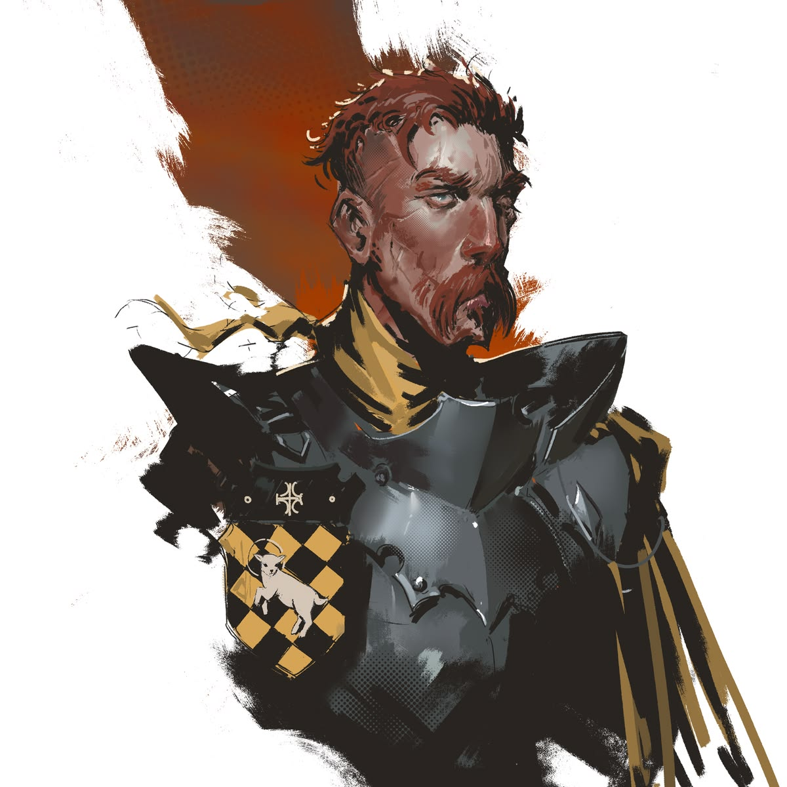

%%  
[[Selbia]]  
[[Selbia Brigade]]  
[[Wars of Elbae Aggression]]  
[[Second War of Elbae Aggression]]  
[[Third War of Elbae Aggression]]  
[[Miskomir IV]]  
[[Idrov zi Sribo]]  
[[Jurahim al-Biad]]  
[[Grevenna]]  
[[Breza]]  
[[Vihr]]  
%%  

  
<h4 class="wiki-header">Rezvyr zi Sribo</h4>  

  
<strong>Occupation</strong>  
Var of <a href="Selbia" class="internal-link">Selbia</a>, Supreme Commander of the 3rd Reani Coalition  

  

  
<strong>Culture</strong>  
<a href="Vihri" class="internal-link">Vihri</a> Human  

  

  
<strong>Born</strong>  
762PA, Ibozka  

  

  
<strong>Died</strong>  
814PA, Danipol  

  

  
<strong>Cause of Death</strong>  
Killed by the invocation of <a href="Jurahim al-Biad" class="internal-link">Jurahim al-Biad</a>, 52 years of age  

  

  

  
<strong>House</strong>  
Sribo  

  

  
<strong>Personal Arms</strong>  
Sheep on Black and Yellow  

  

  
<strong>Issue</strong>  
Bogdan zi Sribo, <a href="Idrov zi Sribo" class="internal-link">Idrov zi Sribo</a>  

  

  
<strong>Allegiance</strong>  
<a href="Vihr" class="internal-link">Rascy zi Vihr</a>, Reani Coalition  

  

  
  

  

Rezvyr zi Sribo was Var of <a href="Selbia" class="internal-link">Selbia</a> from 788 to 814PA and the supreme commander of the Reani Coalition in the <a href="Third War of Elbae Aggression" class="internal-link">Third War of Elbae Aggression</a>. He is counted the finest commander the coalition produced in all three wars. At the Battle of the Crossing he became the first coalition commander to win a victory on Elbae homeland soil, and at the Battle under the Stars he took Danipol back from the Sultanate. He died at Danipol in 814PA, when <a href="Jurahim al-Biad" class="internal-link">Jurahim al-Biad</a> sank the Horad Isthmus into the sea and killed everyone on the field. A student of history and of war, he distrusted magic, faith and allies alike and put his trust in ground, supply and strategy, and he is sometimes credited with turning the warfare of Ilrakhan toward logistics. The military tradition for which Selbia is known is above all his work.
  
<h2>Early Life</h2>  

Rezvyr was born in 762PA at the Pearlywhite Palace in Ibozka, the heir of House Sribo, in the year the First War ended and the year before the <a href="Gethric Pogroms" class="internal-link">Gethric Pogroms</a>. His mother was a daughter of House Badoz, an old noble house of <a href="Breza" class="internal-link">Breza</a> that holds Nailwind Keep on the border with Selbia, and it was from her that he took his red hair and his personal arms, a sheep on black and yellow, the old arms of the Badoz, which he bore in place of the arms of Sribo for the whole of his life. He was raised among the officers of the <a href="Selbia Brigade" class="internal-link">Selbia Brigade</a> as much as at his father's court, and he learned his trade in its Banners rather than at the tourney. He read history as other young lords read romances, and he knew the campaigns of the Unification Wars and of the Auguri generals by heart before he had commanded a single company.
  
<h2>The Second War</h2>  

When Vihr went to war again in 781PA, Rezvyr was nineteen. He served in the <a href="Second War of Elbae Aggression" class="internal-link">Second War</a> under Gri Waskor zi Treblin, the Vihri commander of the coalition, and he was before the walls of Horad when Waskor died there trying to break the Sultanate's fortifications. He regarded Waskor with consideration all his life and acknowledged his courage and his gift for leading men, but he judged him in the end a weak man who had let the dream of glory get the better of him, and he thought his famous hatred of the elves largely comical. He came home from a lost war convinced that the Sultanate had to be fought as an army, with better ground, better supply and a better plan, and not as a host of demons. His father died in 788PA, and he became Var of Selbia at twenty-six.
  
<h2>Var of Selbia</h2>  

In the years of peace between the Second and the Third War, Rezvyr turned the Vadcy into the military power it has been ever since. He drilled the Selbia Brigade harder than it had ever been drilled, mounted most of it, and chose its officers for their skill rather than their blood. He set up depots and stores along the roads of the south and made the supply of an army a matter for its commanders and not for its sutlers. He married in 789PA, and his wife gave him two sons, Bogdan, the heir, and Idrov, who would become the most famous soldier of his generation.
  
<h2>The Third War</h2>  
<h3>Supreme Commander</h3>  

When the third Reani Coalition was formed in 805PA, Ras <a href="Miskomir IV" class="internal-link">Miskomir IV</a> put Rezvyr forward as its commander, passing over lords of higher rank. Grevenna and the other allies accepted him, and his appointment was one of the rare decisions of the coalition that reflected a genuine assessment of ability rather than political convenience. He commanded the central theatre at the Horad Isthmus himself, while Grand Lord Torsal I led the forces of <a href="Grevenna" class="internal-link">Grevenna</a> and the knights of Garmeley and Urbridge held the west in the Vale of Rean.
  
<h3>The Crossing</h3>  

In 806PA Rezvyr mounted a major assault on the Horad Isthmus and broke through at the Battle of the Crossing, one of the largest engagements of all three wars. No coalition commander before him had won a battle on Elbae homeland soil. The Sultanate recovered quickly, and at the Battle of Copper Tower its commanders Meas Arsifan Elbae and Jahrim of Mereskis cut up a Vihri van that had advanced too far, but the Crossing could not be undone, and its weight on both sides was enormous.
  
<h3>The Withdrawal from Danipol</h3>  

After three years of stalemate, the Sultanate tried once more to break the coalition's hold on Danipol. At the Battle of Thunders, while Arsifan pressed the fortress from the south, Ferik Maros al-Corum landed on its eastern cliffs with Magi of Karajal and a golem built by al-Biad himself. Rezvyr withdrew from Danipol rather than risk having his armies trapped inside it. The decision was argued over for the rest of his life and long after it. His defenders held that a coherent army in the field was worth more than a besieged garrison, his critics that he had abandoned the object of the whole war at the moment it was most threatened.
  
<h3>The Battle under the Stars</h3>  

He answered his critics in 812PA. At the Battle under the Stars he launched a night assault that broke the Sultanate's lines before Danipol, while Marfenna of Grevenna led a small force through a tunnel into the fortress and struck from within at the same moment. The timing of the operation, fought in the dark along several lines of approach, was the finest piece of planning of all three wars. Danipol fell into coalition hands once more, and the coalition held it under a long and well supplied siege.
  
<h2>Death at Danipol</h2>  

In 814PA the Sultanate brought its greatest army against Danipol, and the two largest armies of all three wars met there. On the second day of the battle Jurahim al-Biad completed the invocation he had been ordered to abandon. The Horad Isthmus sank into the sea, and everyone on the field died with it, Rezvyr among them, along with Marfenna of Grevenna and Sir Boris of Szulblood. His body was never recovered. His younger son Idrov had been sent away from the army with dispatches a few days before and was the only one of his family near the field to survive. That the war which had made him should end in an act of magic was an irony that his admirers have never failed to point out.
  
<h2>Views on War</h2>  

The wars left Rezvyr with a stern distaste for magic. He had seen what the Magi of Karajal could do on a battlefield, and he would not build a plan on spells, his own side's or the enemy's. He was just as wary of allies, of whom he had seen too many come and go, and of occult and holy orders such as the Kherovan Inquisition, whose help he thought too fickle to be counted on. If anything, he saw a likeness between the arcane scholars and the preachers who condemned them, since both promised victory by powers that no general could command or measure, and he preferred to rely on martial skill and above all on strategy.
  

He was known for saying that "Who wins the day is decided by a simple question, who can bring more men while being first." He valued above everything the taking of the ground on which a battle would be fought and the holding of good positions, and he held that a well supplied soldier was worth two hungry ones. He is sometimes credited with a reform of military strategy as a whole, and with a greater attention to logistics that later historians trace across the wider history of warfare in Ilrakhan.
  
<h2>Considerations on the Elven Wars</h2>  

Rezvyr's memoirs and thoughts were recorded by the bard Sefia Hatko in the "Considerations on the Elven Wars", a series in three parts. Hatko followed his household in the last years of his life and took down what he dictated in the long winters of the siege of Danipol, but left the fortress for Ibozka early in 814PA with the finished pages of the first two parts, and so escaped the fate of the army. The first part is given to the First War and to the older campaigns he had studied, the second to the Second War, in which he had served under Waskor. The third, on his own war, was unfinished when he died. Hatko completed it from his letters and notes and from the accounts of Idrov and the other few who had left Danipol before the sinking, and it breaks off after the Battle under the Stars with a short account of the last days of the siege. Together the three parts set down his judgements on the commanders of both sides and his views on ground, supply and the use of magic in war. They are still read by the officers of the Selbia Brigade and by students of war across Ilrakhan, and much of what is known of the man himself comes from them.

<h2>Legacy</h2>  

Rezvyr is remembered as the best commander of the Wars of Elbae Aggression, and in Vihr as the best general the realm produced in the 9th century. In Selbia he is the founder of the house's military tradition, and an empty tomb in the chapel of the Pearlywhite Palace bears his name and his sheep on black and yellow. The Brigade still drills by the methods he set down. His son <a href="Idrov zi Sribo" class="internal-link">Idrov</a> became the hero of the Brothers War, and his grandson Feliks won the 2nd Battle of Tears with the Brigade, so that three generations of House Sribo gave Vihr its finest soldiers of the age.
  

His reputation in Vihr has always been a cool one compared to the zealous Waskor zi Treblin. He never preached against the elves and was suspected by some at court of respecting the commanders of the Sultanate more than the bishops of his own side, and it is said that Meas Arsifan, his great opponent, mourned him when he heard of his death.
  
