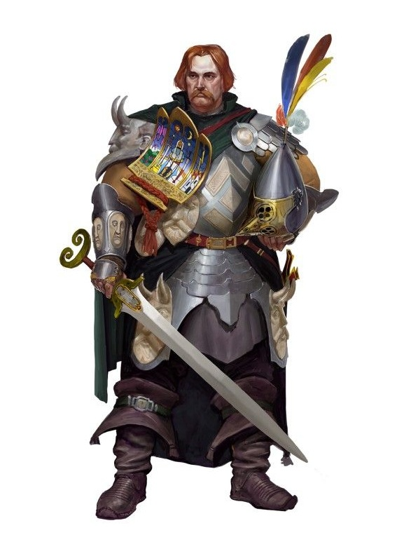

%%  
[[Rovgi]]  
[[Black Tanya]]  
[[Iron Hole]]  
[[Thiar]]  
[[Signa Nylldottr]]  
[[Jallbreg]]  
%%  

  
 <h4 class="wiki-header">Espir</h4>  
 
  
 <strong>Title</strong>  
 Sir, of the Oathhills  
 
  
 
  
 <strong>Occupation</strong>  
 Knight  
 
  
 
  
 <strong>Culture</strong>  
 <a href="Vihri" class="internal-link">High Vihri</a> Human  
 
  

        <strong>Born</strong>
        375PA , Oathhills 
	    

    

        <strong>Died</strong>
        451PA, Jallbreg
    

 
  
 
  
 <strong>Allegiance</strong>  
 <a href="Vihr" class="internal-link">Rascy zi Vihr</a>, the Heroes of Sydrow  
 
  
 
  
 <strong>Faith</strong>  
 <a href="Gethricism" class="internal-link">Gethricism</a>  
 
  
 
  
   

  

Sir Espir of the Oathhills was a Vihri knight of the late 4th and early 5th century PA, a Knight of Grand Renown and one of the three Heroes of Sydrow who killed the witch <a href="Black Tanya" class="internal-link">Black Tanya</a> around 400PA. He declined the rule of Sydrow that was offered to him afterwards, and instead became one of the Vihri merchants, adventurers and travellers who founded <a href="Jallbreg" class="internal-link">Jallbreg</a> in 411PA, where the Great Gate of the city is still known as Espir's Gate.
  

Espir came from the Oathhills of <a href="Rovgi" class="internal-link">Rovgi</a>, the old frontier with Wermia, where the settlements were built for defence and the warriors were famous for their stubbornness and their loyalty. He grew up in the generation after the lords of the Vadcy marched on Zavlech in 377PA, and he won his name as a knight in the wars of the western marches against the ogres of the Ruby Valley and the horrors of the hills.
  
<h2>The Heroes of Sydrow</h2>  

Around 400PA, in the reign of Ras Boris I "the Pious", Espir went to Sydrow Isle in the Torn Sea, where Black Tanya had ruled as Gri for almost forty years and taken sailors, travellers and islanders for her blood rituals. There he joined the elf <a href="Thiar" class="internal-link">Thiar</a> and the Jueli warrior <a href="Signa Nylldottr" class="internal-link">Signa Nylldottr</a>, and the three of them broke into Syd Keep and killed the witch. After her death the rule of Sydrow was offered to Espir, but he declined it, and the knights of the Ras took the island for the Crown instead.
  
<h2>Jallbreg</h2>  

Espir did not return to the Oathhills. He joined a company of Vihri merchants, adventurers and travellers who sailed west along the coast of the Torn Sea, and in 411PA they founded a free trading settlement on the Hagshorn Peninsula, which grew into the city of Jallbreg. The Great Gate of Jallbreg is still known as Espir's Gate, and the city remembers him as one of its founders, though it passed into the <a href="Baeling Empire" class="internal-link">Baeling Empire</a> within half a century.
  

Espir is a hero of tales in Rovgi and Trazlova and a founder in Jallbreg. In the Oathhills he is the model of the knight who serves and does not rule, and his refusal of Sydrow is told there as the best of his deeds.
  
