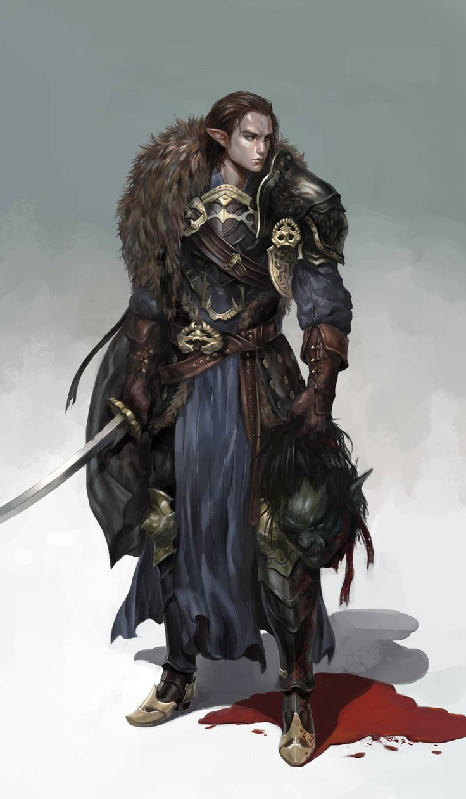

%%  
[[Berengar]]  
[[Elf]]  
[[Black Tanya]]  
[[Iron Hole]]  
[[Espir]]  
[[Signa Nylldottr]]  
[[Nostroya]]  
%%  

  
 <h4 class="wiki-header">Thiar</h4>  
 
  
 <strong>Epithet</strong>  
 the Elf  
 
  
 
  
 <strong>Occupation</strong>  
 Adventurer, Swordsman  
 
  
 
  
 <strong>Culture</strong>  
 <a href="Elf" class="internal-link">Elf</a>  
 
  
 
  
 <strong>Born</strong>  
 4th century PA  
 
  
  
  
 <strong>Died</strong>  
 unknown  
 
  
 
  
 
  
 <strong>Allegiance</strong>  
 the Silverhearts, the Heroes of Sydrow  
 
  
 
  
 <strong>Faith</strong>  
 <a href="Gethricism" class="internal-link">Gethricism</a> (convert)  
 
  
 
  
   

  

Thiar, often called Thiar the Elf, was a legendary swordsman of the 4th century PA and a companion of Saint <a href="Berengar" class="internal-link">Berengar Starknife</a> among the Silverhearts. He is remembered as Berengar's closest friend and the only one of his companions who could equal him with a blade. Long after the deeds of the Silverhearts, he was one of the three Heroes of Sydrow who killed the witch <a href="Black Tanya" class="internal-link">Black Tanya</a> around 400PA.
  
<h2>With the Silverhearts</h2>  

Thiar is best known from the tales of the Silverhearts, the band of heroes who followed Berengar through Ur, Rean and Cevolia. In most of them he is an elf who converted to the Gethric faith, Berengar's best friend and his equal with the sword, and in some he shares with the Saint the love of Masova. Like everything told of the Silverhearts, the stories of Thiar have changed from region to region, and in the folk tales of Vihr and Grachy he is not an elf at all but a roguish human who changes faces to solve problems.
  
<h2>The Heroes of Sydrow</h2>  

Berengar died before 400PA, but Thiar, an elf, outlived him by many years. Around 400PA he came to Sydrow Isle in the Torn Sea together with the Vihri knight <a href="Espir" class="internal-link">Sir Espir of the Oathhills</a> and the Jueli warrior <a href="Signa Nylldottr" class="internal-link">Signa Nylldottr</a>, and the three of them broke into Syd Keep, where Black Tanya had ruled the island as its Gri and terrorised it with blood magic for almost forty years. Of the three, it is Thiar who is said to have struck the blow that killed her. The Vihri tellings of the tale say that Thiar entered the keep in the face of one of Tanya's servants, and it may be from Sydrow that the Vihri picture of a face-changing Thiar first came.

<h2>Legacy</h2>    

After Sydrow Thiar largely vanishes from the tales. He is rumoured to have left for <a href="Nostroya" class="internal-link">Nostroya</a> in search of further adventure, and since elves may live for two and a half centuries, tales from the eastern coast claim to have seen him long after his companions were dead, but none of them can be trusted.
  

Thiar is a hero of children's tales in Ur, <a href="Trykkerog" class="internal-link">Trykkerog</a> and Vihr, where he is usually told alongside Berengar. In northern Vihr he is remembered above all as one of the Heroes of Sydrow. He is one of the few elves of whom the Gethric tradition speaks with affection, and in Vihr, where elvenkind was outlawed in 763PA, the tellers who make him a human have long found it easier to tell his story.
  
