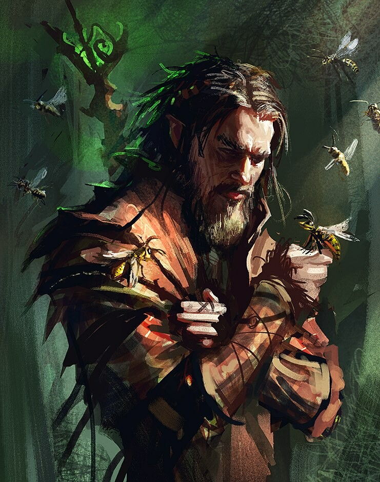

%%
[[Otso]]
[[Leonyd Krunliv]]
[[Aeldcult]]
[[Pehki]]
%%

    <h4 class="wiki-header">Havu</h4>
    

        <strong>Occupation</strong>
        Druid
    

    

        <strong>Culture</strong>
        <a href="Pehki" class="internal-link">Pehki</a> <a href="Human" class="internal-link">Human</a>
    

    

        <strong>Born</strong>
        867PA, <a href="Nostroya" class="internal-link">Nostroya</a>
	    

    

        <strong>Died</strong>
        927PA, Lenkov Estate
    

    

        <strong>Cause of Death</strong>
        Crushed by a druidic Monstrosity, aged 60
    

    

    

        <strong>Allegiance</strong>
        <a href="Aeldcult" class="internal-link">Druids of Nostroya</a> <a href="Otso" class="internal-link">Otso, King of Bear & Giant</a>
    

    

	 

