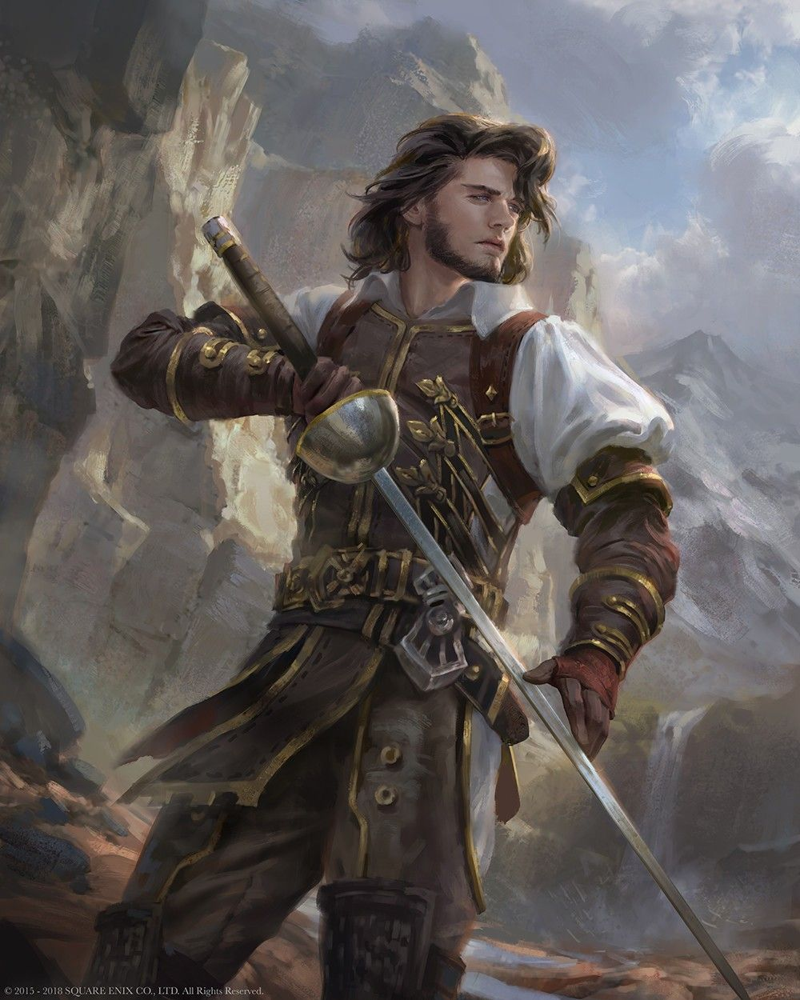

%%
[[Urien]]
[[Garmish Succession Crisis]]
[[Jakub Ralpia]]
[[Rodomyr]]
[[Ormir Pizak]]
%%

    <h4 class="wiki-header">Jan of Kolglade</h4>
    

        <strong>Occupation</strong>
        Partisan
    

    

        <strong>Culture</strong>
        <a href="Urien" class="internal-link">Garmish</a> <a href="Human" class="internal-link">Human</a>
    

    

        <strong>Born</strong>
        906PA, Kolglade
	    

    

        <strong>Died</strong>
        alive
    

    

        <strong>Age</strong>
        21
    

    

    

        <strong>Allegiance</strong>
        <a href="Garmeley" class="internal-link">Garmeley</a> (formerly), Garmish Resistance (formerly)
    

    

	 

