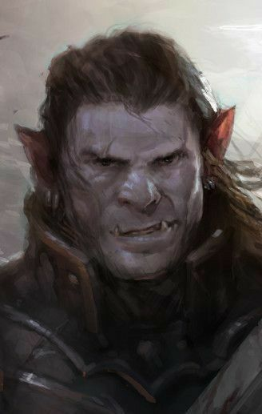

%%
[[Kherovan Inquisition]]
[[Mossbrook Affair]]
[[Niedrest Incident]]
[[Kheri]]
[[Kulum]]
[[Orc]]
%%
<small><i>this article was written by, and concerns a Player Character played by Olle during Campaign 1</i></small>

    <h4 class="wiki-header">Zurán Barbeshvili</h4>
    

        <strong>Epiteth</strong>
        The Hound of Kulum
    

    

        <strong>Culture</strong>
        <a href="Kheri" class="internal-link">Kulumite</a> Half <a href="Orc" class="internal-link">Orc</a>
    

    

        <strong>Born</strong>
        888PA, New Kulum
	    

    

        <strong>Died</strong>
        923PA, Niedrest
    

    

        <strong>Cause of Death</strong>
        unknown,  last seen in Niedrest, 35 years of Age
    

    

    

        <strong>Allegiance</strong>
        <a href="Kherovan Inquisition" class="internal-link">Kherovan Inquisition</a>
    

    

        <strong>Issue</strong>
        unknown
    

    

	 

Zurán Barbeshivili, also known under the epithet of “The Hound of Kulum”, was an Inquisitor for the <a href="Kherovan Inquisition" class="internal-link">Kherovan Inquisition</a>, specifically the newly founded Tribunal of The Onyx Cult. After his rebellious upbringing in New Kulum, Zurán had the honour of being tutored under the highly regarded High Inquisitor Khatia Gvazava and became a promising acolyte and quickly adapted to the Tribunal's needs. His parents, of half-orcish descent, had fled <a href="Kulum" class="internal-link">Old Kulum</a> for a new life, but they did not make it out before some of the <a href="Ahrmiz Saceren" class="internal-link">Conjurer's</a> magic had taken hold of them. Zurán, due to the nature of his birth, was someone known locally as “A Child of Kulum”. These individuals were named so due to birth defects, both physical and mental, that were common amongst them. These defects could vary greatly, but in a lot of cases these so-called “Children” had qualities often seen as beneficial to the Inquisition if the corruption could be uprooted. No one really knows exactly why this was such a common phenomenon. Still, there are speculations within the more radical branches of the Inquisition that Ahrmiz was intentionally building a foundation for some sort of magically enhanced population.

The majority of Zuráns career was occupied by what would eventually accumulate to what is now known as the <a href="Niedrest Incident" class="internal-link">Niedrest Incident</a>. He was reportedly sent out and followed evidence that pointed towards the fact that the Cult Of Ahrimz was still existing outside the borders of Kherova Proper. After over a decade of work and dead ends, Zurán had found evidence of an object bearing similarities to previous Profane Artefacts with ties to the organisation. Infiltrating a group of now infamous adventurers, The Chestbearers. They transported a Cold Iron Steel Chest under the orders of a certain Viximir, an alleged member of the Cult.

During this escort, this group of adventurers, according to verbal and written records collected later on by independent Acolytes and Inquisitors, had ties to criminal organisations, branches of the Gethric church considered by many to be known as Zealots, greedy lawless mercenaries, dwarven war criminals and even alleged otherworldly powers in the form of illegal protean practice. When speaking with surviving witnesses, which are few and far between, it is speculated this group of adventurers laid waste to the small fishing village of <a href="Mossbrook Affair" class="internal-link">Mossbrook</a> in The Deathcap Mire in some sort of magical experiment in an alleged conjecture with the Notorious <a href="Pavo of Alban" class="internal-link">Pavo of Alban</a>.
