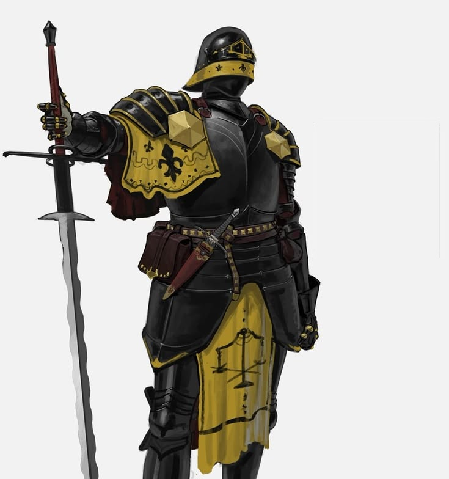

%%  
[[Selbia]]  
[[Candle Oath]]  
[[Flickersworn]]  
[[Carguez di Mindano]]  
[[Opuzna]]  
[[Honoured Assembly]]  
[[Vihr]]  
%%  

  
<h4 class="wiki-header">Paul Beladoz zi Sribo</h4>  

  
<strong>Epithet</strong>  
the Black  

  

  
<strong>Occupation</strong>  
Noble of <a href="Selbia" class="internal-link">Selbia</a>  

  

  
<strong>Culture</strong>  
<a href="Vihri" class="internal-link">Vihri</a> Human  

  

  
<strong>Born</strong>  
899PA, Ibozka  

  

  
<strong>Died</strong>  
922PA, Zavlech  

  

  
<strong>Cause of Death</strong>  
Killed in a <a href="Candle Oath" class="internal-link">Candle Oath</a>, 23 years of age  

  

  

  
<strong>House</strong>  
Sribo  

  

  
<strong>Siblings</strong>  
Provim, Var of Selbia, Yeliza zi Sribo  

  

  
  

  

Paul Beladoz zi Sribo, known as Beladoz the Black, was a noble of House Sribo of <a href="Selbia" class="internal-link">Selbia</a>, the younger brother of Var Provim and of Yeliza zi Sribo. In 922PA he stood as his sister's champion in the <a href="Candle Oath" class="internal-link">Candle Oath</a> against Var Ilia of <a href="Opuzna" class="internal-link">Opuzna</a>, whom she accused of rape, and he was killed by <a href="Carguez di Mindano" class="internal-link">Carguez di Mindano</a>, the champion of Opuzna, at the age of twenty-three. His death began the feud between Selbia and Opuzna that divides the south of the realm today.
  
<h2>Early Life</h2>  

Beladoz was born in 899PA at the Pearlywhite Palace in Ibozka, the youngest child of House Sribo. He grew up in the military tradition of his house and was taller and stronger than any of his brothers in arms by his sixteenth year. He took his byname from the black armour he wore from the day he was knighted, and he was known at the tournaments of the south as a fair and fearless knight who was better at the lance than at the sword.
  
<h2>The Oath of 922</h2>  

In 922PA his sister Yeliza, a maiden of honour whose good name nobody had ever questioned, accused Var Ilia of Opuzna of having raped her at the Poets Fest of Tienov earlier in the year. As the quarrel lay between two Var, it came before the <a href="Honoured Assembly" class="internal-link">Honoured Assembly</a>, and the Assembly granted the Candle Oath. Selbia stood as the accuser. Ilia named Carguez di Mindano, and Beladoz would not let a hired sword fight for his sister. He took the candle himself, and he fought in his black armour under a yellow surcoat on which he had the scales of justice sewn for the day.
  

Everyone knew that House Sribo was in the right, and Beladoz was taller, stronger and of greater blood than his opponent, though younger. He was utterly outclassed. Carguez cut him up piece by piece, and Beladoz bled to death on holy ground before the candle had burned half its span. By the law of the oath Ilia was cleared and the accusation was held false.
  
<h2>Legacy</h2>  

Beladoz was buried at Ibozka, and House Sribo has not forgiven Opuzna or the court that granted the oath. Yeliza withdrew from the court after the verdict and has not appeared at it since. In Selbia Beladoz is mourned as a martyr of the oath, and in the rest of the realm his death is the oath that the reformers point to when they say that the Candle Oath judges the purse and not the cause.
  
