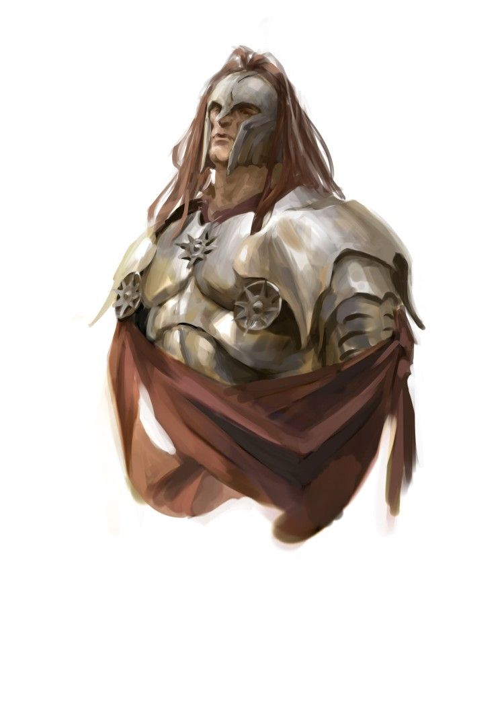

%%  
[[Waśko Ralpia]]  
[[Flickersworn]]  
[[Candle Oath]]  
[[Zavlech]]  
[[Vihr]]  
%%  

  
<h4 class="wiki-header">Boleslaw the Bull</h4>  

  
<strong>Occupation</strong>  
Sworn sword and <a href="Flickersworn" class="internal-link">Flickersworn</a> of the Kisras  

  

  
<strong>Culture</strong>  
<a href="Vihri" class="internal-link">Low Vihri</a> Human  

  

  
<strong>Born</strong>  
ca. 889PA, Lovno  

  

  
<strong>Age</strong>  
38  

  

  

  
<strong>Known for</strong>  
Undefeated in more than twenty <a href="Candle Oath" class="internal-link">Candle Oaths</a>  

  

  
<strong>Allegiance</strong>  
Kisras <a href="Waśko Ralpia" class="internal-link">Waśko zi Ralpia</a>  

  

  
  

  

Boleslaw, called the Bull, is the sworn sword of the Kisras <a href="Waśko Ralpia" class="internal-link">Waśko zi Ralpia</a>, the heir to the throne of <a href="Vihr" class="internal-link">Vihr</a>, and likely the most famous <a href="Flickersworn" class="internal-link">Flickersworn</a> in the realm. He has fought more than twenty <a href="Candle Oath" class="internal-link">Candle Oaths</a> and has never lost one, and he is as well known in the taverns of Zavlech as the Kisras he serves.
  
<h2>Early Life</h2>  

Boleslaw was born about 889PA at Lovno, the castle north of <a href="Zavlech" class="internal-link">Zavlech</a> that belongs to the heir of the crown, the son of a smith in the castle's service. He was a head taller than any boy of his age and broader than most men, and he earned his byname before he was grown, when he is said to have thrown a bullock that had broken loose in the castle yard. He served as a man-at-arms in the garrison of Lovno and won his first fame in the melees of the Zavlech tournaments.
  
<h2>In the Service of the Kisras</h2>  

When Waśko took Lovno as heir, he took Boleslaw into his own service, first as a guard and soon as his sworn sword. The Kisras is no soldier, and the tournaments have never been his place, and Boleslaw has fought for him wherever a sword was wanted. He has stood for Waśko and for those under his protection in more than twenty Candle Oaths, from quarrels over land and debts in the domain of Lovno to cases that touched the governance of Zavlech itself, and he has won them all. Several more were settled before any candle was lit, when the other party learned who would take it.
  

Boleslaw fights in plain bright plate with a red sash, and he wears the stubs of his oath candles in a row at his belt. He is loud, generous and well loved by the common folk of the capital, who find in him the warrior that the Kisras is not.
  
<h2>Reputation</h2>  

The enemies of the Kisras do not miss the irony that the prince who would take the clergy out of the royal courts keeps the most famous champion of the Church's own rite of judgement. Waśko's friends answer that he did not make the Candle Oath and will not lose by it while it stands. Boleslaw himself has never spoken on the question, and it is  said only that the bull fights for the Kisras and not for church or candle.
  
