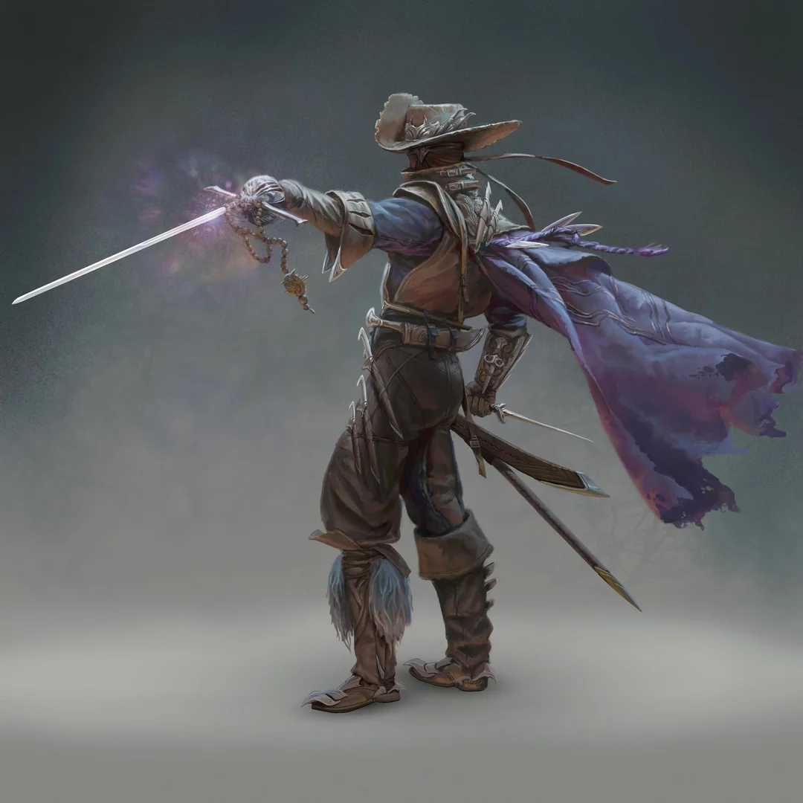

%%  
[[Mindano]]  
[[Flickersworn]]  
[[Candle Oath]]  
[[Opuzna]]  
[[Selbia]]  
[[Beladoz the Black]]  
[[Vihr]]  
%%  

  
<h4 class="wiki-header">Carguez di Mindano</h4>  

  
<strong>Occupation</strong>  
<a href="Flickersworn" class="internal-link">Flickersworn</a> of the Var of <a href="Opuzna" class="internal-link">Opuzna</a>  

  

  
<strong>Born</strong>  
ca. 890PA, <a href="Mindano" class="internal-link">Mindano</a>  

  

  
<strong>Age</strong>  
37  

  

  

  
<strong>Known for</strong>  
The <a href="Candle Oath" class="internal-link">Candle Oath</a> of 922PA  

  

  
<strong>Arms</strong>  
A violet blade imbued with magic  

  

  
<strong>Allegiance</strong>  
House Terjan of <a href="Opuzna" class="internal-link">Opuzna</a>  

  

  
  

  

Carguez di Mindano is a fencer and duellist from <a href="Mindano" class="internal-link">Mindano</a> and the <a href="Flickersworn" class="internal-link">Flickersworn</a> of Var Ilia of <a href="Opuzna" class="internal-link">Opuzna</a>. He fights with a violet blade imbued with magic, and he has a reputation for cruelty that no other champion of the realm can match. He is best known, and most hated, for the <a href="Candle Oath" class="internal-link">Candle Oath</a> of 922PA, in which he killed <a href="Beladoz the Black" class="internal-link">Beladoz the Black</a> of Selbia and cleared his lord of the charge of rape.
  
<h2>Early Life</h2>  

Carguez was born in Mindano about 890PA and learned the sword in its fencing schools, where the duel is an art and a business. He made his name in the duels of the southern cities, where he is said to have killed more men in affairs of honour before his twentieth year than most soldiers kill in a war, and he came north to Vihr in the 910s, where the great houses pay more for a champion than any city of the south pays for a fencing master. House Terjan took him into its service a few years later.
  
<h2>The Violet Blade</h2>  

Carguez fights with a long, thin blade that glows violet when it is drawn and throws off sparks of the same colour when it strikes. Where it came from he has never said. In Vihr, where the people of the hills distrust anything enchanted and the Church looks hard at the arcane, a champion with an enchanted blade is a scandal in himself, but no court has yet refused him the candle for it. He carries a string of prayer beads wound about his sword hand, and he fights masked under a broad plumed hat.
  
<h2>The Oath of 922</h2>  

In 922PA House Sribo of <a href="Selbia" class="internal-link">Selbia</a> brought a Candle Oath against Var Ilia of Opuzna, whom Yeliza zi Sribo, the sister of Var Provim, accused of having raped her at the Poets Fest of Tienov earlier that year. Her younger brother Beladoz took the candle for her, and Carguez took it for Ilia. Beladoz was taller, stronger and of greater blood, and he was utterly outclassed. Carguez cut him again and again, and bled the young noble to death on holy ground before the candle had burned half its span. By the law of the oath Ilia was cleared. Hardly anyone in Vihr believes that he was innocent, and the oath has left a feud between the two houses that has not cooled since.
  
<h2>Reputation</h2>  

Carguez is feared more than any champion in the realm, and he is hated in Selbia above all. The Sribo have sworn that he will not die in his bed, and he is said to keep his door barred and his food tasted. To the reformers at court he is the proof that justice in Vihr goes to whoever can afford the better sword. To the Var of Opuzna he is worth every coin he costs.
  
