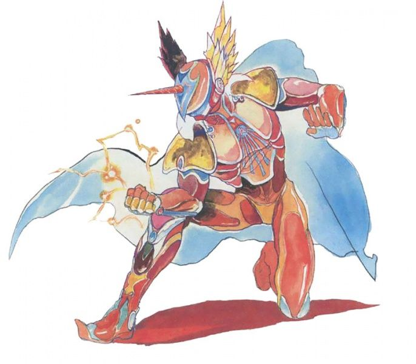

%%  
[[Wermia]]  
[[Candle Oath]]  
[[Flickersworn]]  
[[Uhl]]  
[[Rovgi]]  
%%  

  
<h4 class="wiki-header">Dazhek Winghelm</h4>  

  
<strong>Occupation</strong>  
Knight, champion of the Candle Oath  

  

  
<strong>Culture</strong>  
<a href="Wermia" class="internal-link">Wermian</a> Human  

  

  
<strong>Born</strong>  
ca. 420PA, Wermia  

  

  
<strong>Died</strong>  
ca. 489PA, Wermia  

  

  

  
<strong>Known for</strong>  
More than thirty <a href="Candle Oath" class="internal-link">Candle Oaths</a> won, the two duels with Vinitia of Gardhill  

  

  
<strong>Arms</strong>  
His fists, and armour of pure mithril  

  

  
<strong>Allegiance</strong>  
<a href="Wermia" class="internal-link">Wermia</a>  

  

  
  

  

Dazhek Winghelm was a <a href="Wermia" class="internal-link">Wermian</a> knight of the 5th century and the most famous champion of the <a href="Candle Oath" class="internal-link">Candle Oath</a> in the old tales. He is said to have won more than thirty oaths, and he fought them not with sword or lance but with his fists, in a suit of armour made of pure mithril. He is remembered above all for his two duels with Vinitia of Gardhill, and his fame made the hiring of a famous champion a matter of prestige among the lords on both sides of the Oathhills, long before the <a href="Flickersworn" class="internal-link">Flickersworn</a> had their name.
  
<h2>Life</h2>  

Dazhek was born about 420PA in Wermia, in the country west of the Oathhills, and was knighted young. Little is told of his family or of his early years, and the tales begin with his first oath, which he is said to have won with his bare hands after his sword broke on his opponent's shield. From then on he fought with his fists alone. His armour of pure mithril, a gift said to have come from a Wermian lord whose cause he had saved, turned the blades of his opponents, and the helm with the crest of wings that gave him his name made him known to every crowd that gathered at an oath.
  

Over the following decades he fought for Wermian lords and for whoever else would pay his price, Vihri Gri of the hills among them, though the people of the Oathhills had little love for anything that came from the Wermian side. The chroniclers credit him with more than thirty oaths won and none lost, and the number grew with every telling.
  
<h2>Vinitia of Gardhill</h2>  

His most famous opponent was Vinitia of Gardhill, a champion of great renown in her own right. In their first oath Dazhek beat her until she yielded, and by the custom of the oath a champion who has yielded may not take the candle against the same opponent again. Vinitia would not accept it. Against all custom she challenged Dazhek directly, and he accepted, and she lost once more. She begged him for death at his hands, and he denied it to her. Vinitia wandered into the moors east of <a href="Uhl" class="internal-link">Uhl</a> in her shame and was never seen again, and the moors are said to be haunted by her to this day.
  
<h2>Legacy</h2>  

Dazhek is said to have died an old man in Wermia, about 489PA, undefeated. His duels with Vinitia are told across Wermia and the Oathhills, and the tale of the second duel is told both as a lesson in mercy and as a lesson in cruelty, for some hold that to deny the beaten champion her death was the harder blow. The mithril armour is said to have passed to his heirs and to have been lost in the centuries since, and Flickersworn of the hills still swear by his name before an oath.
  
