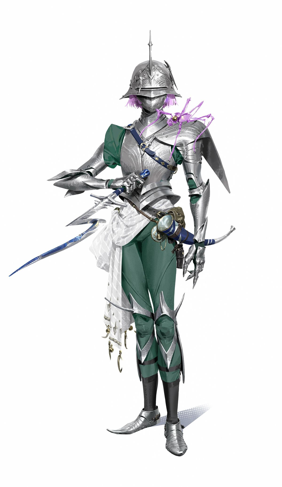

%%  
[[Grevenna]]  
[[Hannah of Krav]]  
[[Rovgi]]  
[[Flickersworn]]  
[[Candle Oath]]  
[[Vihr]]  
%%  

  
<h4 class="wiki-header">Intonina Duson</h4>  

  
<strong>Occupation</strong>  
<a href="Flickersworn" class="internal-link">Flickersworn</a> of the Var of <a href="Rovgi" class="internal-link">Rovgi</a>  

  

  
<strong>Culture</strong>  
Pilvian Human  

  

  
<strong>Born</strong>  
ca. 893PA, <a href="Grevenna" class="internal-link">Grevenna</a>  

  

  
<strong>Age</strong>  
34  

  

  

  
<strong>Allegiance</strong>  
Var Zeslav zi Wogrov of <a href="Rovgi" class="internal-link">Rovgi</a>  

  

  
  

  

Intonina Duson is a Pilvian duellist from <a href="Grevenna" class="internal-link">Grevenna</a> and the <a href="Flickersworn" class="internal-link">Flickersworn</a> of Var Zeslav zi Wogrov of <a href="Rovgi" class="internal-link">Rovgi</a>, whom she has served for the last decade. She is one of the best-known champions of the <a href="Candle Oath" class="internal-link">Candle Oath</a> in Vihr, and one of the few foreigners whom the stubborn people of the Oathhills have come to accept as their own.
  
<h2>Early Life</h2>  

Intonina was born about 893PA in Grevenna, whose duellists have been sought by the great houses of Vihr for centuries for their reputation as skilled combatants. She was trained in the school of Krav, the Grevenni tradition of the sword that looks back to <a href="Hannah of Krav" class="internal-link">Hannah of Krav</a>, the Thawblade, the most celebrated duellist Grevenna has produced, and she fought her first duels in the cities of Grevenna before she went north, as many of her countrymen do, to sell her sword where it would fetch the highest price.
  
<h2>In Rovgi</h2>  

Zeslav zi Wogrov took her into his service about 917PA. A Pilvian woman in the service of the Var of the Oathhills was a scandal at first among a people who distrust anything that comes from beyond their hills, but she won the hill folk over in her first oaths, and Rovgi now counts her as its own. As the Var of Rovgi is the uncle of the Kisras and sits in the Honoured Assembly as the family of the heirs, her sword is never far from the politics of the court.
  

She fights in bright plate over green and wears a white sash hung with small charms, and a small creature of violet crystal rides on her shoulder, which she has never explained, and which the people of Rovgi, who trust no sorcery, have decided not to ask about.
  
