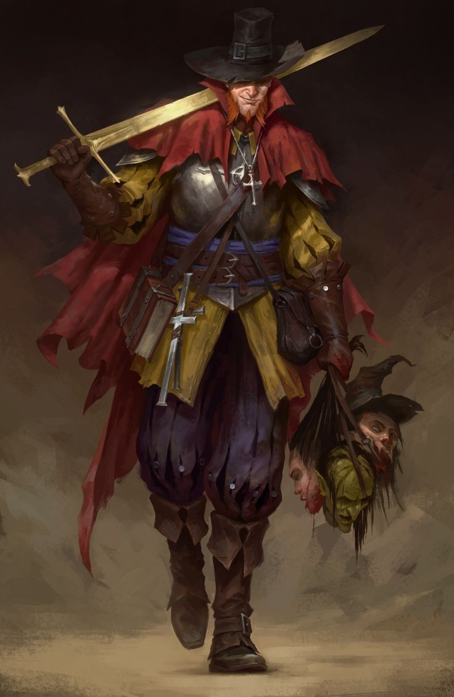

%%
[[Vihri]]
[[Rodomyr]]
[[Ormir Pizak]]
%%

    <h4 class="wiki-header">Odric Pizak</h4>
    

        <strong>Occupation</strong>
        Swordsmaster & Enforcer
    

    

        <strong>Culture</strong>
        <a href="Vihri" class="internal-link">Grachi</a> <a href="Human" class="internal-link">Human</a>
    

    

        <strong>Born</strong>
        901PA, near Soludha
	    

    

        <strong>Died</strong>
        827PA, Lenkov Estate
    

    

        <strong>Cause of Death</strong>
        atomized, aged 26
    

    

    

        <strong>Allegiance</strong>
        Boyar Ulyanov, <a href="Rodomyr" class="internal-link">Grigory Rodomyr</a> 
    

    

	 

Odric Pizak was a grachi Swordsman and men at arms who, alongside his brother <a href="Ormir Pizak" class="internal-link">Ormir Pizak</a>, led a band of hardened and cutthroat  mercenaries in northern Grachy. For the past year the brothers were hired on by <a href="Rodomyr" class="internal-link">Grigory Rodomyr</a> in the name of the Ulyanov family of Soludha and eventually moved alongside their main operation further east to the Lenkov Estate.

In service to the desires of the Ulyanovs and their Priest, Father <a href="Leonyd Krunliv" class="internal-link">Leonyd Krunliv</a>, Odric led his band to aquire the mystical wood of the druid groves, known as the Aeldtrees, and a druid of the land as well. They had heard rumours about a family with child but found no druid when they arrived at the grove, only a child amongst the strange trees. Taking the life of this young girl and then bringing back the tree would eventually lead to her father, the Druid Havu, to begin his quest for vengeance and at long last bring justice and ruin to the Houses of Lenkov and Ulyanov.

Odric was atomized by the magical feedback of the ritual conducted by Krunliv when they went ahead with their plans to forge a ring granting immortality without the proper formulae to stabilize their <a href="Graccum" class="internal-link">Wealdstone</a>, never learning that his brother Ormir had died just a day ago to the same people that now came to bring him down as well.
