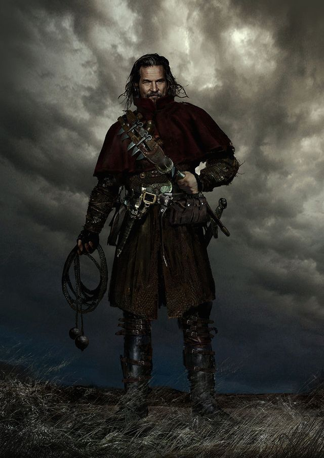

%%  
[[Kherovan Inquisition]]  
[[Kheri]]  
[[Kethricism]]  
[[Vihr]]  
[[Breza]]  
[[Andre]]  
[[Valeri Temzin]]  
%%  

  
 <h4 class="wiki-header">Teron Maz</h4>  
 
  
 <strong>Epithet</strong>  
 Iron Maz  
 
  
 
  
 <strong>Faith</strong>  
 <a href="Kethricism" class="internal-link">Kethricism</a>  
 
  
 
  
 <strong>Occupation</strong>  
 High Inquisitor of the Marble Script  
 
  
 
  
 <strong>Culture</strong>  
 <a href="Kheri" class="internal-link">Ankheri</a> <a href="Human" class="internal-link">Human</a>  
 
  
 
  
 <strong>Born</strong>  
 815PA, Kairos  
 
  
 
  
 <strong>Died</strong>  
 877PA, Kairos  
 
  
 
  
 <strong>Cause of Death</strong>  
 Killed in the Kairos Incident, 62 years of age  
 
  
 
  
 
  
 <strong>Allegiance</strong>  
 <a href="Kherovan Inquisition" class="internal-link">Kherovan Inquisition</a>  
 
  
 

	 

  

Teron Maz, known as Iron Maz, was an Ankheri Inquisitor of the <a href="Kherovan Inquisition" class="internal-link">Kherovan Inquisition</a> and the High Inquisitor of the Tribunal of the Marble Script in the middle of the 9th century. He is remembered above all for his part in the Grain Rising of 854 in <a href="Vihr" class="internal-link">Vihr</a>, where he burned dozens of Sarloni villages and had the healer Urilla burned as a witch at Atej. He was killed in the Kairos Incident of 877PA.
  
<h2>Early Life and Rise</h2>  

Teron Maz was born in 815PA at Kairos, the ancient city of the Ankheri on the shore of Lake Kher. He entered the Inquisition young and first gained notoriety as the acolyte of the High Inquisitor Lazia Zimvili, who was instrumental in the empowerment of the Keepers of the Pale Truth and in the crackdowns on corruption within the Kherovan and Azuvken clergy and within the Inquisition itself. Under her he learned to hold no office and no robe above suspicion. The mountain villages south of the lake, where his own people still kept forms of spirit worship that the Inquisition sought to eradicate, were among the first places where he hunted heathens. By the early 850s he had risen to High Inquisitor of the Tribunal of the Marble Script, which is charged with the persecution of heretics and heathens within <a href="Kherova" class="internal-link">Kherova</a>.
  
<h2>The Grain Rising</h2>  

In 855PA, at about forty years of age and at the height of his influence and power, Maz led the Inquisition into Vihr at the invitation of Ras Jerziv I. The Sarloni of <a href="Breza" class="internal-link">Breza</a> had risen against the requisition of their harvest for the War of Horn and Fang in the Grain Rising of 854, and sorcery seemed to lie behind some of the more militant operations of the rebels, the Grainers. Maz burned dozens of small villages and conducted brutal and bloody campaigns against the local Sarloni to flush out not only partisans and rebels but also the supposed "occult elements elemental to this disturbance". He worked alongside the royal judge whom Jerziv had sent into the Expanse, the agents of the <a href="Vaergriff" class="internal-link">Vaergriff</a> and the Gri of Trydlew, <a href="Andre" class="internal-link">Andre of Trydlew</a>.
  

At the Judgements of Atej that ended the rising, his Inquisitors presented a peasant girl and healer, Urilla, as the Witch behind it, and after a public judgement she was burned alive at Atej. It was never proven that she possessed an ounce of magical power. Among the Inquisitors who followed Maz into Vihr was the young dwarf <a href="Valeri Temzin" class="internal-link">Valeri Temzin</a>, later the Inquisition's ambassador to southern Urland.
  
<h2>Death</h2>  

Maz died in 877PA in the Kairos Incident, when a group of artifacts of immense power was stolen from the vaults of the Inquisition at Kairos and turned against it by a band of criminals and self-styled freedom fighters of Kurini heritage known as the Fist of Kurin. He was sixty-two years old.
  
<h2>Legacy</h2>  

Among the Sarloni of Vihr the name of Iron Maz is still spoken with hatred, and Urilla is mourned as his innocent victim. Within the Inquisition he is remembered as one of the most feared High Inquisitors the Tribunal of the Marble Script ever had.
  