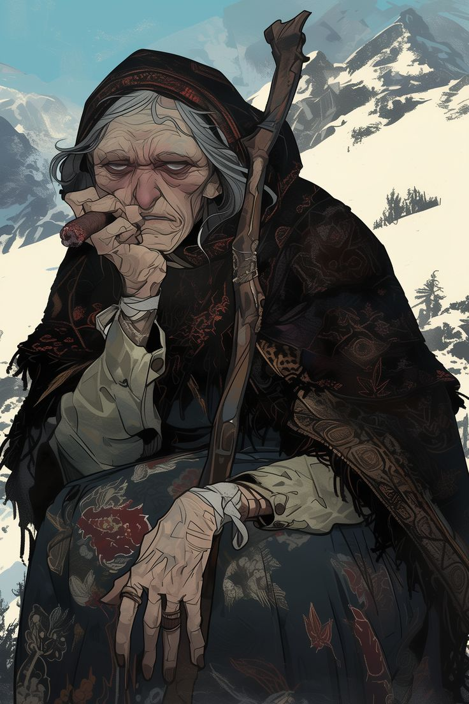

%%
[[The Golden Gambit]]
[[Mogyr]]
[[Ayerlan]]
[[Rash Gopal]]
%%

    <h4 class="wiki-header">Yara</h4>
    

        <strong>Occupation</strong>
        Retiree
    

    

        <strong>Culture</strong>
        Dres-Ma <a href="Mogyr" class="internal-link">Mogyr</a>
    

    

        <strong>Born</strong>
        820PA, western Drizan
	    

    

        <strong>Age</strong>
        107
    

    

    

        <strong>Allegiance</strong>
        <a href="The Golden Gambit" class="internal-link">The Golden Gambit</a> <a href="Rash Gopal" class="internal-link">The Rash Gopal</a>
    

    

	 

<small><i>this article concerns a Player Character played by Tombo during Campaign 2</i></small>