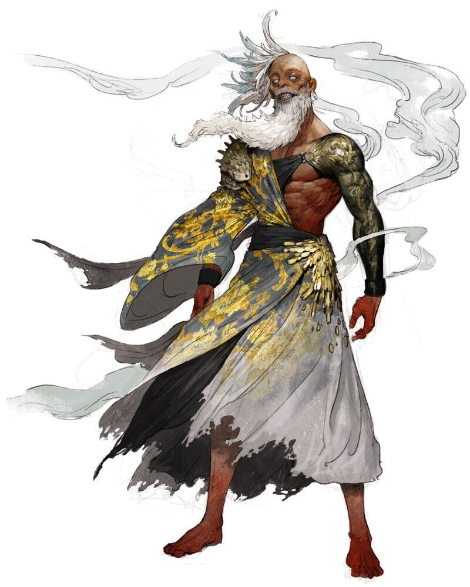

%%
[[Cinderstone Temple]]
[[Ikara]]
[[Manymirror]]
[[Inive]]
[[The Pillars of Myan]]
[[The Golden Gambit]]
[[Chian Genzin]]
[[Nabil]]
%%

    <h4 class="wiki-header">Cinderstone Mikor</h4>
    

        <strong>Epiteth</strong>
        the Red Monk
    

    

        <strong>Occupation</strong>
        Monk of the Cinderstone
    

    

        <strong>Culture</strong>
        <a href="Inive" class="internal-link">Inive</a> <a href="Human" class="internal-link">Human</a>
    

    

        <strong>Born</strong>
        865PA, Forbidden Lands
    

    

        <strong>Died</strong>
        927PA, <a href="Nabil" class="internal-link">Nabil</a>
    

    

        <strong>Cause of Death</strong>
        Falcon ate through his head, 62 Years of Age
    

    

        <strong>Allegiance</strong>
        <a href="Cinderstone Temple" class="internal-link">Cinderstone Temple</a>
        

        

	 
    

The Red Monk, as he is known in Ikara, also going by Cinderstone Mikor or just Mikor, is an elder member of the <a href="Cinderstone Temple" class="internal-link">Cinderstone Temple</a> of Tazil that has spend the last few weeks holed up in the Ebony Grin, an establishment in the Riverside of <a href="Ikara" class="internal-link">Ikara</a> after reportedly escaping captivity of the mysterious <a href="Manymirror" class="internal-link">Manymirror</a>. Not much is known of the monks past or heritage, but he seems to be from lands far away, as far as the local population is concerned, in truth Mikor was born among the <a href="Inive" class="internal-link">Inive</a> of the Forbidden Lands on the southern edge of the <a href="Niryd Steppe" class="internal-link">Niryd Steppe</a>, whose red skin he shares.

The Monk is currently avoiding capture after fighting another ikaran at the Ebony Grin, a less reputable Inn in Riverside, reports are that his hands reached beneath the very skin of his opponent and his skeleton burst into a thousand pieces. Wether true or not, he fled north into the Izker Moor soon after and hasnt been seen since.

Members of the 2nd Pillar of the <a href="The Pillars of Myan" class="internal-link">Myan Pillars</a> went after him lead by the Channeler <a href="Chian Genzin" class="internal-link">Chian Genzin</a>, fortunately for Mikor, they were not the only ones.

Mikor, travelling with the <a href="The Golden Gambit" class="internal-link">Golden Gambit party</a>, sought to help the Goblin Perzuk find Manymirror once again, so the goblin may free his brothers, tragically he died at the hands of Huan the Falcon Shifter, lover of the Ram Knight <a href="Provost Mihun" class="internal-link">Provost Mihun</a>, when the latter tracked down the Gambit at the Oasis of <a href="Nabil" class="internal-link">Nabil</a>.
