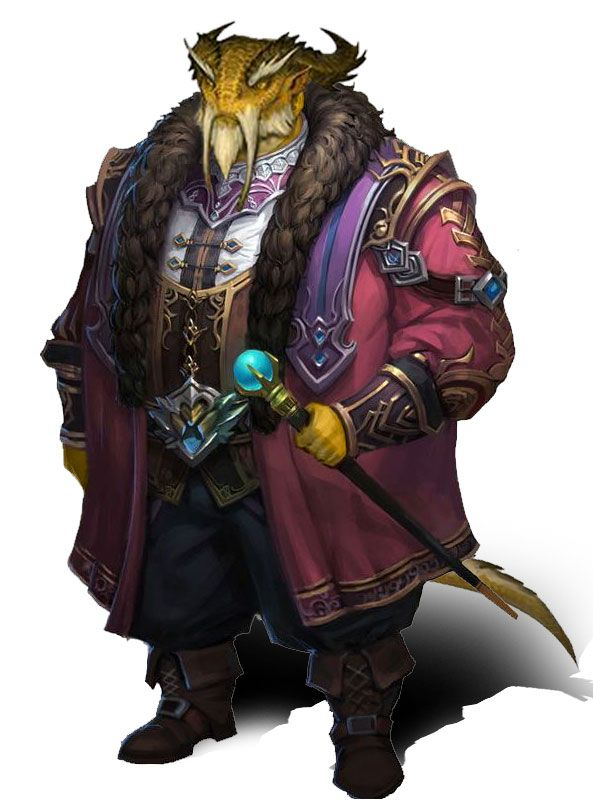

%%
[[Bihra]]
[[Jink]]
[[Majir]]
[[Ganoan]]
[[Ganoan Dye]]
[[Mystics Guild]]
[[Orc]]
%%

    <h4 class="wiki-header">Goash Mab</h4>
    

        <strong>Epithet</strong>
        Shining Mab
    

    

        <strong>Occupation</strong>
        Lord of the Jink Council
    

    

        <strong>Culture</strong>
        Ganoan <a href="Bihra" class="internal-link">Bihra</a>
    

    

        <strong>Born</strong>
        888PA
	    

    

        <strong>Age</strong>
        39
    

    

        <strong>Allegiance</strong>
        <a href="Jink" class="internal-link">City of Jink</a>
    

    

	 

Goash Mab, called Shining Mab, is a <a href="Ganoan" class="internal-link">Ganoan</a> <a href="Bihra" class="internal-link">Bihra</a> of <a href="Jink" class="internal-link">Jink</a>, one of the Lords of the Council of the city and the richest man in the Ganoa Valley. His epithet refers both to his wealth and to the gold scales for which he is known throughout the valley. Among his many holdings are the largest slave plantations of the valley, and his credit reaches into nearly every trade of the lake, including much of the debt of <a href="Majir" class="internal-link">Majir</a>. He is the most powerful Bihra in the patrician circles of Jink, and is widely held to be one of the true powers behind the Archon's chair.

<h2>Early Life & Rise to Power</h2>

Goash Mab was born in Jink in 888PA into a family of Bihra ferrymen, one of the many Bihra clans who had run the crossings and pilots of Lake Ganoa for generations without ever being counted among the patrician clans of the city. He was five years old when the riots of 893PA turned into war between Jink and Majir. During the war his family grew rich carrying mercenaries, arms and supplies across the lake for the families of Jink, and after the truce of 895PA it used its profits to buy land on the northern shore, much of it from families ruined by the war and the loss of their holdings in the south.

Goash inherited the family's affairs as a young man and turned a fortune of the ferries into the greatest fortune of the valley. He expanded the family's lands into plantations of rice and cotton worked by slaves, became one of the leading moneylenders of the lake, and bought his way into the trade in flowers and <a href="Ganoan Dye" class="internal-link">Ganoan Dye</a>. His lending to the dome works, merchants and even the treasury of Majir has made him one of the largest creditors of the free city, so that it is often said that half of Majir's debts end up in his books. His wealth eventually won him a seat among the Lords of the Council, an honour that few Bihra had held before him.

<h2>Wealth and Holdings</h2>

The plantations of Goash Mab line much of the northern shore of the lake and are the largest of their kind in the valley. Their slaves are <a href="Orc" class="internal-link">orcs</a>, Bihra and humans, and like all slaves of Jink they bear the Master's Seal, the enchantment burned into the skin of the throat that allows an escaped slave to be found, which makes Mab one of the most important patrons of the <a href="Mystics Guild" class="internal-link">Mystics</a> of Jink. Beyond the plantations he holds ferries, warehouses and lending houses on both shores, and stakes in several of the guilds of Jink.

<h2>Politics and Reputation</h2>

Within the Council, Goash Mab is publicly counted among the firmest supporters of the truce with Majir, which protects his debts and his trade on the southern shore, and among the staunchest defenders of slavery in the valley. In Jink he is admired and resented in equal measure, an outsider among the old human clans who has outgrown nearly all of them. In Majir he is perhaps the most hated man of the northern shore, a symbol of everything the radicals despise, though many there owe him money and fewer still dare to say so openly. His gold scales, rare even among the Ganoan Bihra, have made him instantly recognisable on both shores, and he is known to dress in Ganoan Dye of the finest quality, so that by evening he is said to shine in reds and blues as brightly as by day.

