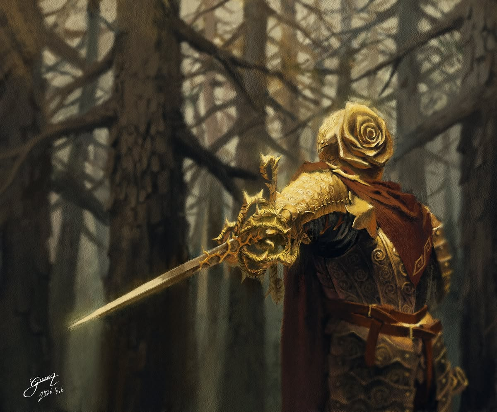
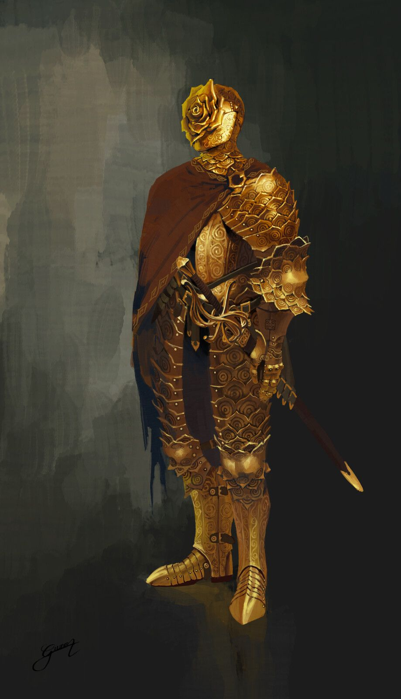

%%  
[[Wytlands]]  
[[Ravenleaf Forest]]  
[[Daban-Kol]]  
[[Tizin-Kol]]  
[[Levazci]]  
[[Opuzna]]  
[[Waśko Ralpia]]  
%%  

  
 <h4 class="wiki-header">Goldenrose</h4>  
 
  
 <strong>Occupation</strong>  
 Wytlord, Bandit Chief  
 
  
 
  
 <strong>Holds</strong>  
 Dag Valley  
 
  
 
  
 <strong>Culture</strong>  
 presumed <a href="Vihri" class="internal-link">Wyt</a> Human  
 
  
 
  
 <strong>Active since</strong>  
 late 910s PA  
 
  
 
  
   

  

  
<small><i>Goldenrose in the woods of the Wytlands</i></small>  

Goldenrose is the greatest of the Wytlords, the bandit lords and robber barons of the eastern <a href="Wytlands" class="internal-link">Wytlands</a>, and the master of Dag Valley, the lands around Lake Dag in the far east. He takes his name from his armour of gold and his helmet shaped like a rose. Since he emerged as the head of a band of brigands in the late 910s he has become the most feared figure in the Wytlands, and even the Ogres of the <a href="Ravenleaf Forest" class="internal-link">Ravenleaf</a> fear him. Some of the Wyt, however, call him their hope.
  
<h2>Rise</h2>  

Nothing certain is known of Goldenrose before the late 910s. He first appeared as the leader of a band of brigands in the eastern hills, already in his golden armour, and within a few years he had driven out or brought to heel the lesser Wytlords of the east and taken Dag Valley for his own. Who he is beneath the helmet is a matter of endless rumour. He is said to be a Wyt lord of the old blood, a disgraced knight, a deserter from the wars of the south, a dwarf, a woman or no living man at all, and he has never been seen without his armour by anyone who lived to say so.
  
<h2>Dag Valley</h2>  

Goldenrose rules Dag Valley as no other Wytlord rules anything. His following is far greater than the few dozen riders of the other Wytlords, his towers watch the valley and the roads that lead out of the mountains, and the villages of the valley pay him as they would pay a lord. Every traveller who comes west from <a href="Tizin-Kol" class="internal-link">Tizin-Kol</a> and <a href="Daban-Kol" class="internal-link">Daban-Kol</a> across the southern Mistspires into the Wytlands must pass through his land, and he extorts them all, dwarves and men alike. The Ogres of the southern Ravenleaf, who fear few things, keep away from his valley.
  
<h2>The Hope of the Wyt</h2>  

To the lords of Levazci and Opuzna and to the merchants who travel the eastern roads, Goldenrose is a bandit and a murderer. Among the Wyt of the eastern Wytlands he is something more. Some of them call him the hope of the Wyt people, and pray that one day he will rise as a greater leader of all the Wyt, unite the Wytlands and stand up once more against what they see as the oppression of the Vihri crown, as the Wyt lords did before they were broken at Glancz in 251PA. Whether Goldenrose himself wants anything of the kind, he has never said.
  

The plan at court to grant titles to those who pacify the Wytlands has made him more important still. For the Var of Levazci and Opuzna he is the greatest obstacle to their claims. For Kisras <a href="Waśko Ralpia" class="internal-link">Waśko</a>, who hopes for a lord of the Wytlands indebted to him alone, he may be either the greatest obstacle or the greatest opportunity.
  

