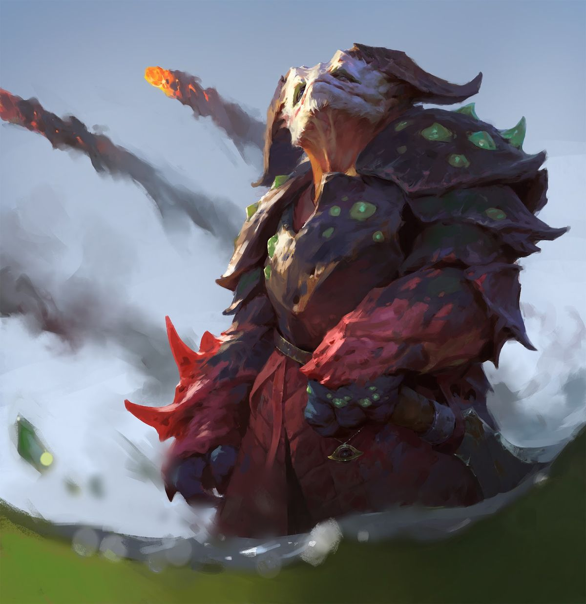

%%  
[[Duol Khaganate]]  
[[Niryd Steppe]]  
[[Bihra Shamanism]]  
[[Great Khaganates of the Steppe]]  
[[Kareli Hierarchy]]  
%%  
  

  
 <h4 class="wiki-header">Orsogai Duol</h4>  
 
  
 <strong>Epiteth</strong>  
 Ogujan, the Invincible  
 
  
 
  
 <strong>Occupation</strong>  
 Khan of the Duol, Khan of Khans  
 
  
 
  
 <strong>Culture</strong>  
 <a href="Steppe Bihra" class="internal-link">Steppe Bihra</a>  
 
  
 
  
 <strong>Born</strong>  
 899PA, Duol Rabad  
 
  
 
  
 <strong>Died</strong>  
 alive  
 
  
 
  
 <strong>Age</strong>  
 28  
 
  
 
  
 
  
 <strong>Dynasty</strong>  
 Duol  
 
  
 
  
 <strong>Allegiance</strong>  
 <a href="Duol Khaganate" class="internal-link">Duol Khaganate</a>  
 
  
 
  
   

  
  

Orsogai Duol, known as Ogujan, meaning "Invincible" in Lihbare, is the Khan of the <a href="Duol Khaganate" class="internal-link">Duol Khaganate</a> and, by the claim of his line, the Khan of Khans of the <a href="Niryd Steppe" class="internal-link">Niryd Steppe</a>. Born in 899PA, he is 28 years old and the youngest Khan to hold Duol Rabad in living memory. He is famed across the steppe for his impenetrable scales, a mutation that, according to the Bihra who follow him, no blade or arrow has yet been able to pierce, and which has made him the subject of songs and tales far beyond his own lands.
  
<h3>Background and Rise</h3>  

Orsogai was born at Duol Rabad into the ruling line of the Duol, which traces its descent from the blood of the Jigallor. His scales are said to have been unusually hard from birth, and among the Steppe Bihra, who hold that spiritual worth is proven through strength and mutation, they marked him early as a child of great destiny. He became Khan in 918PA at the age of 19, after the death of his father, and spent his first years in power bringing the lesser Khans and chieftains of the southern steppe back under the authority of Duol Rabad, many of whom had grown independent in the last years of his father's rule.
  
<h3>Reign</h3>  

Under Orsogai the Duol Khaganate has regained much of the strength it lost after the other great Khaganates refused it service. He has renewed the raids of the Duol on the <a href="Kareli Hierarchy" class="internal-link">Kareli Hierarchy</a>, which once again faces a consolidated threat from the steppe, and he presses the old claim of his line to be Khan of Khans more openly than any Duol Khan before him. Among his own people his reputation for invincibility in battle has done much to restore the faith of the shamans in the line of Duol, while the Anatai, Yadu and Gökol watch the rise of the young Khan with growing unease.
  

Orsogai is a towering, horned Steppe Bihra who goes to war in heavy armour of overlapping plates set with green stones, worn over robes of deep red.
  
