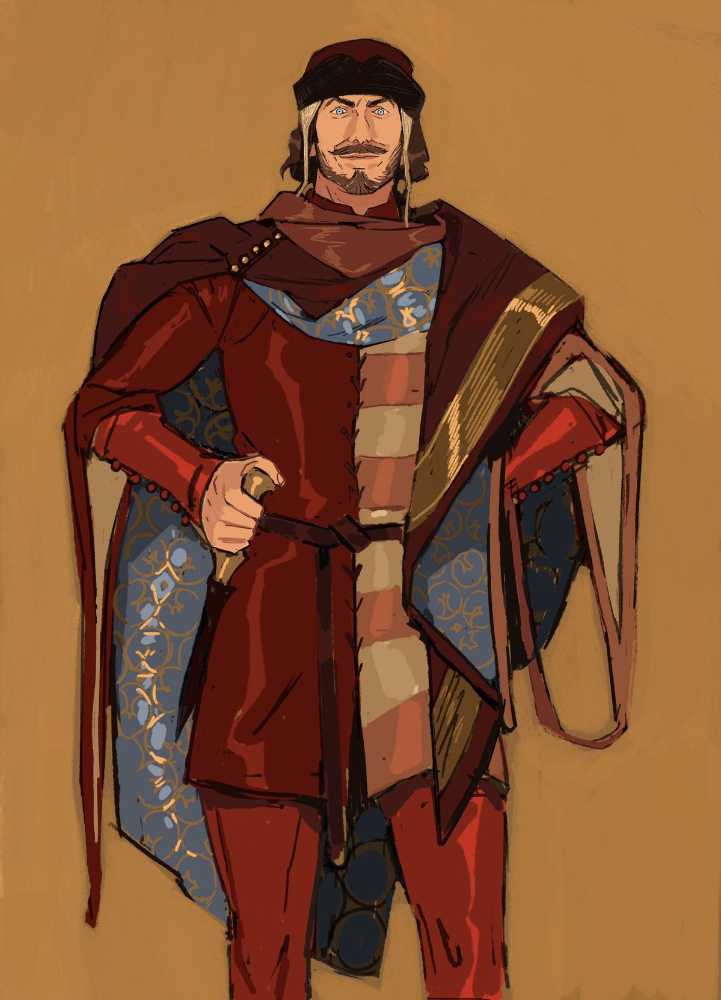

%%
[[Dalniz]]
[[Provost Mihun]]
[[Marosz Kirelli]]
%%

    <h4 class="wiki-header">Hrado Cantemirești</h4>
    

        <strong>Occupation</strong>
         Gri of Sarack
    

    

        <strong>Culture</strong>
        <a href="Vihri" class="internal-link">Sarloni</a> <a href="Human" class="internal-link">Human</a>
    

    

        <strong>Born</strong>
        881PA, Sarack
    

    

        <strong>Age</strong>
        46
    

    

    

        <strong>Issue</strong>
        Marek Cantemirești, Despina Cantemirești
    

    

        <strong>Dynasty</strong>
        Cantemirești
    

    

        <strong>Allegiance</strong>
        <a href="Dalniz" class="internal-link">Rascy zi Dalniz</a>
    

    

	 

Hrado Cantemirești is the current Gri of Sarack Keep and Head of the ancient southern sarloni line of nobility, the Cantemirești. He is a leal subject to his majesty Ras Ildan IV of <a href="Dalniz" class="internal-link">Dalniz</a> and his line has held Sarack for houndreds of years. While not the richest clan of members of the more influential higher nobility, Cantemirești knows how to play the game of games well and has done so since he inherited the Keep from his father at the age of 32. The Cantemirești family is a well respected name, and aside from his two children, Marek & Despina, many landed or landless members of the dalniz nobility are part of their blood as well. The Cantemirești Coat of Arms depicts a Blue Eagle upon red and Gold.

He was recently investigated by agents of the Government as part of a scheme to uncover the drug trade from eastern nirydia and behera through Dalniz into the lands of Vihr and Grevenna, that uncovered and led to the exile of <a href="Provost Mihun" class="internal-link">Provost Mihun</a>, however it seems like either Hrado was innocent in the matter or took much better care to hide his connections to shady figures such as the ever present <a href="Marosz Kirelli" class="internal-link">Marosz Kirelli</a>.
