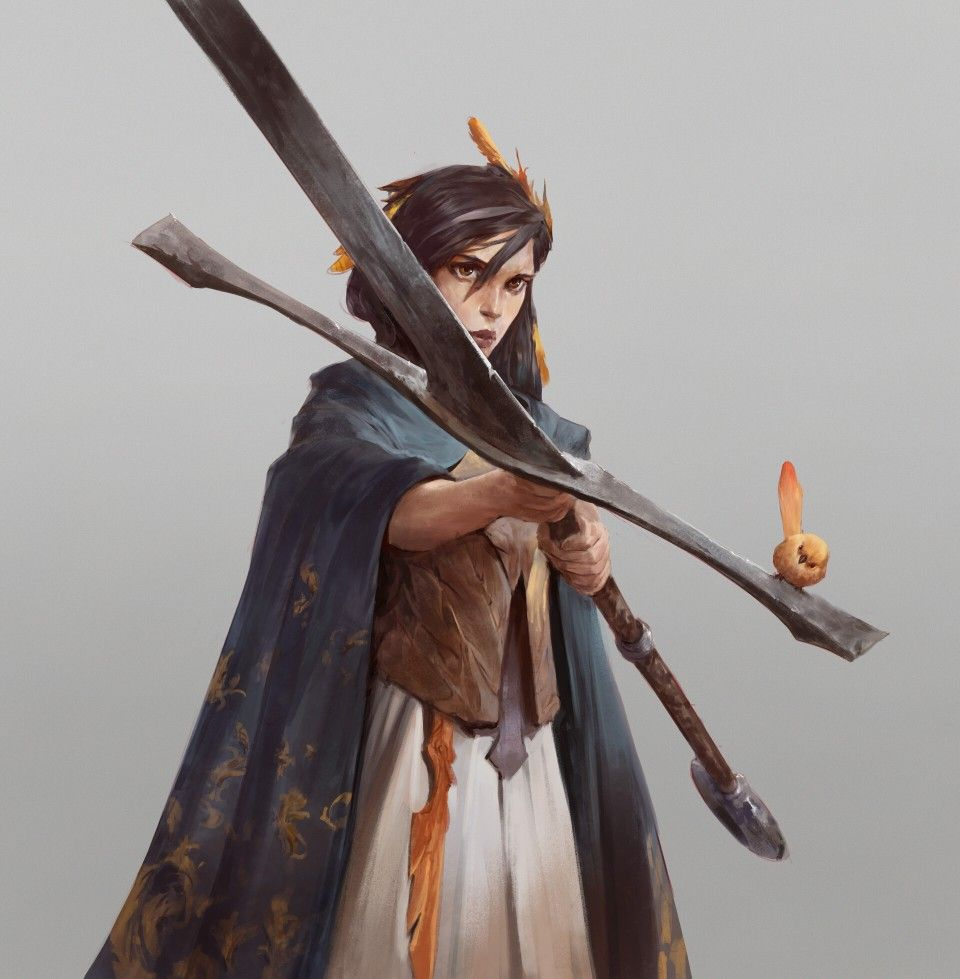

%%
[[Fenhir]]
[[Kheri]]
[[Revolution of Rox]]
[[Roxeria]]
%%

    <h4 class="wiki-header">Rox Mahr</h4>
    

        <strong>Epiteth</strong>
        the Chosen, the Annihilator
    

    

        <strong>Occupation</strong>
        Leader of the Revolution,  First Lady of Roxeria
    

    

        <strong>Successor</strong>
        Harax Rox I
    

    

        <strong>Culture</strong>
        <a href="Kheri" class="internal-link">Roxanae</a> <a href="Human" class="internal-link">Human</a>
    

    

        <strong>Born</strong>
        535PA, Sincali Moors
	    

    

        <strong>Died</strong>
        600PA, Mount Javal
    

    

        <strong>Cause of Death</strong>
        Disintegration 65 Years of Age
    

    

    

        <strong>Allegiance</strong>
        <a href="Roxeria" class="internal-link">Chosen Realm of Roxeria</a>
    

    

	 

Rox Mahr, called Rox the Chosen and, by her enemies, Rox the Annihilator, was the leader of the <a href="Revolution of Rox" class="internal-link">Revolution of Rox</a> and the first ruler of <a href="Roxeria" class="internal-link">Roxeria</a>, which bears her name. Born in the Sincali Moors in 535PA, the younger sister of the prophet <a href="Fenhir" class="internal-link">Fenhir</a>, she led the Kheri of the eastern Bay of Azuv in their revolt against the <a href="Azuvke" class="internal-link">Khatrym of Azuvke</a> from 560PA to 564PA, and ruled the realm she had won for thirty-six years. She is famed above all as a warrior and as the wielder of Livar, the Nullblade. In 600PA she climbed Mount Javal and stepped into the Pillar of the One; To this day she is venerated by the <a href="Javalim" class="internal-link">Javalim</a> as the hero the One had foreseen.

<h2>Early Life</h2>

Rox grew up in the Sincali Moors among the keepers of the old faith of the One, and followed her elder brother when he went to preach in the eastern cities. In the tellings of the Javalim, Fenhir saw in a vision that the One would give the eastern shore a hero from his own blood, and knew it to be his sister long before she did.

<h2>The Revolution</h2>

In 560PA the kethric authorities of Bakalas condemned Fenhir to burn as a heretic. Rox led the crowd that broke up the pyre and pulled her brother from the flames, and Bakalas rose with her. Over the following four years she drove the Azuvken garrisons from the eastern shore, took Furel after a siege of more than a year and had the spears of its defenders planted on its walls, and in 564PA defeated the Azuvken army landed on the coast near Alkon, after which Azuvke made peace.

Rox was renowned for her physical prowess and fought at the head of her people throughout the war. She moved across the battlefield with a speed and fury that no fighter of her age could match, and it was said that no man or woman could hope to best her, so that the Azuvken soldiers who faced her named her the Annihilator. At Alkon she met Nitol the Good, a legendary kethric paladin and the greatest fighter on the Azuvken side, and killed him with Livar.

<h2>Livar</h2>

Livar, also known as the Nullblade, was the sword Rox carried throughout the revolution. The name Nullblade was given to it by her enemies and later taken up by some scholars, while texts of the Javalim at times call it the Hand of the One. It is a massive blade nearly two metres long, forged out of a single piece of meteorite and so heavy that it seems made for giants. Its exact origins, and how it came into Rox's hands, are unknown, but the tellings agree that she bore it while still a small girl, and that a sword no man of great strength should have been able to lift was as light as a feather in her hands.

Livar gave its wielder the power to change its mass at will. Rox could swing it as lightly as a reed and then, for the fraction of a second in which it struck, make it as heavy as an oak tree, and it was this, as much as her own strength and speed, that made her the most feared fighter of her age. Before she stepped into the Pillar of the One she laid the sword down, and it rests today in the Siblings Tomb near Bakalas, alongside great stone murals that tell the story of the revolution.

<h2>First Lady of Roxeria</h2>

As the first ruler of the new principality Rox took the title of Lady, which her successors have carried ever since, and governed from Bakalas with Fenhir at her side as Great Seer. Her rule was given to securing the realm against Azuvke and against the Luchun Khaganate, which subjugated the Omna of Az in 578PA, and to building up the Javalim in place of the kethric faith.

<h2>Ascension</h2>

In 600PA, at the age of sixty-five, Rox climbed to the Vale of the One Mind at the top of Mount Javal and stepped into the Pillar of the One, where she disintegrated before the eyes of those who had come with her. The Javalim hold that she was taken into the One, whose chosen she had always been, and her stepping into the Pillar is the holiest moment of Roxerian history after the revolution itself. She was succeeded by her son Harax, who took her name as his own and founded the line of Rox that rules Roxeria to this day, and after her ascension Fenhir proclaimed the principality the Chosen Realm of Roxeria.
