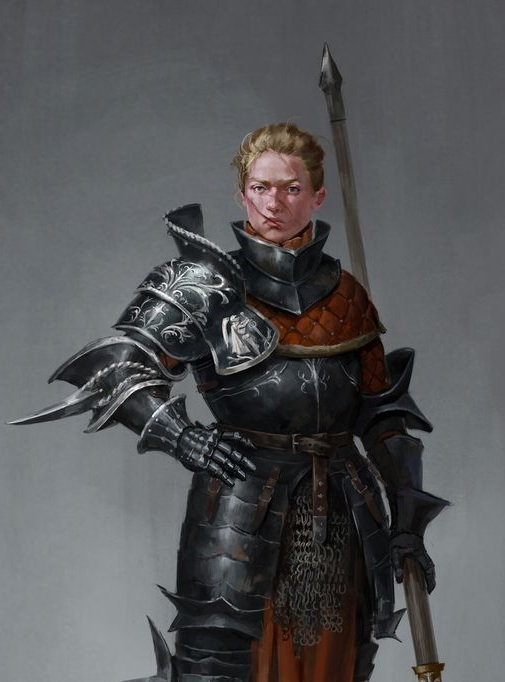

%%  
[[Zepria]]  
[[Zuhurism]]  
[[Gorati]]  
[[Organius of Aviv]]  
[[Nural]]  
[[Hastermon Temple]]  
[[Rian]]  
%%  

  
 <h4 class="wiki-header">Suzana Dragović</h4>  
 
  
 <strong>Epiteth</strong>  
 the Cruel  
 
  
 
  
 <strong>Occupation</strong>  
 Queen of Zepria, Sun Empress  
 
  
 
  
 <strong>Culture</strong>  
 <a href="Gorati" class="internal-link">Zepri</a> <a href="Human" class="internal-link">Human</a>  
 
  
 
  
 <strong>Born</strong>  
 459PA, Rivno  
 
  
 
  
 <strong>Died</strong>  
 520PA, Plavigrad  
 
  
 
  
 <strong>Cause of Death</strong>  
 Fever,   61 years of age  
 
  
   

  
   

  
 <strong>Father</strong>  
 Morac Dragović  
 
  

  
 <strong>Issue</strong>  
 Morana Dragović  
 
  
 
  
 <strong>Dynasty</strong>  
 Dragović  
 
  
 
  
 <strong>Allegiance</strong>  
 Zeprian Empire  
 
  
 
  
    
  

  

Suzana Dragović, known as Suzana the Cruel, was Queen of Zepria and the first Empress of the <a href="Zepria" class="internal-link">United Lands of Gorat</a>. Through a long series of conquests she united most of the Gorati peoples under a single throne and saw Bihra Khans and Shirin generals bow before her, finally in 491PA she was crowned Sun Empress by the zuhuri Oracle of the Organius in Aviv. A ruthless conqueror and a devout patron of the faith, she is remembered as the founder of the Gorati imperial tradition, and to this day she is a symbol of Gorati stubbornness and strength.
  
<h2>Early Life</h2>  

Suzana was born in 459PA in Rivno, a princess of the then small Kingdom of Zepria and the daughter of King Morac of Plavigrad. Morac was known above all for his subjugation of the Malvic League, an alliance of merchant cities that controlled the trade through the Strait of Zelarvo from its two greatest cities, Malvic on the mainland and Kroz on the island of Zelarvo. Suzana is said to have been very close to her father. In 479PA Morac was killed at the age of 44 during a feast, impaled by an assassin's spear. The perpetrators were never identified with certainty, but several old Zeprian nobles were later blamed for the murder, tried and executed, and Suzana succeeded her father on the throne of Zepria.
  
<h2>Conquests</h2>  

As Queen, Suzana waged war on the petty princes and lords who then divided Gorat, and over twelve years brought most of the Gorati lands under her rule. She openly embraced the moniker "the Cruel" and judged dissenters and opposition without mercy, infamously wiping out the entire bloodline of the House Dajateš to the last son for their betrayal at the Battle of Hastermon. She was equally ruthless towards those who did not follow <a href="Zuhurism" class="internal-link">Pen Zuhur</a>, above all in the south and in the mountain valleys, where she had great fires raised to burn down the sacred groves of the <a href="Nural" class="internal-link">Nural</a>.
  

Her conquests ended with a journey north to Aviv, where in 491PA she was crowned Sun Empress by the Oracle of the Organius (see <a href="Organius of Aviv" class="internal-link">Organius of Aviv</a>) and proclaimed the Zeprian Empire. The coronation at Aviv was repeated by five of the Emperors who followed her.
  
<h2>Legacy</h2>  

Suzana remained a devout follower of Pen Zuhur throughout her life and held the God's name in high honour. She elevated the priesthood within her realm and is often credited with the wave of clerical education that spread through Gorat with the founding of the Empire. The <a href="Rian" class="internal-link">Rian</a>, which became the common coin of the region and later of much of Nirydia, was first struck under her rule. She died of a fever in Plavigrad in 520PA at the age of 61 and was succeeded by her daughter Morana.
  
