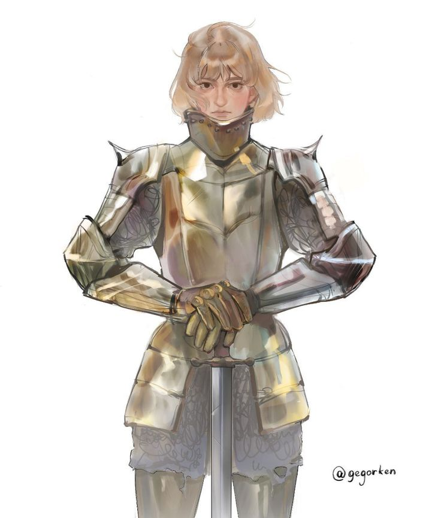

%%  
[[Vihr]]  
[[Kasimir I]]  
[[Szievek]]  
[[Breza]]  
[[Trydlew]]  
[[Rulers of Vihr]]  
%%  

  
 <h4 class="wiki-header">Boris zi Szinmo</h4>  
 
  
 <strong>Epithet</strong>  
 the Traitor Prince  
 
  
 
  
 <strong>Title</strong>  
 Kisras of <a href="Vihr" class="internal-link">Vihr</a>  
 
  
 
  
 <strong>Culture</strong>  
 <a href="Vihri" class="internal-link">Low Vihri</a> <a href="Human" class="internal-link">Human</a>  
 
  
 
  
 <strong>Born</strong>  
 483PA, Szievek  
 
  
 
  
 <strong>Died</strong>  
 505PA, Zavlech  
 
  
 
  
 <strong>Cause of Death</strong>  
 Stabbed in a tavern brawl, 22 years of age  
 
  
 
  
 
  
 <strong>Father</strong>  
 <a href="Kasimir I" class="internal-link">Kasimir I</a>  
 
  
 
  
 <strong>Mother</strong>  
 Gras Elfiara  
 
  
 
  
 <strong>Issue</strong>  
 Dobrov Szinmo  
 
  
 
  
 <strong>Dynasty</strong>  
 zi Szinmo  
 

 

 

  

Boris zi Szinmo, sometimes called the Traitor Prince, was the eldest son of Ras <a href="Kasimir I" class="internal-link">Kasimir I</a> of <a href="Vihr" class="internal-link">Vihr</a> and the heir to the throne, who rose in arms against his own father in 503PA. The rebellion, which is remembered as the Boris Uprising, failed within the year, and although he was pardoned, the shamed and much hated heir was stabbed to death in a tavern brawl two years later. His fall cost the old lords of <a href="Breza" class="internal-link">Breza</a> their Vadcy and gave it to the house that holds it today.
  
<h2>Heir of Szievek</h2>  

Boris was born in 483PA in <a href="Szievek" class="internal-link">Szievek</a>, where his father was Var, and grew up as the heir of the richest Vadcy of the realm. He was the spitting image of his father, blond of hair and fair of skin, and he was known as the most gallant and beautiful knight of his time. He was a young man when the Red Pestilence carried off the heirs of the senior line of the Zav, and he was eighteen when his father was accepted as Ras in 501PA and he himself became Kisras, the heir to the crown.
  
<h2>The Boris Uprising</h2>  

In 503PA Boris rose against his father, backed by the zi Brediv, the lords of Breza, and by various other lords. The chronicles do not agree on why. Some say that he could not bear to wait for the crown, others that the zi Brediv, old rivals of Szievek on the Tryd, promised him the realm in return for a free hand in their own, and others again that father and son had simply come to hate each other. The rebellion did not last. Kasimir I took the field himself, broke it and asserted his authority, and he stripped the zi Brediv of their Vadcy and made them merely the Gri of Tansaw, giving Breza and <a href="Trydlew" class="internal-link">Trydlew</a> to House Dibrevi.
  

On the pleas of his mother, Gras Elfiara, the Ras pardoned his son, and Boris remained his heir. He was shamed before the whole realm, and he was much hated, not least by the knights who had fought for his father.
  
<h2>Death</h2>  

In 505PA Boris was stabbed in a tavern brawl in Zavlech by drunken knights proclaiming royalist creeds. The knights were never punished. His younger brother became heir in his place and reigned after their father as Kasimir II.
  
<h2>Legacy</h2>  

Boris left a son, Dobrov, born in 504PA, who was raised in Szievek and held the Vadcy in later years. In 553PA, when Katerina I died without a clear heir, it was Dobrov, the son of the shamed Kisras, who claimed the crown and began the Vihri War of Succession, which ended with his execution in 562PA. The lords of the Expanse remember the Boris Uprising for another reason: the fall of the zi Brediv put Breza in the hands of lords who were not Sarloni, a grievance that was still alive in the <a href="Vihri" class="internal-link">Sarloni</a> Uprising of 529PA.
  
<h2>People of Interest</h2>  

<a href="Kasimir I" class="internal-link">Kasimir I</a> "the Elder", father of Boris, Ras of Vihr, 462PA to 508PA Elfiara, Gras of Vihr, mother of Boris, 466PA to 521PA Kasimir II "the Younger", brother of Boris, Ras of Vihr, 486PA to 530PA Dobrov Szinmo, son of Boris, Var of Szievek, 504PA to 562PA
  
