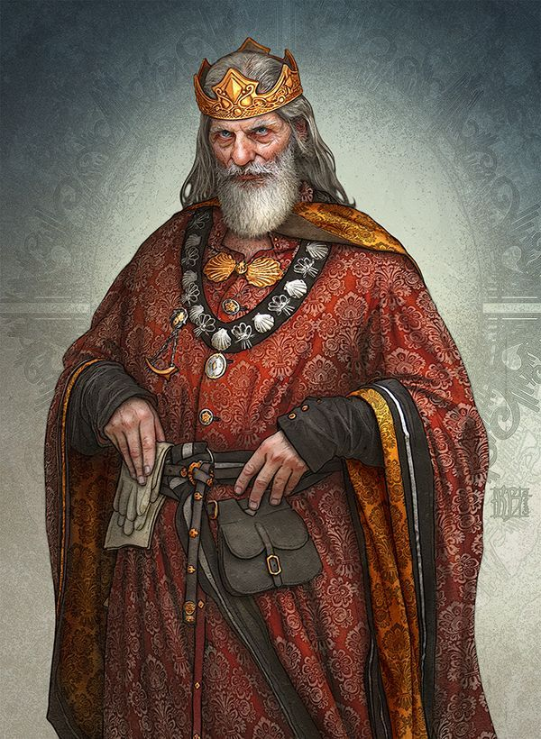

%%  
[[Vihr]]  
[[Rulers of Vihr]]  
[[Vihri-Reani War]]  
[[Church of Iztaw]]  
[[Fairriver]]  
[[Iron Hole]]  
[[Zervind II]]  
%%  

  
<h4 class="wiki-header">Jasper II zi Zav</h4>  

  
<strong>Epithet</strong>  
the Old  

  

  
<strong>Occupation</strong>  
Ras of <a href="Vihr" class="internal-link">Vihr</a>  

  

  
<strong>Predecessor</strong>  
Viago III  

  

  
<strong>Successor</strong>  
Tragomir I  

  

  
<strong>Culture</strong>  
<a href="Vihri" class="internal-link">Low Vihri</a> Human  

  

  
<strong>Born</strong>  
266PA, Zavlech  

  

  
<strong>Died</strong>  
339PA, Zavlech  

  

  
<strong>Cause of Death</strong>  
Old age, 73 years of age  

  

  

  
<strong>Father</strong>  
Zervind I "the Eagle"  

  

  
<strong>Issue</strong>  
Tragomir I, among others  

  

  
<strong>Dynasty</strong>  
zi Zav  

  

 

  

Jasper II zi Zav, called the Old, was Ras of <a href="Vihr" class="internal-link">Vihr</a> from 299PA until his death in 339PA. He came to the throne in the middle of the <a href="Vihri-Reani War" class="internal-link">Vihri-Reani War</a>, on the day his elder brother Viago III fell at the Battle of the Pilv, and he won the war that had killed his brother. His reign of forty years is the longest in the history of the House of Zav, and the peace that followed it is remembered as the most stable stretch of the dynasty. It was also the time in which the <a href="Church of Iztaw" class="internal-link">Church of Iztaw</a> grew into the power that would hold his great-grandson Zervind II in 377PA.
  
<h2>Early Life</h2>  

Jasper was born in 266PA in Zavlech, the second son of Ras Zervind I "the Eagle". He grew up in the shadow of his elder brother Viago, who was the heir and the soldier of the family, and Jasper was thought the quieter of the two, a careful and patient young man who preferred the council chamber to the tiltyard. When Viago came to the throne in 289PA, Jasper served him as a councillor and later as a commander in the south.
  
<h2>The Vihri-Reani War</h2>  

In 291PA King Salkon I du Rean declared war on Vihr, and the war went badly for the young kingdom for its first eight years. In 299PA Viago III was killed at the Battle of the Pilv, holding the river line against a Rean advance, and Jasper, who commanded the reserve, gathered the broken host and held the crossings until the Rean army withdrew. He was acclaimed Ras by the lords in the field and crowned at Zavlech later that year.
  

Jasper did not fight the war as his brother had. He would not meet the Rean host in the field where it was strongest, and for seven years he made it bleed on the river, in the hills and at its supply lines, until Rean had more to lose by fighting than by making peace. In 306PA Salkon I sued for peace, and the Peace of the Pilv gave Vihr the Pilv Valley between the Grevi and the Trollback Mountains, with its mines, its arable land and the ferry town that would one day become <a href="Fairriver" class="internal-link">Fairriver</a>. Jasper rewarded those who had served him well, among them Belia zi Syd, whose family he made Gri of the county of Sydrow.
  

In the same year as his accession the Grachi tribes west of the Grachhyll formed the Kingdom of <a href="Halgrach" class="internal-link">Halgrach</a> out of what had been the eastern colonies of the Vihri. With the Rean host on the Pilv, the new Ras did not contest it, and Halgrach went its own way.
  
<h2>Reign</h2>  

The thirty-three years of peace that followed the war were the most settled the Zav ever knew. Jasper settled the Pilv Valley with Vihri farmers and miners, raised churches in the new lands and gave the Church of Iztaw generous grants of land and tithe in the south and across the realm. He was a pious man, and he believed that a kingdom made of many lords and peoples would be held together better by one faith than by one army. The Church repaid him with loyalty, and with schools, hospices and clerks that the crown could not have raised by itself.
  

The cost of that patronage became clear only later. By the end of his reign the Church held more land in the realm than any lord but the crown, and the High-Bisops of Iztaw had learned how much a king could be made to owe them. The great lords, who had fought the war against Rean and been paid with thanks, watched the Church grow richer on the lands they had won, and they did not forget it.
  
<h2>Death and Legacy</h2>  

Jasper outlived most of his generation and his brother by forty years, and by the time he died at Zavlech in 339PA, at the age of seventy-three, he had been king for longer than most of his subjects had been alive, which is how he came to be called the Old. His son Tragomir succeeded him, already a man in middle age.
  

He is remembered as a wise and patient king who won a war he had not chosen and gave the realm a long peace, and the chroniclers of the Church have always written of him kindly. Later historians of the crown have been less generous, and they count his reign as the time in which the troubles of the Lords' Crisis were sown.
  
