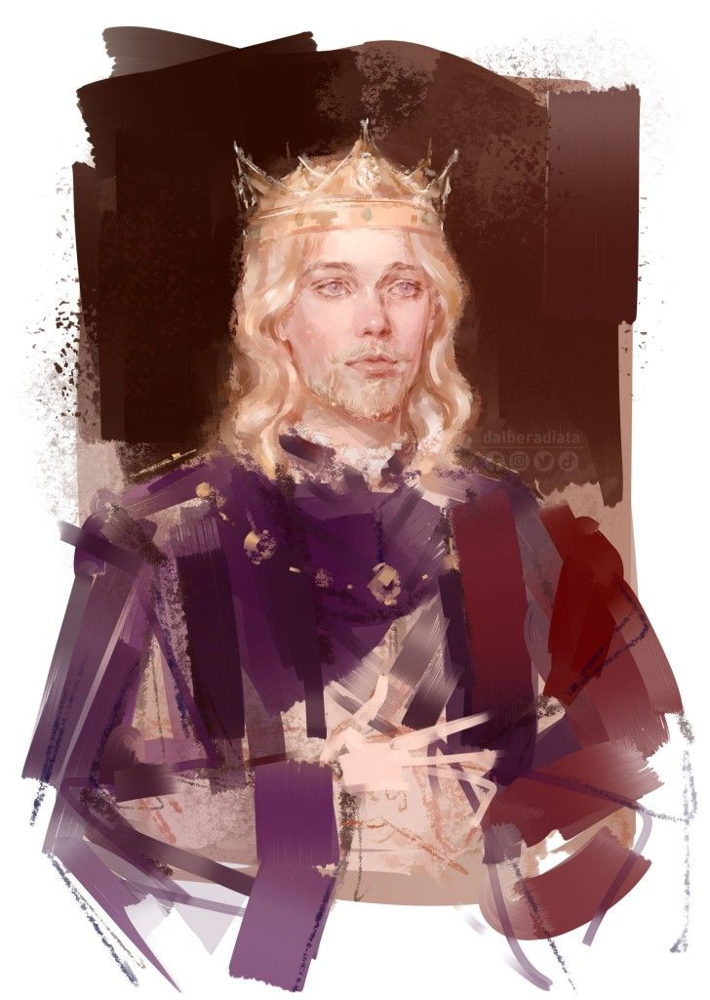

%%  
[[Vihr]]  
[[Rulers of Vihr]]  
[[Szievek]]  
[[Boris Szinmo]]  
[[Breza]]  
[[Vormil III]]  
[[Viago V]]  
%%  

  
 <h4 class="wiki-header">Kasimir I zi Szinmo</h4>  
 
  
 <strong>Epithet</strong>  
 the Elder  
 
  
 
  
 <strong>Occupation</strong>  
 Ras of <a href="Vihr" class="internal-link">Vihr</a>, Var of <a href="Szievek" class="internal-link">Szievek</a>  
 
  
 
  
 <strong>Predecessor</strong>  
 Martis III "the Unlucky"  
 
  
 
  
 <strong>Successor</strong>  
 Kasimir II "the Younger"  
 
  
 
  
 <strong>Culture</strong>  
 <a href="Vihri" class="internal-link">Low Vihri</a> <a href="Human" class="internal-link">Human</a>  
 
  
 
  
 <strong>Born</strong>  
 462PA, Szievek  
 
  
 
  
 <strong>Died</strong>  
 508PA, Zavlech  
 
  
 
  
 <strong>Cause of Death</strong>  
 Natural causes, 46 years of age  
 
  
 
  
 
  
 <strong>Spouse</strong>  
 Gras Elfiara  
 
  
 
  
 <strong>Issue</strong>  
 <a href="Boris Szinmo" class="internal-link">Boris</a>, Kasimir II  
 
  
 
  
 <strong>Dynasty</strong>  
 zi Szinmo  
 

 

  

  

Kasimir I zi Szinmo, called the Elder, was Ras of <a href="Vihr" class="internal-link">Vihr</a> from 501 to 508PA and the first king of the House of Szinmo. He was Var of <a href="Szievek" class="internal-link">Szievek</a>, then the richest and greatest of the Vadcy, when the senior line of the House of Zav died out, and he was the first lord of a Vadcy ever to take the throne. His reign was short and troubled. He is remembered for the Sapphire Band, the crown that was made for him, and for the rebellion of his own eldest son, the Boris Uprising of 503PA.
  
<h2>The Szinmo Claim</h2>  

The Szinmo were a junior branch of the House of Zav. They descended from a younger son of Ras Jasper III who married the heiress of Szievek, and so held the richest Vadcy of the realm and a claim to the throne behind the senior line. Kasimir was born in 462PA, the great-grandson of that marriage, and succeeded to Szievek as a young man.
  

When the Red Pestilence came north in the 490s, Ras Martis III at first refused to quarantine the cities of the south, and the sickness spread. It took all four of the Ras's heirs, and as the king lay crippled and dying the party of Szievek began to speak openly for its Var as the nearest of the Zav kin. Old loyalists of the senior line, among them the hero <a href="Darmil zi Perliav" class="internal-link">Darmil of Perliav</a>, spoke against them, but Darmil himself died of the plague in 497PA. When Martis III died in 501PA, the Honoured Assembly accepted Kasimir as Ras.
  
<h2>The Sapphire Band</h2>  

The crown of <a href="Viago I" class="internal-link">Viago I</a>, which the Zav had worn for generations, and the Firespear were lost when the senior line ended, and Kasimir was crowned with a new crown, a band of gold set with sapphires that has been known since as the Sapphire Band of Kasimir I. It remained among the crowns of the realm after the Szinmo fell, and <a href="Vormil III" class="internal-link">Vormil III</a> has chosen to wear it in his own reign, a somewhat controversial decision.
  
<h2>The Boris Uprising</h2>  

Kasimir's children brought him little but trouble. In 503PA his eldest son, the Kisras <a href="Boris Szinmo" class="internal-link">Boris</a>, later called the Traitor Prince, rose against him in arms, backed by the zi Brediv, then the lords of <a href="Breza" class="internal-link">Breza</a>, and by various other lords. The Ras broke the rebellion himself and asserted his authority over the realm. He took the titles of the zi Brediv and made them merely the Gri of Tansaw, and gave their Vadcy and their ancestral seat of <a href="Trydlew" class="internal-link">Trydlew</a> to House Dibrevi, which holds them to this day.
  

On the pleas of his wife, Gras Elfiara, Kasimir pardoned his son. Boris remained heir, shamed and much hated, until he was stabbed in 505PA in a tavern brawl by drunken knights proclaiming royalist creeds. The knights were never punished, and it was said in Szievek that the Ras did not mourn his son for long.
  
<h2>Death and Legacy</h2>  

Kasimir I died in Zavlech in 508PA, and his younger son succeeded him as Kasimir II "the Younger". The Szinmo kept the throne until 553PA. In the reign of Vormil III many have pointed to the similarities between the two kings, given their strengths and their struggles, and above all their sons: Vormil's two sons are strong and opposed figures, and Kasimir's children brought him nothing but grief. In Szievek, the <a href="Eye of Kasimir" class="internal-link">Eye of Kasimir</a> bears the same name, though it is named for the Saint and not for the king.
  
<h2>People of Interest</h2>  

<a href="Boris Szinmo" class="internal-link">Boris</a>, eldest son of Kasimir I, leader of the Boris Uprising, 483PA to 505PA Kasimir II "the Younger", younger son of Kasimir I, Ras of Vihr, 486PA to 530PA Elfiara, Gras of Vihr, wife of Kasimir I, 466PA to 521PA Martis III "the Unlucky", the last Ras of the senior line of the Zav, 460PA to 501PA
  
