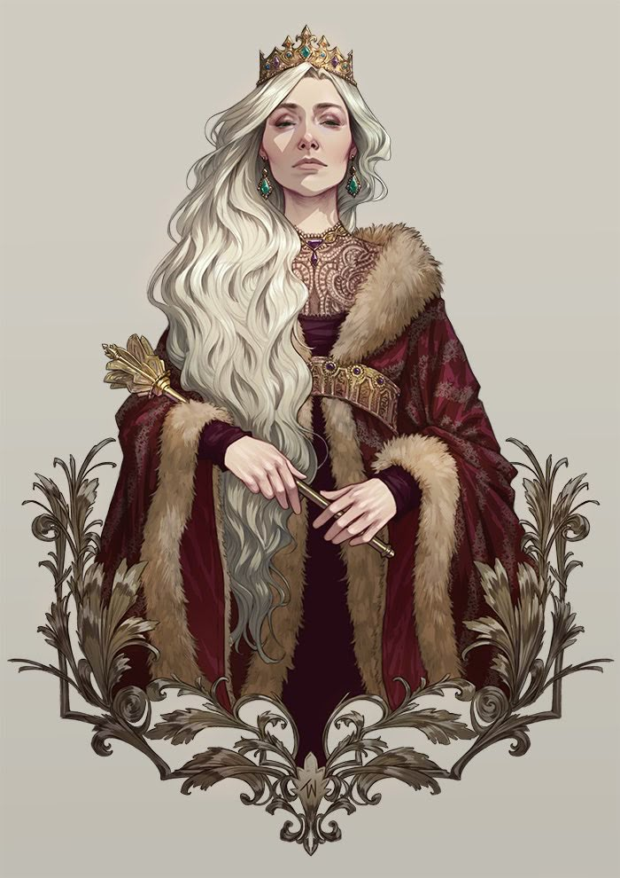

%%   
[[Vihr]]   
[[Rulers of Vihr]]   
[[Kasimir I]]   
[[Boris Szinmo]]   
[[Wermian Accords]]   
[[Tytus]]   
[[Zawis I]]   
[[Rovgi]]   
[[Mesziev]]   
[[Holbrind]]   
%%   

   
<h4 class="wiki-header">Katerina I zi Szinmo</h4>   

   
<strong>Epithet</strong>   
the Owl   

   

   
<strong>Occupation</strong>   
Gras of <a href="Vihr" class="internal-link">Vihr</a>   

   

   
<strong>Predecessor</strong>   
Viago VI "the Boy King"   

   

   
<strong>Successor</strong>   
<a href="Zawis I" class="internal-link">Zawis I "Silverbeard"</a>   

   

   
<strong>Culture</strong>   
<a href="Vihri" class="internal-link">Low Vihri</a> <a href="Human" class="internal-link">Human</a>   

   

   
<strong>Born</strong>   
509PA, Zavlech   

   

   
<strong>Died</strong>   
553PA, Zavlech   

   

   
<strong>Cause of Death</strong>   
Heart attack, 44 years of age   

   

   

   
<strong>Spouse</strong>   
Miskos zi Wogrov   

   

   
<strong>Issue</strong>   
Matjez, Annrietta   

   

   
<strong>Dynasty</strong>   
zi Szinmo   

  
 
  
    

   

Katerina I zi Szinmo, called the Owl, was Gras of <a href="Vihr" class="internal-link">Vihr</a> from 532 to 553PA and the last ruler of the House of Szinmo. The daughter of Kasimir II "the Younger", she governed the realm first as regent for her nephew, the Boy King Viago VI, and then in her own right, the first woman ever to do so. Her reign saw the signing of the <a href="Wermian Accords" class="internal-link">Wermian Accords</a> on Vihri soil, the undead occupation of the Tlok Valley by the lich Mendizaba, and the Culling of 549, in which she lost both of her children. When she died in 553PA without living children and without a clear heir, the Vihri War of Succession followed, and the crown passed in the end to the House of Worocek.
   
<h2>Early Life</h2>   

Katerina was born in Zavlech in 509PA, the year after her father succeeded <a href="Kasimir I" class="internal-link">Kasimir I</a> as Ras. Like the rest of her dynasty she was known for her long white hair, which she wore loose and down to her waist all her life, and which in her later years was said to make her look older than she was and wiser than her counsellors. She grew up at a court still shadowed by the Boris Uprising and the shameful death of her uncle, the Traitor Prince <a href="Boris Szinmo" class="internal-link">Boris</a>, and she was a grave and watchful child, more at home among her father's clerks and ledgers than at the dances of the court.
   

She married Miskos zi Wogrov, the second son of the Var of <a href="Rovgi" class="internal-link">Rovgi</a>, and the marriage gave her two children, a son, Matjez, and a daughter, Annrietta.
   
<h2>The Regency</h2>   

In 529PA the people of the Expanse, Sarloni and Wyt alike, rose against their northern overlords in Breza, Opuzna and Selbia in the Sarloni Uprising. Katerina's brother, the Kisras Jasper, fell in the fighting, and when Kasimir II died the following year the crown passed to Jasper's son, Viago VI, a child of six. Katerina, his aunt, governed in his name as regent.
   

Her regency was short and hard. To keep the people of the Expanse from ever again making common cause, it ordered that ill tidings in the Sarloni vales be carried by Wyt envoys and in the Wyt country by Sarloni ones, a custom that has outlived the order and is kept to this day, when the Sarloni still call the Wyt envoys "ravens" and the Wyt call the Sarloni ones "horn-criers". In the same years the building of the Towers of Open Skies, the seat of the Kar-Zavr beside the palace in Zavlech, was begun by the court wizard David Thal.
   

The Boy King died of a fever in 532PA, at the age of eight, and Katerina was crowned in his place. Rumours that she had poisoned her nephew followed her for the rest of her life and long after it, but historians have largely agreed, on the strength of contemporary sources, that they were baseless.
   
<h2>Reign</h2>   

Katerina was the first woman to rule Vihr in her own right, and she ruled as she had governed for her nephew: patiently, coldly and with an eye on everything. The realm called her the Owl. It was said that she saw in the dark and slept with her eyes open, and her pale face and white hair lent the name the rest of its truth. She is remembered in her portraits with the sceptre that was forged for her in the shape of a mace, which the Ras of Vihr still bear today as a sign of power and rule.
   
<h3>The Wermian Accords</h3>   

In 536PA the <a href="Wermian Accords" class="internal-link">Wermian Accords</a> were signed at Stagbone Hall in Morael, in the March of <a href="Nuv Werm" class="internal-link">Nuv Werm</a>, with Vihr as host and protector. Katerina followed the advice of the bishop <a href="Palus" class="internal-link">Palus Aergestes</a>, the father of the Accords, and of the Church, and signed them with the other rulers of Ilrakhan. They were protested by a large group of mages, among them her own Kar-Zavr, David Thal, who left her service over them. With them went many of the magical authorities and advisers who had served the crown and the great lords for generations.
   
<h3>The Skullbringer</h3>   

The price of that loss was paid in the Tlok Valley. In the 540s the dwarven necromancer Mendizaba, who had achieved lichdom in her mountain stronghold of Xurugam, brought the hold of Xer-Kol under her dominion and raised the dead of the valley in skeletal legions. The Tloky and the people of the surface lands called her the Skullbringer. Katerina sent a contingent of knights and men-at-arms against her, but the threat had been greatly underestimated, and the lich's early successes were immense. A realm that had rid itself of so many of its own arcane powers found itself weak against a sorceress who cared nothing for the Accords. Katerina then promised riches and lands to anyone who could slay the Skullbringer, and in 545PA it was <a href="Tytus" class="internal-link">Tytus</a>, a minister of the Church, and not the crown, who broke her host in the valley and destroyed her phylactery at Xurugam.
   
<h3>The Culling of 549</h3>   

In the last days of October 549PA the royal procession was on its way from Zavlech to <a href="Mesziev" class="internal-link">Mesziev</a>, where Tytus had been laid to rest that year, when it was attacked on the road by nearly two hundred brigands. Katerina survived, but both of her children, Matjez and Annrietta, were killed, and the attack has been known ever since as the Culling of 549. Of the great lords of the realm only <a href="Zawis I" class="internal-link">Zawis</a>, the Gri of Nediv, was with the procession, and he fought to protect the Gras with his own entourage. Her husband Miskos survived the attack, but he never recovered from the death of his children, and in February 550PA he took his own life.

Who was behind the Culling has never been settled. Many believed it the work of Sarloni freedom fighters. Others tied it to an assault by rogue mages, who blamed the Gras in part for the signing of the Accords. Yet others pointed to stray acolytes of the Skullbringer, or to assassins paid by House Bereski, the Gri of Trydowka, Katerina's greatest political opponents. Their head, Volod Bereski, the Gri of Trydowka, was then often said to be richer and more powerful even than the Var of Trazlova. None of these theories was ever given greater weight in the chaos that followed. It is true that almost all of the slain attackers were found to be Sarloni, but three of them were clearly spellcasters of considerable power, and if they were indeed mere Sarloni brigands, someone wealthy and powerful had paid for their horses, weapons and equipment.
   
<h2>Death and Succession</h2>   

Katerina never named an heir after the Culling. The nearest of her kin was her cousin Dobrov Szinmo, the Var of <a href="Szievek" class="internal-link">Szievek</a> and the son of the Traitor Prince, and she refused to name him. Some at court said that she quietly favoured Zawis of Nediv, the only lord who had drawn his sword for her on the road to Mesziev, but she never said so in public.
   

She died of a heart attack in Zavlech in 553PA, at the age of forty-four, and with her the reign of the House of Szinmo at Zavlech ended. Zawis, later called Silverbeard, contended for the inheritance first with Volod Bereski, the Gri of Trydowka, and later above all with Dobrov, and the quarrel with Dobrov broke out into open war. The Vihri War of Succession lasted until 562PA and ended with the coronation of Zawis I, the first king of the House of Worocek.
   
<h2>Legacy</h2>   

Katerina is remembered as one of the most capable and one of the most unfortunate rulers of Vihr. Her mace sceptre is still carried by the Ras, the custom of the ravens and the horn-criers that her regency began is still kept in the south, and the Accords she signed still bind the realm. The Sarloni remember her for the envoys and for her harshness after the Uprising, the mages for the Accords, and the Tloky for the knights who did not come back from the valley. The present Varina of Szievek, Katerina of House Szinmo, a descendant of Dobrov's spared son, bears her name.
   
<h2>People of Interest</h2>   

Kasimir II "the Younger", father of Katerina, Ras of Vihr, 486PA to 530PA Kisras Jasper, brother of Katerina, 506PA to 529PA Viago VI "the Boy King", nephew of Katerina, Ras of Vihr, 524PA to 532PA Miskos zi Wogrov, husband of Katerina, took his own life in 550PA Matjez, son of Katerina, killed in the Culling of 549 Annrietta, daughter of Katerina, killed in the Culling of 549 David Thal, "Great Thal", Kar-Zavr of Vihr <a href="Palus" class="internal-link">Palus Aergestes</a>, father of the Wermian Accords <a href="Tytus" class="internal-link">Tytus</a>, slayer of the Skullbringer Mendizaba, the Skullbringer, lich of Xurugam Dobrov Szinmo, cousin of Katerina, Var of Szievek, 504PA to 562PA Volod Bereski, Gri of Trydowka, her greatest political opponent <a href="Zawis I" class="internal-link">Zawis I "Silverbeard"</a>, Gri of Nediv and her successor

