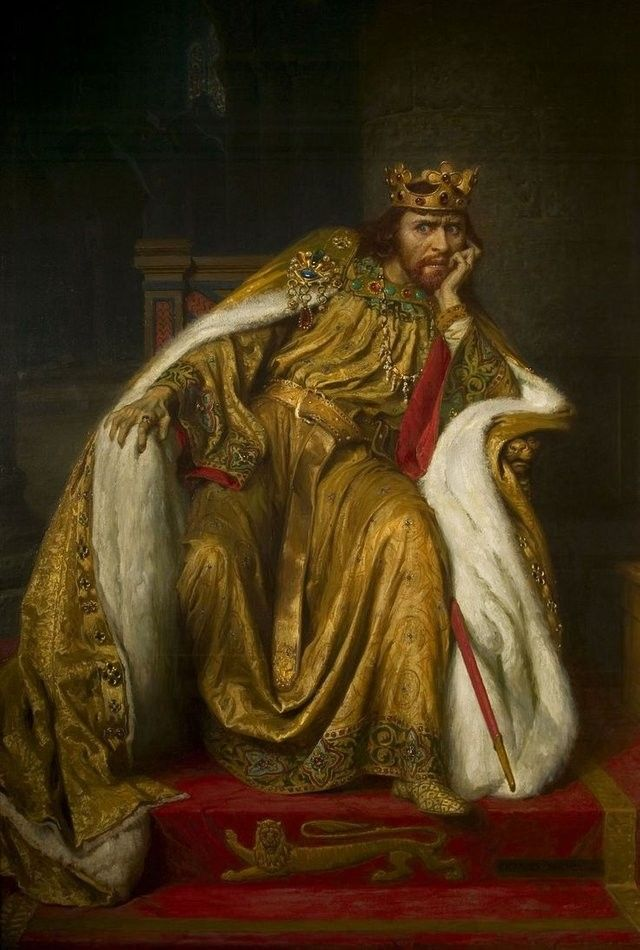

%%  
[[Vihr]]  
[[Rulers of Vihr]]  
[[Viago V]]  
[[Kasimir I]]  
[[Darmil zi Perliav]]  
[[Zuzka]]  
[[Szievek]]  
[[Honoured Assembly]]  
[[Mikael Bivaldi]]  
%%  

  
 <h4 class="wiki-header">Martis III zi Zav</h4>  
 
  
 <strong>Epithet</strong>  
 the Unlucky  
 
  
 
  
 <strong>Occupation</strong>  
 Ras of <a href="Vihr" class="internal-link">Vihr</a>  
 
  
 
  
 <strong>Predecessor</strong>  
 <a href="Viago V" class="internal-link">Viago V</a> "the Merry"  
 
  
 
  
 <strong>Successor</strong>  
 <a href="Kasimir I" class="internal-link">Kasimir I</a> "the Elder"  
 
  
 
  
 <strong>Culture</strong>  
 <a href="Vihri" class="internal-link">Low Vihri</a> <a href="Human" class="internal-link">Human</a>  
 
  
 
  
 <strong>Born</strong>  
 460PA, Zavlech  
 
  
 
  
 <strong>Died</strong>  
 501PA, Zavlech  
 
  
 
  
 <strong>Cause of Death</strong>  
 Red Pestilence, 41 years of age  
 
  
 
  
 
  
 <strong>Spouse</strong>  
 Gras Halina zi Wogrov  
 
  
 
  
 <strong>Issue</strong>  
 Viago, Martis, Zervind, Ludmila  
 
  
 
  
 <strong>Dynasty</strong>  
 zi Zav  

 

 

  

Martis III zi Zav, called the Unlucky, was Ras of <a href="Vihr" class="internal-link">Vihr</a> from 486 to 501PA and the last king of the senior line of the House of Zav. His reign saw the end of the Zuzka, but it is remembered for the Red Pestilence, which took his queen and all four of his heirs, left the Ras himself crippled and mute for the last eleven months of his life, and ended the line of <a href="Viago I" class="internal-link">Viago I</a> after two hundred and sixty years. His refusal to quarantine the south has been held against him ever since, and also, by some, in his favour.
  
<h2>Early Life</h2>  

Martis was born in Zavlech in 460PA, the only legal child of Ras <a href="Viago V" class="internal-link">Viago V</a> "the Merry". He spent much of his youth on the road with his father's caravan court, among singers, poets and the half-brothers and half-sisters whom the realm would come to call the Leafblown, and he grew into a man as grave as his father was merry. He married Halina zi Wogrov of <a href="Rovgi" class="internal-link">Rovgi</a>, and she gave him three sons and a daughter.
  
<h2>Reign</h2>  

Martis came to the throne in 486PA, when the <a href="Zuzka" class="internal-link">Zuzka</a> of the Ogre Mage <a href="Yagund" class="internal-link">Yagund</a> had preyed on the south for nearly seventy years. In 489PA <a href="Darmil zi Perliav" class="internal-link">Darmil of Perliav</a> led the expedition of heroes that slew Yagund in his lair at Horomur, and the Ras received him at Zavlech with great honour. Darmil became one of the most outspoken supporters of the House of Zav.
  

The early years of the reign are, if anything, remembered fondly. Martis raised the great Statue of the Firespear in honour of the founder of his house, <a href="Viago I" class="internal-link">Viago I</a>, and it stands alone on a small island in Lake Zav to this day.
  
<h2>The Red Pestilence</h2>  

In the 480s and 490s the Red Pestilence swept across Ilrakhan, out of Nirydia by way of Azuvke and <a href="Kherova" class="internal-link">Kherova</a>, and in 496PA it reached the cities of southern Vihr. Martis refused at first to quarantine them, holding that it was not the way of the Candleflame to leave the people of southern Vihr to die, and the sickness crept north along the roads and rivers. Many blame that decision for the greater death that followed. Darmil died of the pestilence at Ibozka in 497PA.
  

It came into the royal house as well. Between 496 and 500PA it took Gras Halina zi Wogrov and all four of the king's children, his daughter first and his eldest son, the Kisras Viago, last, and in 500PA it took hold of the Ras himself.
  
<h2>The Eleven Months</h2>  

Martis survived the fever, but not whole. The sickness blackened his tongue, and his physicians cut it out to save his life. For eleven months he lay crippled and bedridden in Zavlech, unable to speak, in a state that was said to be worse than death itself could ever be, while the Foreman of the <a href="Honoured Assembly" class="internal-link">Honoured Assembly</a> and a council of the Var governed in his name. Later historians and poets would say of those months that "at long last the great Zav line could no longer wield its mightiest forces, no tongue to call on its banners, and its knights rotted in their castles."
  

Those months decided the succession. The party of <a href="Szievek" class="internal-link">Szievek</a> pressed the claim of its Var, Kasimir Szinmo, a great-grandson of Jasper III and the nearest of the Zav kin, and the loyalists of the senior line, who had lost Darmil, their loudest voice, could find no one to set against him. A few lords of the south put forward one of the Leafblown, the king's own half-brother Tjerin "the Crownless" Bivaldi, but the Assembly would not hear of a bastard. Tjerin later went south and became a knight at the court of Antigor of Kisnau, fought in his war for Pilvian independence and was granted a keep near Reanport, and his line lives on to this day. The renowned knight <a href="Mikael Bivaldi" class="internal-link">Mikael Bivaldi</a> is among his descendants.
  
<h2>Death and Legacy</h2>  

Martis III died in Zavlech in 501PA at the age of forty-one, and with him the senior line of the House of Zav ended. The crown of Viago I and the Firespear were lost in the confusion that followed, and the Assembly accepted the Var of Szievek as <a href="Kasimir I" class="internal-link">Kasimir I</a>, who was crowned with the new Sapphire Band.
  

His epithet was given to him by a realm that had watched him lose everything, and it has stuck. Some in the north still call his refusal to close the south the folly that killed half the realm, while in the south, and among the more devout, he is remembered as a king who would not abandon his people to save himself, and paid for it with his house.
  
<h2>People of Interest</h2>  

<a href="Viago V" class="internal-link">Viago V</a> "the Merry", father of Martis, Ras of Vihr, 435PA to 486PA Gras Halina zi Wogrov, wife of Martis, 462PA to 497PA Kisras Viago, son of Martis, 481PA to 500PA Kis Martis, son of Martis, 484PA to 498PA Kis Zervind, son of Martis, 487PA to 497PA Kisa Ludmila, daughter of Martis, 489PA to 496PA <a href="Darmil zi Perliav" class="internal-link">Darmil of Perliav</a>, hero and Gri of Perliav, 443PA to 497PA Tjerin "the Crownless" Bivaldi, half-brother of Martis, 478PA to 549PA <a href="Kasimir I" class="internal-link">Kasimir I</a> "the Elder", Var of Szievek and his successor, 462PA to 508PA
  
