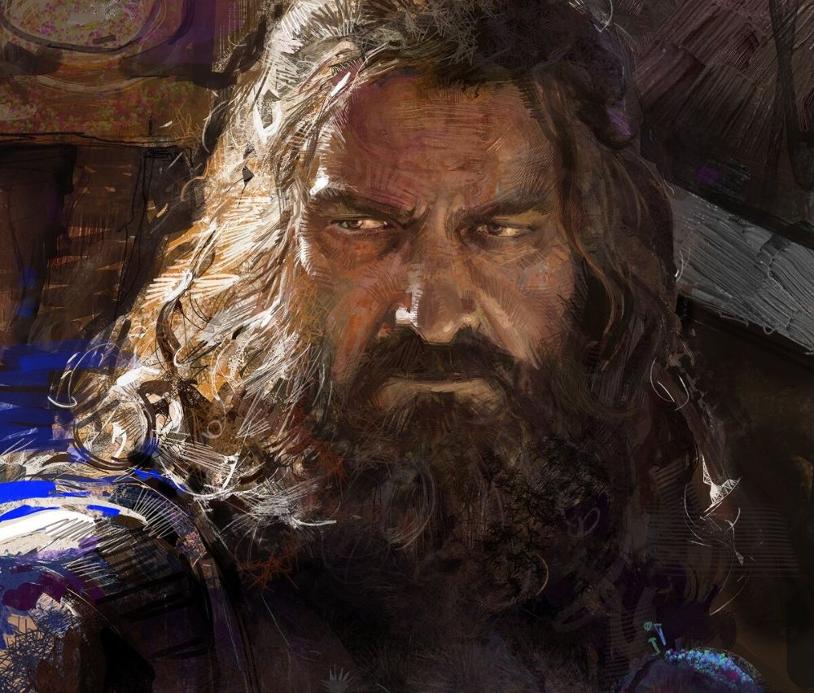

%%  
[[Vihr]]  
[[Rulers of Vihr]]  
[[Wars of Elbae Aggression]]  
[[Second War of Elbae Aggression]]  
[[Third War of Elbae Aggression]]  
[[Levazci]]  
[[Selbia]]  
[[Zavlech]]  
[[Silver Towns of Gleamig]]  
[[Xer-Kol]]  
[[Vormil II]]  
%%  

  
<h4 class="wiki-header">Miskomir IV zi Ralpia</h4>  

  
<strong>Occupation</strong>  
Ras of <a href="Vihr" class="internal-link">Vihr</a>  

  

  
<strong>Predecessor</strong>  
Orian I  

  

  
<strong>Successor</strong>  
Viago VII  

  

  
<strong>Culture</strong>  
<a href="Vihri" class="internal-link">Low Vihri</a> <a href="Human" class="internal-link">Human</a>  

  

  
<strong>Born</strong>  
758PA, Zavlech  

  

  
<strong>Died</strong>  
813PA, Gleamig  

  

  
<strong>Cause of Death</strong>  
Fall from his horse, 55 years of age  

  

  

  
<strong>Spouse</strong>  
Jadwiga of House Tryn  

  

  
<strong>Issue</strong>  
Viago VII, <a href="Vormil II" class="internal-link">Vormil II "Axebreaker"</a>  

  

  
<strong>Dynasty</strong>  
zi Ralpia  

  

 

  

Miskomir IV zi Ralpia was Ras of <a href="Vihr" class="internal-link">Vihr</a> from 786 to 813PA. He came to the throne in the middle of the <a href="Second War of Elbae Aggression" class="internal-link">Second War of Elbae Aggression</a>, a war he had spoken against as Kisras, and he reigned through its defeat and through most of the <a href="Third War of Elbae Aggression" class="internal-link">Third War</a>. He is remembered above all for the wars with the elves, and he is sometimes blamed for the great defeat of the coalition in the Second War, though he had little part in causing it. Less often credited are the sewers and bathhouses he built in the towns of Vihr and the Royal Medicae Academy he founded in 804PA. His reputation has risen a great deal in recent times, and it is sometimes said that had he lived in another age he might have been one of the greatest kings Vihr has had.
  
<h2>Early Life</h2>  

Miskomir was born in Zavlech in 758PA, the son of Orian, the heir of Ras Miskomir III "the Black". He was named after Miskomir II, the first Ras of the House of Ralpia, rather than after his grandfather, and it was taken at the time as a sign of how his father felt about the Black's rule. He was a boy when Miskomir III enacted the <a href="Gethric Pogroms" class="internal-link">Gethric Pogroms</a>, and a young man when the Treeplague came south through Vihr in the 770s, and the dead of the plague years in the crowded towns of the south made a deep impression on him.
  

His father became Ras as Orian I in 778PA, ended the Pogroms in the same year and made Miskomir his Kisras. When Vihr joined the second Reani Coalition against the Sultanate in 781PA, the young Kisras spoke against it openly. The realm, he argued, had barely buried the dead of the plague, and its quarrel with the elves had already cost it the unity of the Church. He was overruled, and Vihr went to war.
  
<h2>Reign</h2>  
<h3>The Second War</h3>  

Orian I died in 786PA, and Miskomir, then twenty-eight, inherited the war he had argued against. It was already going badly. The Kherovan Spellbreakers had left the coalition, the Sultanate fought on two fronts of its own choosing, and the Vihri Gri Waskor zi Treblin, the most famous commander of the coalition, died before the fortifications of Horad. In 790PA the Princedom of <a href="Hainach" class="internal-link">Hainach</a> fell and was made an Eyalet of the Sultanate. Miskomir was cautious and had no gift for war, but he did not abandon his allies, and he held Vihr to the coalition until the end. Later writers who wanted someone to blame for the defeat often chose the king who had reigned through it, and the charge stayed with him for a long time, though most historians now hold that the war was lost before he came to the throne.
  
<h3>Sewers, Bathhouses and the Medicae</h3>  

Miskomir's true interest lay at home. He spent the crown's money on works that would outlast him: sewers beneath the streets of Zavlech and of a dozen lesser towns, public bathhouses, wells and drains, often in the face of lords who saw no glory in them. He went on paying for them even in the years of war, which was held against him at the time and has been counted in his favour since.
  

In 804PA he founded the Royal Medicae Academy at <a href="Zavlech" class="internal-link">Zavlech</a>, known simply as the Medicae. It was meant to bring the medicine of Vihr up to the standard of the west, above all of the Cevoli physicians who had followed Artor Perisco, whose "De corporis divinitas" of 771PA had changed the study of anatomy, and the king invited physicians from <a href="Cevolia" class="internal-link">Cevolia</a> to teach there. The clergy did not always welcome the new learning, but the Medicae survived its founder, and its physicians have attended the court ever since.
  
<h3>Marriage and the House of Tryn</h3>  

Miskomir married Jadwiga of House Tryn, a family of loyal knights of <a href="Levazci" class="internal-link">Levazci</a>. When House zi Kerv died out in 802PA, the crown raised House Tryn to the Vadcy in its place. It was understood at the time that the favour of the queen's husband counted for as much as the service of her house, and Tryn has not forgotten whom it owes its place to. Jadwiga gave the king two sons who would both reign after him, Viago and Vormil.
  
<h3>The Third War</h3>  

When the third Reani Coalition was formed in 805PA, Miskomir again preferred peace, and again he led Vihr into the war once it came. His most important decision was the choice of its commander. Passing over lords of higher rank, he put forward Rezvyr zi Sribo, the Var of <a href="Selbia" class="internal-link">Selbia</a>, who became the supreme commander of the coalition and proved the finest commander of all three wars. Miskomir did not live to see the end of the war.
  
<h2>Death</h2>  

In 813PA Miskomir travelled to the dwarven hold of <a href="Xer-Kol" class="internal-link">Xer-Kol</a> on a diplomatic visit. On the way home he toured the towns and valleys of <a href="Silver Towns of Gleamig" class="internal-link">Gleamig</a>, and as his entourage passed through a small wood in the uplands, it disturbed a flock of cockatrices, which fell upon the company. None of the beasts harmed the king himself, but they attacked his horse, and when the fighting was over Miskomir was found lying beside it, dead of a broken neck. He was fifty-five. His eldest son succeeded him as Viago VII.
  
<h2>Legacy</h2>  

For generations Miskomir IV was remembered as the king of the lost Second War and little more. His standing has changed in recent times, as historians and the scholars of the universities, who admire him above all, have looked past the wars to the sewers, the bathhouses and the Medicae, and to a king who argued for peace and then did his best with the war he was given. It is often said of him that in a different time he could well have been one of the greatest Ras that Vihr has ever seen.
  
