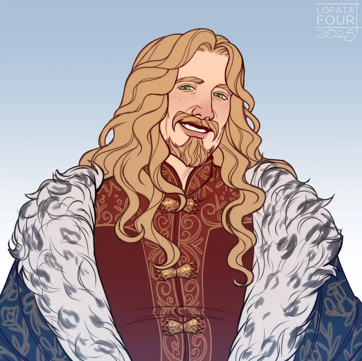

%%  
[[Vihr]]  
[[Rulers of Vihr]]  
[[Zuzka]]  
[[Opuzna]]  
[[Kherova]]  
[[Holbrind]]  
[[Breza]]  
%%  

  
 <h4 class="wiki-header">Viago V zi Zav</h4>  
 
  
 <strong>Epithet</strong>  
 the Merry  
 
  
 
  
 <strong>Occupation</strong>  
 Ras of <a href="Vihr" class="internal-link">Vihr</a>  
 
  
 
  
 <strong>Predecessor</strong>  
 Martis II  
 
  
 
  
 <strong>Successor</strong>  
 Martis III "the Unlucky"  
 
  
 
  
 <strong>Culture</strong>  
 <a href="Vihri" class="internal-link">Low Vihri</a> <a href="Human" class="internal-link">Human</a>  
 
  
 
  
 <strong>Born</strong>  
 435PA, Zavlech  
 
  
 
  
 <strong>Died</strong>  
 486PA, Zavlech  
 
  
 
  
 <strong>Cause of Death</strong>  
 Natural causes, 51 years of age  
 
  
 
  
 
  
 <strong>Issue</strong>  
 Martis III, the Leafblown (rumoured)  
 
  
 
  
 <strong>Dynasty</strong>  
 zi Zav  

 

  
 

  

Viago V zi Zav, called the Merry, was Ras of <a href="Vihr" class="internal-link">Vihr</a> from 456 to 486PA. He was a singer, poet and dancer who came to the throne when his elder brother fell against the Zuzka, and he ruled for thirty years from the road rather than from Zavlech. He is remembered as one of the most colourful kings of the House of Zav, for his bastards, the Leafblown, for the ring that let him float above the earth, and for letting the councils that split the Church meet on his soil.
  
<h2>The Merry Prince</h2>  

Viago was born in 435PA, the younger son of Ras Martis I and the grandson of Jasper III. Even as a Kis he was known as a living man, a singer and a poet, a lavish dancer and a well endowed friend to the fairer sex. In 456PA his elder brother, Ras Martis II, was killed fighting the <a href="Zuzka" class="internal-link">Zuzka</a> in the southern marches, and Viago came to the throne.
  
<h2>The Caravan Court</h2>  

In his early years Viago rarely stayed at Zavlech. Like many rulers of his time he travelled his lands in long caravans, holding court wherever he stopped. He fathered only one legal child, the later Martis III, but he is rumoured to have fathered at least a dozen bastards across the realm, who are known colloquially as the Leafblown, and more than one family of the Expanse and the river towns has claimed descent from them. The best known of them was Tjerin "the Crownless" Bivaldi, whom a few southern lords put forward for the crown in 501PA. Refused by the Honoured Assembly, he went south and became a knight at the court of Antigor of Kisnau, fought in his war for Pilvian independence and was granted a keep near Reanport, where his line lives on to this day; the renowned knight <a href="Mikael Bivaldi" class="internal-link">Mikael Bivaldi</a> is among his descendants. It was he who first sponsored the royal prize at the Poets Fest of Tienov, in <a href="Breza" class="internal-link">Breza</a>, which the crown has awarded ever since.
  
<h2>The Councils</h2>  

Two of the great councils of the Church met in his realm. In 458PA Archbishop Adzul of Kherova convened the First Council of <a href="Opuzna" class="internal-link">Opuzna</a>, which wrote the Doctrine of Dualism, and in 471PA the Second Council of Volazc, in Opuzna's southern marches, issued the Kethric Declaration that separated <a href="Kherova" class="internal-link">Kherova</a> from Iztaw. Viago let both councils meet, and refused the demand of High-Bisop Taromir I to break them up. Iztaw never forgave him for it.
  
<h2>The South</h2>  

The Zuzka of the Ogre Mage <a href="Yagund" class="internal-link">Yagund</a> roamed the south for most of his reign. The lords of the south remembered that one Ras had died fighting them while the next one danced, and the merry court did little to change their minds. The menace was only ended in 489PA, three years after his death, by <a href="Darmil zi Perliav" class="internal-link">Darmil of Perliav</a>.
  
<h2>Later Years</h2>  

In later life Viago gained much weight, and he amassed great wealth. The Great Mage <a href="Holbrind" class="internal-link">Holbrind</a> crafted a ring of power for him that allowed him to levitate ever so slightly above the earth, and the sight of the heavy king floating a finger's breadth above the floor of his hall was long remembered. He died in Zavlech in 486PA, and his only legitimate son succeeded him as Martis III "the Unlucky".
  
<h2>People of Interest</h2>  

Martis II, elder brother of Viago, Ras of Vihr, 433PA to 456PA Martis III "the Unlucky", son of Viago, Ras of Vihr, 460PA to 501PA Tjerin "the Crownless" Bivaldi, son of Viago, 478PA to 549PA <a href="Holbrind" class="internal-link">Holbrind</a>, Great Mage Taromir I, High-Bisop of Iztaw, 421PA to 484PA
  
