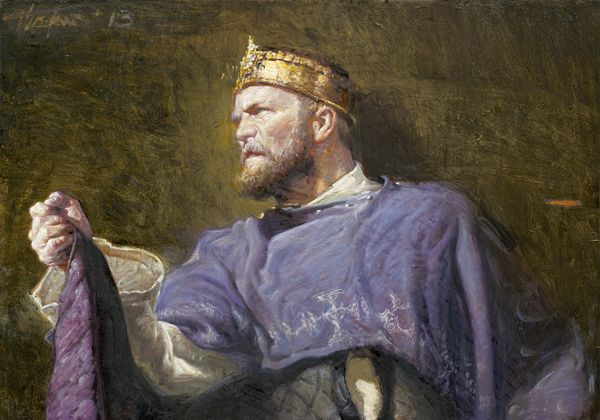

%%   
[[Vihr]]   
[[Rulers of Vihr]]   
[[Trazlova]]   
[[Trazlov Consortium]]   
[[Melmer]]   
[[Uhl]]   
[[Honoured Assembly]]   
[[Szievek]]   
[[Torry]]   
[[Owlbear]]   
%%   

   
<h4 class="wiki-header">Vormil I zi Ralpia</h4>   

   
<strong>Epithet</strong>   
Seaborn   

   

   
<strong>Occupation</strong>   
Ras of <a href="Vihr" class="internal-link">Vihr</a>   

   

   
<strong>Predecessor</strong>   
Miskomir II   

   

   
<strong>Successor</strong>   
Jerziv I   

   

   
<strong>Culture</strong>   
<a href="Vihri" class="internal-link">Low Vihri</a> <a href="Human" class="internal-link">Human</a>   

   

   
<strong>Born</strong>   
678PA, Trazlov Bay   

   

   
<strong>Died</strong>   
742PA, the royal woods   

   

   
<strong>Cause of Death</strong>   
Killed by an owlbear, 64 years of age   

   

   

   
<strong>Spouse</strong>   
Lotta von Mussling "the Fair"   

   

   
<strong>Issue</strong>   
Seven, among them Jerziv I, Jasper IV and Nidislaw the Keen   

   

   
<strong>Dynasty</strong>   
zi Ralpia   

  
 
  
    

   

Vormil I zi Ralpia, called Seaborn, was Ras of <a href="Vihr" class="internal-link">Vihr</a> from 713 to 742PA and the second king of the House of Ralpia. Born at sea and raised in the harbour of Trazlov, he was the most seafaring of all the kings of Vihr, and it was said of him that "The Ras of Vihr ruled more from the deck of his ships than from the throne of Zavlech", a remark he would not have minded. In his reign the Table of Trazlov became the <a href="Trazlov Consortium" class="internal-link">Trazlov Consortium</a>, the White Fleet was built and the pirate called the Dead Shark was broken, and the city of <a href="Uhl" class="internal-link">Uhl</a> came under the protection of Vihr. He kept the peace at home through nearly thirty years of growth before the great wars of the 8th century, and he is remembered as one of the most beloved kings the realm has had.
   
<h2>Early Life</h2>   

Vormil was born in 678PA on a Trazlov cog in a storm on Trazlov Bay, while his father Miskomir, who would later be Ras Miskomir II, was the Var of <a href="Trazlova" class="internal-link">Trazlova</a>. The manner of his birth gave him his name, and the sea never let go of him. He grew up in the harbour of Trazlov among shipwrights, factors and captains rather than at court, and he learned to sail before he learned to ride. He became an expert sailor and a lifelong devotee of Saint <a href="Melmer" class="internal-link">Melmer</a>, the Wave-Kissed, whose voyages he knew by heart.
   

In 692PA the <a href="Honoured Assembly" class="internal-link">Honoured Assembly</a> and the Gethric Bishops elected his father Ras, and the fourteen year old Vormil became the heir to the throne of Vihr and Wermia.
   
<h2>Marriage</h2>   

In 695PA the ruler of Uhl held a feast on the island of Valenisle in the Bay of Uhl to celebrate his own marriage, and Vormil, then seventeen, was among the guests. There he met Lotta von Mussling, the daughter of Graf Wilhelm von Mussling, a girl of his own age already known as Lotta the Fair for her remarkable beauty, and the two are said to have fallen in love at first sight. By all accounts the match was far below the station of the heir of Vihr. Vormil gave the Graf a necklace of white gold and silver, and the pair were married in Vihr only a year later, in 696PA.
   

The marriage was a happy one and gave them seven children. Two of them would sit the throne after their father, their second child Jerziv and their son Jasper, and their youngest son, Nidislaw, became one of the most learned men of his age.
   
<h2>Reign</h2>   

Vormil succeeded his father in 713PA, at the age of thirty-five. He was a strong king and a popular one, and he spent as much of his reign aboard his ships as he did in Zavlech, to the despair of his councillors and the delight of the common folk.
   
<h3>The Twentieth Seat</h3>   

When Miskomir II came to the throne he brought with him the twentieth seat at the Table of Trazlov, the council of the nineteen richest merchants of Trazlov, which gave its holder a share of five parts in a hundred of all their profits. The Ralpia kept it as a personal holding even after the Vadcy of Trazlova passed to a cadet line of the house around 710PA. The crown, however, owed the Table a great deal, for Miskomir had borrowed heavily from its merchants to win the Assembly in 692PA and to hold his claim to Wermia.
   

In 716PA Vormil renounced the seat. For an exorbitant sum and the cancellation of all the personal debts of the crown to the Table, he gave it up and granted the Table special rights and freedoms that hold even before the laws of the local Vadcy, one of the first grants of the crown ever to reach across the borders of the Vadcy. In 717PA the Table took the name of the Trazlov Consortium. The Honoured Assembly received the grant with mixed feelings. The royalist lords disliked it, since the ties between Trazlova and the crown were the backbone of their party, but their opponents largely welcomed it as a further separation between the new dynasty on the throne and its Lawchlaw cousins in Trazlova.
   
<h3>The White Fleet and the Dead Shark</h3>   

Vormil spent the money on the sea. He built the White Fleet in the yards of Trazlov and gave it a harbour at Sniezo, on the western shore of the Iron Claw facing Trazlov Bay. Its first task was the Dead Shark, a Bykmåli captain, most likely of <a href="Juelfluk" class="internal-link">Juelfluk</a>, who had gathered a ragtag fleet and held the island of Iffelin, called the White Finger. For nearly forty years she had terrorised the islands between the Malksbay, Trazlov Bay and the White Bay, and in 715PA she had infamously sacked the Grachi port of Durilsk. The White Fleet hunted her down and broke her fleet.
   
<h3>The Speculum Regni</h3>   

In 724PA Vormil and the High-Bisop jointly commissioned <a href="Radosław of Szievek" class="internal-link">Radosław of Szievek</a>, the Bishop of Szievek, to compile the laws of the realm, so that the crown, the Church and the lords would at last have their laws written down side by side. Radosław convened congregations in every Vadcy at which the lords declared their own custom, and in 741PA, a year before the king's death, he completed the <a href="Speculum Regni" class="internal-link">Speculum Regni</a>, the Mirror of the Realm.
   
<h3>The Procession of the Kar-Zavr</h3>

Nearly two centuries after the <a href="Wermian Accords" class="internal-link">Wermian Accords</a>, the mages of Vihr were still mistrusted by the common folk and by much of the clergy. Between 731 and 737PA Vormil ordered his Kar-Zavr to assemble a great procession of the most talented mages of the realm and to travel the lands of Vihr, accompanied by ministers from <a href="Iztaw" class="internal-link">Iztaw</a>, offering the services of the arcane to any community that needed them. The procession greatly improved the opinion of the common folk of the mages, and the opinion of many mages of the crown and the Church, in a world still shaped by the Accords, and it is often considered a stroke of genius on the part of the Ras, which kept the Church and the arcane in Vihr from drifting further apart.
   
<h3>Uhl</h3>   

In 735PA Kaspar von Kran of <a href="Lesmere" class="internal-link">Lesmere</a> gathered his troops to march east against Uhl, and the Count of Uhl accepted the protection of Vihr. Vormil led the White Fleet into the Bay of Uhl himself, to the dismay of his advisors, and the von Kran turned back. Uhl remained a Vihri protectorate for more than a century, until the <a href="War of Horn and Fang" class="internal-link">War of Horn and Fang</a>, though the heavy tolls and obligations that Vihr laid on the city were remembered there less fondly than the king who had sailed to its rescue.
   
<h2>The Crowns</h2>   

Vormil had two new crowns forged beside the crowns that the kings of Vihr already had. The first was the Crown of Ralpia, made to honour the wishes of his father, which Vormil himself never wore. The second was the Saltcrown, which he wore so often aboard his ships that it took its name from the sea, and in which he is shown in his portrait.
   
<h2>Death and Succession</h2>   

In 742PA, at the age of sixty-four, Vormil was hunting in the royal woods when his party came upon an <a href="Owlbear" class="internal-link">owlbear</a>. The old king fell to the beast, but as it collapsed over him he drove his spear into its gut, and the hunters found them dead together.
   

He was succeeded by his son Jerziv I, who reigned for only three years. In 745PA a figure known as the Child of Winds gathered the Hyllmen around Borna, a town near the Grachhyll in <a href="Szievek" class="internal-link">Szievek</a>, slaughtered the Gri of Borna and crowned himself Ras of the Hyll. Jerziv besieged the town and was killed there by a chance crossbow bolt, and the crown passed to his brother, Jasper IV.
   
<h2>Legacy</h2>   

Vormil is remembered extremely fondly in Vihr, as a strong man and a strong ruler, the king who married for love and sailed his own ships. His reign came before the <a href="Wars of Elbae Aggression" class="internal-link">Wars of Elbae Aggression</a> and the Pogroms, and the Vihri remember it as a time of peace at home and of great growth, when the Consortium spread across the eastern Torn Sea and the common folk loved their king. The White Fleet, which has lain at Torring since the Council of 870, the Consortium and the Saltcrown are his most visible legacies.
   

His youngest son, Nidislaw, became a cleric and a renowned educator at Szievek, a student of Radosław, and argued against the pogroms against the elves in the years of the wars. As Nidislaw the Keen he wrote numerous works on the nature of plants, trees and crops, gathered as the Encyclopedia Nidisnatura.
   
<h2>People of Interest</h2>   

Miskomir II, father of Vormil, Var of Trazlova and Ras of Vihr, 692PA to 713PA Lotta von Mussling "the Fair", wife of Vormil Jerziv I, son of Vormil, Ras of Vihr, 742PA to 745PA Jasper IV, son of Vormil, Ras of Vihr, 745PA to 753PA Nidislaw the Keen, youngest son of Vormil, author of the Encyclopedia Nidisnatura

