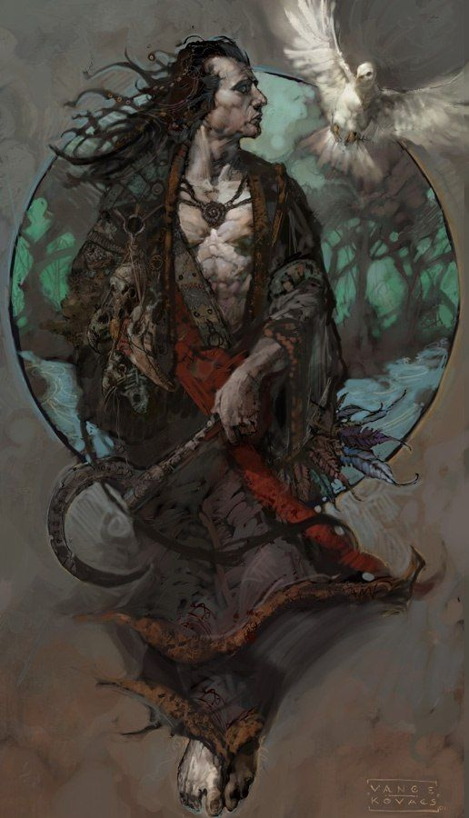

%%
[[Kheri]]
[[Rox]]
[[Revolution of Rox]]
[[Javalim]]
%%

    <h4 class="wiki-header">Fenhir Mahr</h4>
    

        <strong>Faith</strong>
        <a href="Javalim" class="internal-link">Javalim</a>
    

    

        <strong>Occupation</strong>
        Great Seer of the Javalim
    

    

        <strong>Culture</strong>
        <a href="Kheri" class="internal-link">Roxanae</a> <a href="Human" class="internal-link">Human</a>
    

    

        <strong>Born</strong>
        530PA, Sincali Moors
	    

    

        <strong>Died</strong>
        614PA, Bakalas
    

    

        <strong>Cause of Death</strong>
        natural Causes  84 years of age
    

    
    

    

        <strong>Allegiance</strong>
        <a href="Javalim" class="internal-link">The Javalim</a>, <a href="Roxeria" class="internal-link">Chosen Realm of Roxeria</a>
    

    
    

	 

Fenhir Mahr, called Fenhir the Seer, was the prophet whose words founded the modern <a href="Javalim" class="internal-link">Javalim</a>, and the elder brother of <a href="Rox" class="internal-link">Rox</a>, with whom he led the <a href="Revolution of Rox" class="internal-link">Revolution of Rox</a> against the <a href="Azuvke" class="internal-link">Khatrym of Azuvke</a>. Born in the Sincali Moors in 530PA, he became the Prophet of the Javalim in 558PA and served as Great Seer of <a href="Roxeria" class="internal-link">Roxeria</a> until his death in Bakalas in 614PA. He is venerated alongside his sister as one of the two founders of the realm, and the two are remembered together in the Siblings Tomb near Bakalas.

<h2>Early Life</h2>

Fenhir was raised among the keepers of the old faith of the One in the Sincali Moors, a tradition of shamans and druids that had guarded the Pillar on Mount Javal and the Tears on Tazil for thousands of years and had long been persecuted by the <a href="Kethricism" class="internal-link">kethric</a> priesthood. From his youth he was known as a seer, and the Javalim hold that the One showed him the future as it had once seen it itself.

In the 550s Fenhir began to preach in the eastern cities of Azuvke, at a time when plague, the loss of the Ganoa Valley and the rise of the Luchun Khaganate had left them neglected by their overlords. He taught that the One had foreseen a chosen people on the eastern shore, charged with safeguarding its holy places, and that it would give them a hero from his own blood. In 558PA he was proclaimed the Prophet of the Javalim, and his words drew both the keepers of the old faith and many kethric townsfolk to the One. In 560PA the kethric authorities of Bakalas condemned him to burn, and his rescue from the pyre by Rox began the revolution.

After the founding of Roxeria in 564PA Fenhir served as Great Seer of the Javalim at his sister's side, and his prophecies, gathered by his followers, became the core of the Scriptures of Javal. After Rox stepped into the Pillar of the One in 600PA he proclaimed the principality the Chosen Realm of Roxeria and her heirs the house chosen by the One, giving the realm the form of divine monarchy it keeps today. He outlived his sister by fourteen years and died in Bakalas in 614PA, at the age of eighty-four.

<h2>Legacy</h2>

The oldest accounts of Fenhir describe powers more often associated with druidism than with prophecy, drawn from the old faith of the moors in which he was raised. Later folklore and the retellings of the Javalim have largely erased this side of him, and portray him instead in a clean and divine light, as a seer whose gifts came from the One alone. In modern Roxeria he is remembered almost entirely as the Prophet, and the druidic Fenhir survives mainly in older texts and in the stories of the moors.
