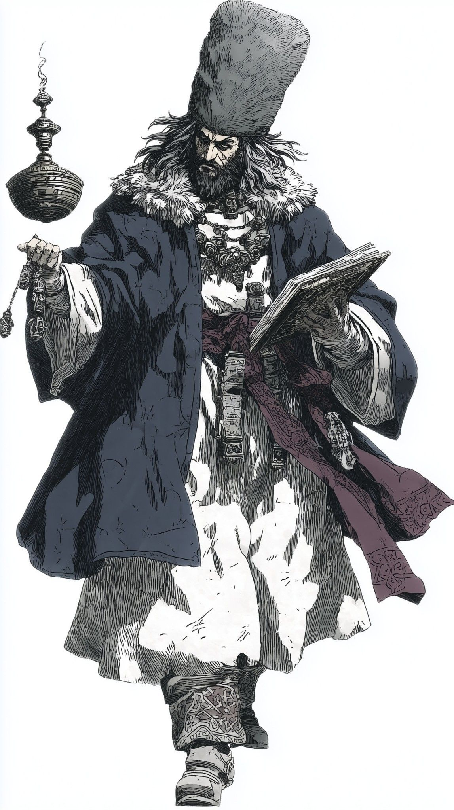

%%
[[Gethricism]]
[[Vihri]]
[[Beryl Lenkov]]
[[Kortyr]]
%%

    <h4 class="wiki-header">Leonyd Krunliv</h4>
    

        <strong>Faith</strong>
        <a href="Gethricism" class="internal-link">High-Gethricism</a>
    

    

        <strong>Epithet</strong>
        Oracle of the Pale
    

    

        <strong>Occupation</strong>
        Gethric Father
    

    

        <strong>Culture</strong>
        <a href="Vihri" class="internal-link">Grachi</a> <a href="Human" class="internal-link">Human</a>
    

    

        <strong>Born</strong>
        879PA, Churovsky
	    

    

        <strong>Died</strong>
        927PA, Lenkov Estate
    

    

        <strong>Cause of Death</strong>
        mauled to Death by Havu  48 years of age
    

    

        <strong>Allegiance</strong>
        <a href="Church of Iztaw" class="internal-link">Gethric Church of Iztaw</a>,  The Ulyanov Family
    

    

	 

Leonyd Krunliv was a Father within the Gethric Church of Grachy, with unknown clerical career except that he was once Father at Soludha Abbey but has since relinquished the post. Krunliv was part of <a href="Beryl Lenkov" class="internal-link">Boyar Beryl Lenkovs</a> Hunting Party in May of 927PA during which the latter tragically passed away, but had worked longer as the spiritual guide for the Ulyanov Family, first Boyar Andre Ulyanov and then later after his death his daughter Katerina Ulyanov. He was instrumental in the Ulyanovs desire to achieve immortality, wich they pursued relentlessly together with the Gri of Perliav, Moreslav zi Perliav, and became known as the Oracle of the Pale, for his studies into the legend of <a href="Kortyr" class="internal-link">Kortyr Paleblood</a>, around which legend the Ulyanovs and Perliavs wrought their design.

