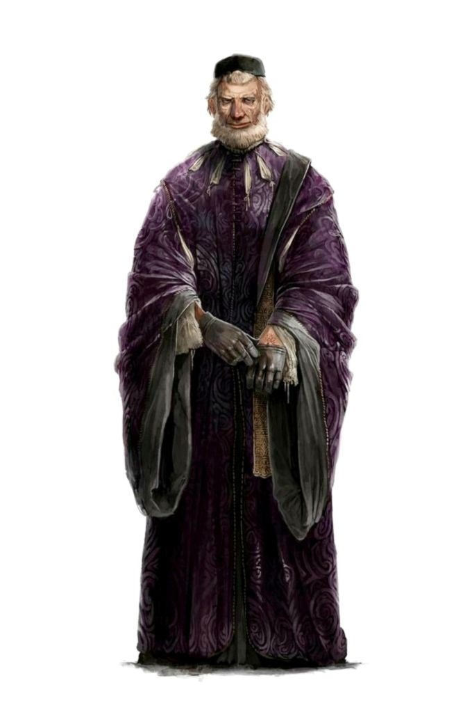

%%  
[[Church of Iztaw]]  
[[Iztaw]]  
[[Gethricism]]  
[[Vihr]]  
[[Rovgi]]  
[[Honoured Assembly]]  
[[Kabernos]]  
[[Wermian Accords]]  
[[Garmish Succession Crisis]]  
[[Tadeuz Pilsud]]  
[[Order of the Silver Wheel]]  
[[Nestor IX]]  
%%  

  
<h4 class="wiki-header">Orthel II</h4>  

  
<strong>Occupation</strong>  
High-Bisop of <a href="Iztaw" class="internal-link">Iztaw</a>, Head of the <a href="Church of Iztaw" class="internal-link">Church of Iztaw</a>  

  

  
<strong>Predecessor</strong>  
Eskomir I "the Kind"  

  

  
<strong>Faith</strong>  
<a href="Gethricism" class="internal-link">High Gethricism</a>  

  

  
<strong>Culture</strong>  
<a href="Vihri" class="internal-link">High Vihri</a> Human  

  

  
<strong>Born</strong>  
861PA, Wogrov  

  

  
<strong>Age</strong>  
66  

  

  

  
<strong>House</strong>  
Wogrov  

  

  
<strong>Elected</strong>  
915PA  

  

  
<strong>Works</strong>  
Periculum Gladii Incantati  

  

  
<strong>Allegiance</strong>  
<a href="Church of Iztaw" class="internal-link">Church of Iztaw</a>  

  

  
  

  

Orthel II is the High-Bisop of <a href="Iztaw" class="internal-link">Iztaw</a> and the head of the <a href="Church of Iztaw" class="internal-link">Church of Iztaw</a>, the highest office of <a href="Gethricism" class="internal-link">High Gethricism</a>, which he has held since his election in 915PA. A younger son of House Wogrov of <a href="Rovgi" class="internal-link">Rovgi</a>, he rose through the Church as a lawyer of the clerical courts, a famed healer of curses in his youth, Vicar at Zavlech and Archbishop of Vihr, and he was chosen as a man of compromise in a divided conclave. His reign has seen the trial of <a href="Kabernos" class="internal-link">Vinfried Kabernos</a>, the Bull of the Righteous Fire and the <a href="Garmish Succession Crisis" class="internal-link">Garmish Succession Crisis</a>. He is held to be a careful and even timid man who has never been caught on the wrong side of a question, and who dares not oppose <a href="Vormil III" class="internal-link">Vormil III</a> in the open. Some at court suspect that the timidity is a mask.
  
<h2>Early Life</h2>  

Orthel was born in 861PA at Wogrov, the castle town of House Wogrov in the Oathhills, a younger son of a cadet line of the house. He is a cousin of Zeslav, the present Var, and of the late Gras Maroza, and so a kinsman of the Kisras <a href="Waśko Ralpia" class="internal-link">Waśko</a> and of the Kis <a href="Jakub Ralpia" class="internal-link">Jakub</a>. As a younger son of the most devout Vadcy of the realm, he was given to the Church as a boy, made the Uwazna to Iztaw and was ordained there.
  
<h2>Minister and Healer</h2>  

As a Minister in his twenties and early thirties, Orthel practised in the clerical courts, where he made his name as a lawyer of the canon and of the Institutiones of the <a href="White Book" class="internal-link">White Book</a>. In the same years he won a reputation of another kind, for his cleansing blessings. He was known as a great healer of curses and banes, and the afflicted of the Oathhills and the Tryd country were brought to him from far away. Those who knew him then speak of a man of real divine gift, and it is the side of him that is least remembered today.
  

He was later called to <a href="Zavlech" class="internal-link">Zavlech</a> as its Vicar, where he served the faithful of the capital and came to know the court, the councillors of the crown and the Var of the <a href="Honoured Assembly" class="internal-link">Honoured Assembly</a> at close quarters.
  
<h2>Archbishop of Vihr</h2>  

In 906PA, at the age of forty-five, Orthel was made Bishop of Wogrov and so, by tradition, Archbishop of Vihr. As Archbishop he wrote the treatise for which he is best known among scholars, the "Periculum Gladii Incantati". In it he warned of the spread of enchanted weapons and of artifacts crafted for war, whose powers, he argued, often exceed the skill of those who wield them, and he called for their stricter regulation. The treatise drew on the curses he had healed in his youth, and it is still read by the clergy and by those who argue over the limits of the <a href="Wermian Accords" class="internal-link">Wermian Accords</a>.
  
<h2>Election</h2>  

His predecessor, Eskomir I, called the Kind, was one of only two High-Bisops of <a href="Bykmali Paganism" class="internal-link">Bykmali</a> descent. When he died in 915PA, the conclave that followed was long and bitterly divided between the bishops of Vihr and the Archbishops of the lands abroad, Ur, Grachy and Trykkerog among them. Orthel was elected relatively quickly after his elevation to Archbishop, as a cautious candidate whom each side could accept, and whom many expected to reign only briefly. He took the name of Orthel I, a High-Bisop remembered as a conciliator between the quarrelling churches of his day, and his choice was read as a promise of the same.
  
<h2>High-Bisop</h2>  
<h3>The Kabernos Letter</h3>  

The first great test of his reign came within months of his election. The Luminist mage <a href="Kabernos" class="internal-link">Vinfried Kabernos</a>, the former Courtmage of Gisvale, had been arrested at <a href="Gelmsburg" class="internal-link">Gelmsburg</a> in 913PA by the <a href="Order of the Silver Wheel" class="internal-link">Knights of the Silver Wheel</a> on charges of treason against the Wermian Accords, and his trial was to open in 915PA. Orthel wrote a letter of penitence to the Bishop of Ur, and it was read aloud at the proceedings. To the surprise of many it spoke of the virtues of the great magi of the past. It ended, however, with a scolding remark, and it gave the pursuit of arcane power the same standing as that of the alchemists or of the doctores of the Medicae: a pursuit that can achieve the best for everyone only with great care and under the supervision of those who have seen the horrors of its failures. It closed by underlining once more the importance of the Accords. The trial was delayed indefinitely, and Kabernos remains a prisoner in the <a href="Brass Spire" class="internal-link">Brass Spire</a>. The letter is still quoted by both sides, which is perhaps what it was written for.
  
<h3>The Bull of the Righteous Fire</h3>  

In 925PA the Church of Iztaw issued the Bull of the Righteous Fire, which proclaimed the use of firearms in the cause of the Candleflame just and right. The Bull was pressed for by the Archbishop of Ur and by the merchants of the <a href="Trazlov Consortium" class="internal-link">Trazlov Consortium</a>, who carry much of the powder of <a href="Xer-Kol" class="internal-link">Xer-Kol</a>, and Orthel signed it only after a year of delay. <a href="The Alchemists Guild" class="internal-link">The Alchemists Guild</a> had hoped for the opposite, a holy ban, since it fears that black powder will hasten the breaking of the monopoly it has long held. Many were surprised by the decision of Iztaw, but it has caused no great fallout within the politics of the clergy.
  
<h3>The Garmish War</h3>  

In the <a href="Garmish Succession Crisis" class="internal-link">Garmish Succession Crisis</a> Orthel has given his blessing to the knights who march to <a href="Garmeley" class="internal-link">Garmeley</a> in support of the northern, Gethric side, and he condemned the treatment of the Gethric clergy at <a href="Sunminster" class="internal-link">Sunminster</a> after the sack of 924PA, when its Bishop was taken hostage and its cathedral looted. He has said nothing against Vormil III, who has refused to support the war, but the Church in effect favours the north, and through it the cause of the Kis Jakub, his kinsman.
  
<h3>Court and Crown</h3>  

As High-Bisop Orthel is both the spiritual leader of the Ras and formally his subject, and he sits in the Honoured Assembly or sends the Archbishop of Vihr in his place. He is widely held to be too afraid of Vormil III to oppose him in the open. His dealings with his young kinsman Waśko are polite and cold. He has spoken several times of the virtue of the common man, by which he means those not of noble blood who rise high in the service of the realm, but he has warned in the same breath of pride, and pointed to the tales of the Pandecta of the White Book, such as Insimir's Doubt, as examples of pride and self-love. These sermons have at times been read as aimed at the Sekretar <a href="Tadeuz Pilsud" class="internal-link">Tadeuz Pilsud</a>, the only man not of noble blood in the Assembly, although both men are far too clever to say anything of the kind in the open.
  
<h3>Faith and Learning</h3>  

Orthel has met the challenges of <a href="Viccolo di Pora" class="internal-link">Viccolo di Pora</a>, the Luminists and <a href="Diarism" class="internal-link">Diarism</a> with letters from the pulpit rather than with pyres, to the resentment of the hardliners of the Church, who think him too soft on heresy. In his years as High-Bisop he has not been known for miracles. The healer of his youth has become a man of the pen rather than of the flame.
  
<h2>Character</h2>  

Orthel is a careful administrator and a lawyer of the canon rather than a firebrand. He has survived the factions of the Church and the court by never being caught on the wrong side of any question, and by letting others speak first. Those who think little of him call him afraid. Others suspect that the fear is a mask, and that the man who was raised among the stubborn hill folk of Rovgi, and who knows the law of the Church better than anyone living, is a good deal more resolute than he lets the court believe.
  
<h2>Succession</h2>  

Orthel is in his late sixties, and his health is watched closely in Iztaw and Zavlech alike, though it is in less decline than he might want people to think. Four candidates are spoken of to succeed him. <a href="Nestor IX" class="internal-link">Nestor of Niedrest</a>, a man of immense gravity and universal respect, is no real candidate, because of his great age and still more because of his own dislike of the politics of the Church. Bereslaw of <a href="Szievek" class="internal-link">Szievek</a> is a young and progressive candidate of the modern wing of the clergy, a member of the One Way, a small movement which seeks to mend the Great Schism and finds adherents among Gethricists, Trinicists and even Kethricists, above all in the lands of Ur. To many he is too close to the Trinicists. Nadjek of Wiltov, Bishop of Wogrov and Archbishop of Vihr, the see that Orthel once held, is the clear favourite of the hardliners, a man of immense divine power with close ties to the Order of the Silver Wheel, and he represents a large and old traditionalist faction. Erik of Sallesand, a moderate of less extreme views than Bereslaw or Nadjek and another candidate of Bykmali descent, has some support in the politics of the Church, but less than either of the others. In a realm that its own people call a powderkeg, few doubt that the next conclave will matter in Zavlech as much as in Iztaw.
  
