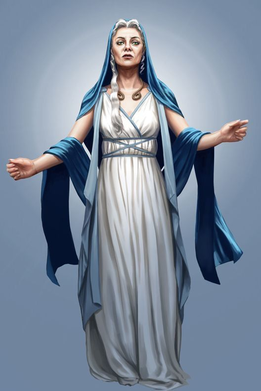

%%  
[[Kethricism]]  
[[Kheri]]  
[[Azuvke]]  
[[Jink]]  
[[Majir]]  
[[Mystics Guild]]  
%%  

  
 <h4 class="wiki-header">The White Sister</h4>  
 
  
 <strong>Faith</strong>  
 <a href="Kethricism" class="internal-link">Kethricism</a>  
 
  
 
  
 <strong>Occupation</strong>  
 Missionary  
 
  
 
  
 <strong>Culture</strong>  
 <a href="Kheri" class="internal-link">Kheri</a> <a href="Human" class="internal-link">Human</a>  
 
  
 
  
 <strong>Born</strong>  
 862PA, unknown  
 
  
 
  
 <strong>Age</strong>  
 65  
 
  
 
  
 
  
 <strong>Allegiance</strong>  
 <a href="Kethricism" class="internal-link">Kethric Church of Ganoa</a>, <a href="Kherova" class="internal-link">Khatrym of Kherova</a>  
 
  
 
  
   

  

The White Sister is a <a href="Kethricism" class="internal-link">kethric</a> missionary who has preached across the <a href="Ganoa Valley" class="internal-link">Ganoa Valley</a> of southern Nirydia for almost a decade. A Kheri woman of advanced age whose true name and birthplace are unknown, she is the most prominent voice of the Kethric Church of Ganoa and the sternest opponent of the <a href="Mystics Guild" class="internal-link">Mystics Guild</a> in the valley. An enigmatic figure of remarkable charisma, she is revered by her followers for her care of the poor, the sick and the dying, while her strong message against magic has made her feared by many and has been condemned by others as unwarranted meddling in the affairs of the valley. Her following has grown rapidly in recent years, and her base lies in the village of Cheriv, south-west of Lake Ganoa.
  
<h2>Appearance</h2>  

The White Sister takes her name from the plain white robes she wears, which stand out in a valley famed for the shifting colours of Ganoan Dye. Over them she wears a long mantle and hood of deep blue, and a ring of brass about her throat that she never is seen without. Her hair is white and her face is fair, even for what many consider is likely an advanced age. Those who have heard her speak describe a presence out of all proportion to her frail age, and a gravity that quiets even hostile crowds.
  
<h2>Mission in the Ganoa Valley</h2>  

The White Sister arrived in the valley in the late 910s, and nothing certain is known of her life before. She is generally held to have come from <a href="Kherova" class="internal-link">Kherova</a>, and like every Kethric she is believed to have sworn a private vow, the content of which is the subject of endless speculation. From Cheriv she travels from community to community along both shores of the lake, preaching in market squares and tending to those in need. She is best known for her work among the dome workers of <a href="Majir" class="internal-link">Majir</a>, whose short lives she has made her particular cause, and for the houses of care she keeps for the sick and dying, where any may come regardless of their faith.
  

Her preaching rests on the Doctrine of Dualism, which holds that divine power springs from a person's own faith and conviction while arcane power is an external force that corrupts those who use it. In the Ganoa Valley she has given this teaching a sharp local edge, warning against the Mystics Guild and its hold over both cities, preaching the dangers of  <a href="Para" class="internal-link">Para</a> and pointing out the Mystics' hunger for it, lamenting  a city whose very air is kept breathable by arcanists, and offering solace in the warm embrace of Kethric. She asks her listeners the old Kethric question of what they will leave behind as testament to their lives, and in Majir, where the dome workers rarely live long enough to see grandchildren, already resenting the Mystics who keep the Para in the air, her sermons have found an eager audience.
  
<h2>Opposition</h2>  

The Mystics Guild regards the White Sister as the gravest threat to its standing in the valley in living memory, and she has been its sternest critic. Many preachers and sages of the <a href="Karaluk" class="internal-link">Karaluk</a> also fear her, as her following grows at the expense of their own congregations, and the leaders of <a href="Jink" class="internal-link">Jink</a> and Majir alike have found her a useful check on the Mystics but a danger to their own authority. She is currently travelling to Majir to preach during the Long Breath, the night of the Hunger on which the Domes fall silent, and many of her followers fear for her life as political assassinations are not above the taste of the rich Para Lords of the Lake.
  

Many in the valley believe that the White Sister, whatever her own intentions, is being used by powerful circles within the establishment of <a href="Azuvke" class="internal-link">Azuvke</a>, who seek to extend their influence and their faith into the lands east of <a href="Roxeria" class="internal-link">Roxeria</a>. Rumours hold that Azuvke is preparing a new war against Roxeria and is looking for allies in the Ganoa Valley. In one telling the Sister is meant to make the cities of the lake more friendly to the Azuvken cause; in another her preaching is meant to stir enough unrest to bring conflict to the valley itself, unsettling Roxeria's eastern border and leaving the realm isolated. None of these claims has been proven, and they remain largely rumours, perhaps spread by the very establishment that fears her disruption.
  
<h2>The Kethric Church of Ganoa</h2>  

The kethric community of the Ganoa Valley is descended largely from the Kurini Kheri of the eastern Bay of Azuv who held to their faith during the <a href="Revolution of Rox" class="internal-link">Revolution of Rox</a> and fled the new realm of Roxeria after 564PA. Settling around Lake Ganoa, then under the rule of the Luchun Khans, they kept their faith and their Kheri tongue for generations, and their descendants form a sizeable community on both shores and in villages such as Cheriv. The Church looks to the Patriarch of Kherova and is led by a Bishop of Ganoa, though it is small and largely self-governing.
  

Its people have long lived quietly among the followers of the Karaluk, and the Church has generally kept to the tolerance of the two cities. Until the arrival of the White Sister it was known more for its craftsmen and moneylenders than for its preachers, and her success has given it a voice in the valley it had not had in centuries, which not all of its own clergy welcome.
  
