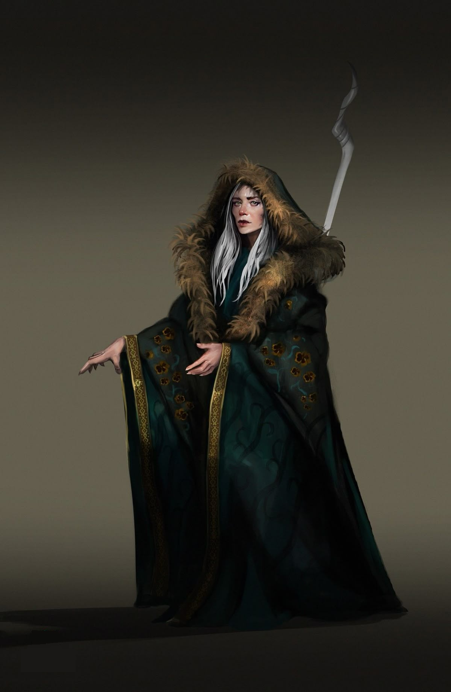

%%  
[[The Anak]]  
[[Anak]]  
[[Shifting]]  
[[Ral]]  
[[Veziva]]  
[[Plašato]]  
[[Gorati]]  
[[Lycanthropy]]  
[[Rivid Tepor]]  
%%  

  
 <h4 class="wiki-header">Sadizka Ovoletru</h4>  
 
  
 <strong>Occupation</strong>  
 Mystic of Rivno  
 
  
 
  
 <strong>Culture</strong>  
 <a href="Gorati" class="internal-link">Gorati</a> <a href="Human" class="internal-link">Human</a>  
 
  
 
  
 <strong>Born</strong>  
 879PA, <a href="Plašato" class="internal-link">Plašato</a>  
 
  
 
  
 <strong>Died</strong>  
 Living  
 
  
 
  
 
  
 <strong>Field of Research</strong>  
 <a href="The Anak" class="internal-link">The Anak</a>, <a href="Shifting" class="internal-link">Shifting</a>  
 
  
 
  
 <strong>Important Works</strong>  
 The Afterimage of the Beast, 912PA  
 
  
 

     

  

Sadizka Ovoletru, called Sadizka of Rivno, is a Gorati arcanist and a member of the Mystics of Rivno in the Kingdom of <a href="Plašato" class="internal-link">Plašato</a>. She is best known for her part in spreading <a href="The Anak" class="internal-link">the Anak</a> through southern Nirydia, and for bringing the old shamanistic and shifter traditions of the region into its framework, giving the arts that the academies had long dismissed as folk practice a place in its cosmology.
  
<h2>The Afterimage of the Beast</h2>  

In her principal work, The Afterimage of the Beast, published in 912PA, Ovoletru places <a href="Shifting" class="internal-link">Shifting</a> firmly among the Anak's magics of afterimage. The beast a shifter becomes, she argues, is not drawn from the Lands Beyond but from the afterimage our moving world has left of that beast, as a people has seen it through the ages: the wolf of a thousand winters, the bear of every hunt. The shifter invites that afterimage onto their own essence. This, she holds, is why shifters always take the beasts their own peoples have revered, and why the beasts of the south, seen for generations through fear, come out more monstrous than those of the north.
  

Drawing on the <a href="Veziva" class="internal-link">Veziva</a> of her own people, she reads the guarded bloodrite of the <a href="Ral" class="internal-link">Ral</a> as the making of a vessel: the blood holds the shifter's own world, as a Vezi's urn holds a world bound into it, while the beast's afterimage is laid over it. <a href="Lycanthropy" class="internal-link">Lycanthropy</a>, in her reading, is an afterimage loosed into the blood of another without any vessel to return to. She calls the Ral the oldest keepers of the Anak, holding in their blood what Anak Montener would only later write in ink, and builds openly on the observations of <a href="Rivid Tepor" class="internal-link">Rivid Tepor</a>.
  
<h2>Teaching and Criticism</h2>  

Ovoletru teaches that the afterimages carry the strength of every beast that ever lived, and that anyone who learns to see them can learn to shift, without the rite of the Ral or the tokens of the druids. Under her the Mystics of Rivno have taken up the practice, and some of her students are said to have mastered the smaller arts of the beast, the eyes of an owl or the nose of a wolf. Her critics point out that none of them has yet taken a full form and returned, and the Ral themselves regard her school with open contempt.
  
