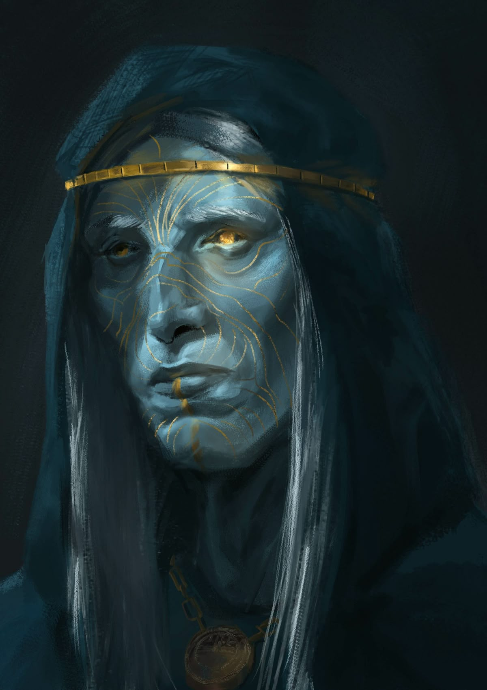

%%
[[Drow]]
%%

    <h4 class="wiki-header">Abin Barom</h4>
    

        <strong>Epithet</strong>
        the Late
    

    

        <strong>Occupation</strong>
        Mage Lord
    

    

        <strong>Culture</strong>
        <a href="Drow" class="internal-link">Drow</a>
    

    

        <strong>Born</strong>
        ca 5th century BA
	    

    

        <strong>Died</strong>
        unknown
    

    

        <strong>Cause of Death</strong>
        lost in time
    

    

    

        <strong>Field of Research</strong>
        Chronomancy
    

    

     

