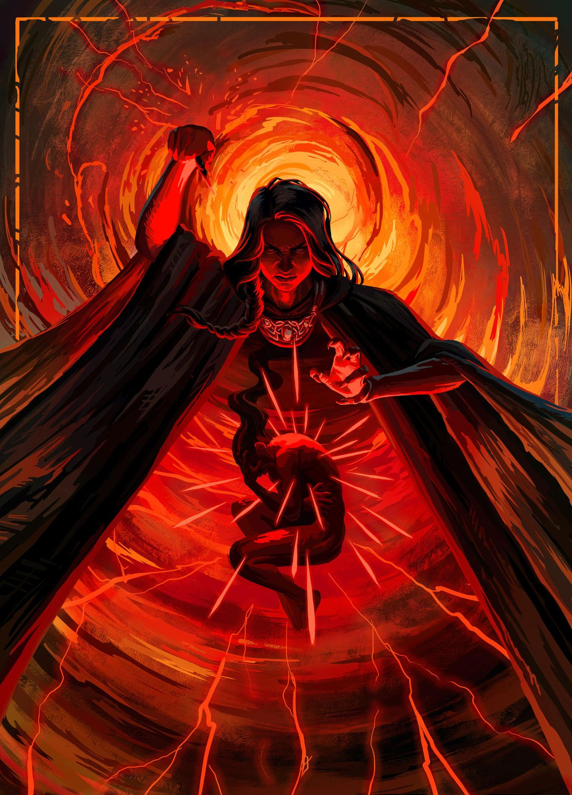

%%  
[[Iron Hole]]  
[[Trazlova]]  
[[Thiar]]  
[[Espir]]  
[[Signa Nylldottr]]  
[[Wermia]]  
[[Trykkerog]]  
[[Rean]]  
[[Vaergriff]]  
%%  

  
 <h4 class="wiki-header">Black Tanya</h4>  
 
  
 <strong>Birth Name</strong>  
 Tanya zi Syd  
 
  
 
  
 <strong>Title</strong>  
 Gri of Sydrow  
 
  
 
  
 <strong>Occupation</strong>  
 Witch  
 
  
 
  
 <strong>Culture</strong>  
 <a href="Vihri" class="internal-link">Low Vihri</a> Human  
 
  
  
  
 <strong>Born</strong>  
 344PA, Syd Keep  
 
  
 
  
 <strong>Ruled</strong>  
 ca. 362PA - ca. 400PA  
 
  
 
  
 <strong>Died</strong>  
 ca. 400PA, Syd Keep  
 
  
 
  
 
  
 <strong>House</strong>  
 zi Syd  
 
  
 
  
   

  

Black Tanya, born Tanya zi Syd, was the Gri of Sydrow from around 362PA until her death around 400PA, and one of the most infamous witches in the history of <a href="Vihr" class="internal-link">Vihr</a>. From Syd Keep on the southern cape of Sydrow Isle, the castle that would later become the <a href="Iron Hole" class="internal-link">Iron Hole</a>, she practised blood magic and enchanting, and for almost forty years she took sailors, travellers and the native people of the island for her rituals, until she was killed by the three adventurers remembered as the Heroes of Sydrow.
  
<h2>Early Life</h2>  

Tanya was the granddaughter of Belia zi Syd, whose family was made Gri of the county of Sydrow as a reward for its services in the war against <a href="Rean" class="internal-link">Rean</a>, which ended in 306PA. Belia built Syd Keep and turned the hamlet of Sydrow into a port town, but the island remained poor, and the house she founded ruled a county of moor, bog and rock far from the court at Zavlech. Tanya was the daughter of Belia's daughter, and she came to rule the county around 362PA.
  
<h2>The Witch of Sydrow</h2>  

Tanya's rule soon became a byword for darkness. She is said to have held court with heathens and to have invited seers and shamans from the north to her keep, among them pagans from <a href="Trykkerog" class="internal-link">Trykkerog</a>, at a time when the Gethric faith was taking hold of the realm. She gathered and studied the forbidden grimoires of <a href="Wermia" class="internal-link">Wermia</a>, which had fallen to the Incursions little more than a century before, and the tales say that she laid with things of blood and dreams.
  

Her art was blood magic and enchanting, and it was paid for with lives. Sailors whose ships put in at Sydrow, travellers who came to the island, and the native people who still lived in its interior disappeared into Syd Keep, and they were sacrificed in her rituals. Among her captives was the brother of the Jueli warrior <a href="Signa Nylldottr" class="internal-link">Signa Nylldottr</a>, who came south from Trykkerog to free him. Signa found him in Syd Keep, bound to Tanya's will as a living puppet, conscious but no longer master of his own body, and she gave him the only release left to him.
  
<h2>Death</h2>  

Around 400PA Signa Nylldottr, the elf <a href="Thiar" class="internal-link">Thiar</a> and the Vihri knight <a href="Espir" class="internal-link">Sir Espir of the Oathhills</a> came to Sydrow, broke into Syd Keep and killed Black Tanya. The tales agree that it was Thiar who struck the killing blow. The three became known as the Heroes of Sydrow, and their deed is one of the best known tales of the Vihri coast. The rule of the island was offered to Sir Espir, who declined it, and the knights of the Ras took Sydrow and Syd Keep for the Crown. The keep stood empty and in ruins for about a hundred and fifty years, until the <a href="Vaergriff" class="internal-link">Vaergriff</a> made it the Iron Hole around 599PA.
  
<h2>Legacy</h2>  

Black Tanya remains a figure of fear and folklore in northern Vihr, above all in Trazlova and on Sydrow itself. She is the witch of countless tales told to children on the coast of Trazlov Bay, and the people of Sydrow say that the island has been haunted since her time. Some of the ghost stories told of the Iron Hole name her victims among the dead who walk there.
  
<h2>People of Interest</h2>  

Belia zi Syd, first Gri of Sydrow, grandmother of Tanya <a href="Thiar" class="internal-link">Thiar</a>, one of the Heroes of Sydrow <a href="Espir" class="internal-link">Sir Espir of the Oathhills</a>, one of the Heroes of Sydrow <a href="Signa Nylldottr" class="internal-link">Signa Nylldottr</a>, one of the Heroes of Sydrow
  
