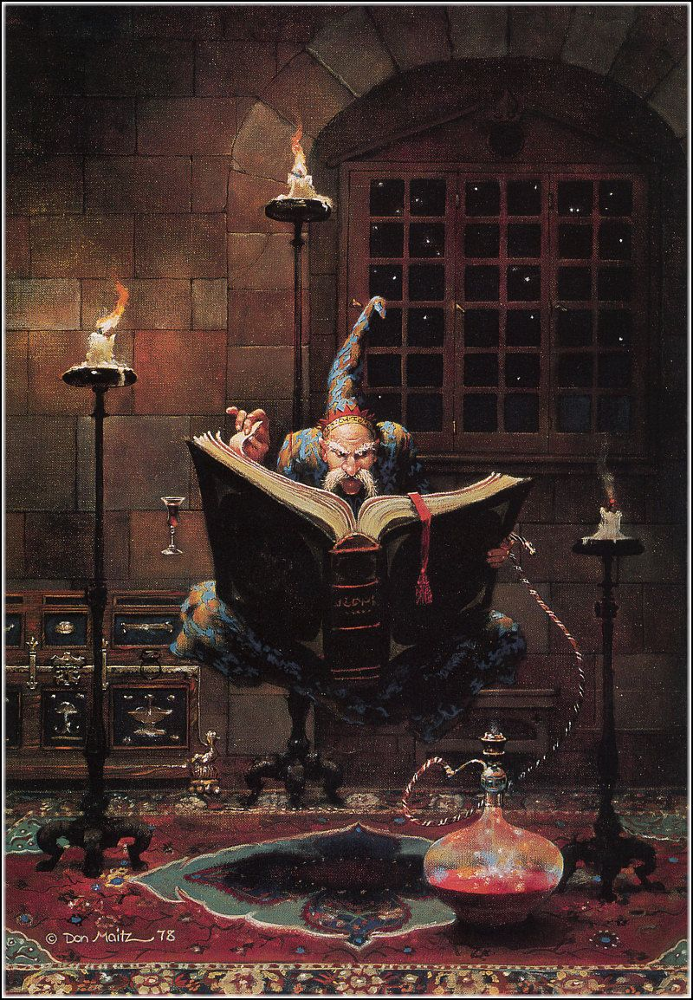

%%
[[Vihri]]
[[Viago V]]
[[Martis III]]
[[Kasimir I]]
%%

    <h4 class="wiki-header">Wojciech Holbrind</h4>
    

        <strong>Occupation</strong>
        Kar-Zavr of <a href="Vihr" class="internal-link">Vihr</a>
    

    

        <strong>Culture</strong>
        <a href="Vihri" class="internal-link">High Vihri</a> <a href="Human" class="internal-link">Human</a>
    

    

        <strong>Born</strong>
        421PA, presumed Oathhills
	    

    

        <strong>Died</strong>
        509PA, Featherlight Tower, near Pjaz
    

    

        <strong>Cause of Death</strong>
        unknown, 88 Years of Age
    

    

    

        <strong>Field of Research</strong>
        Varymancy
    

    

        <strong>Known Students</strong>
        David Thal,  Sidra of Krud
    

     

Wojciech Holbrind was a great <a href="Vihri" class="internal-link">high vihri</a> Wizard of his time, living primarily during the 5th century. He served famously as the Kar-Zavr of <a href="Vihr" class="internal-link">Vihr</a> to 4 rulers and two dynasties of the Rascy: <a href="Viago V" class="internal-link">Viago V "the Merry" zi Zav</a>, <a href="Martis III" class="internal-link">Martis III "the Unlucky" zi Zav</a>, <a href="Kasimir I" class="internal-link">Kasimir I "the Elder" zi Szinmo</a> and Kasimir II "the Younger" zi Szinmo. He was known as an eccentric, wise and mysterious man, that would became the classical stereotype of the "fur-browed vihri Mage" that is a trope in many a play across Ilrakhan to this day.
