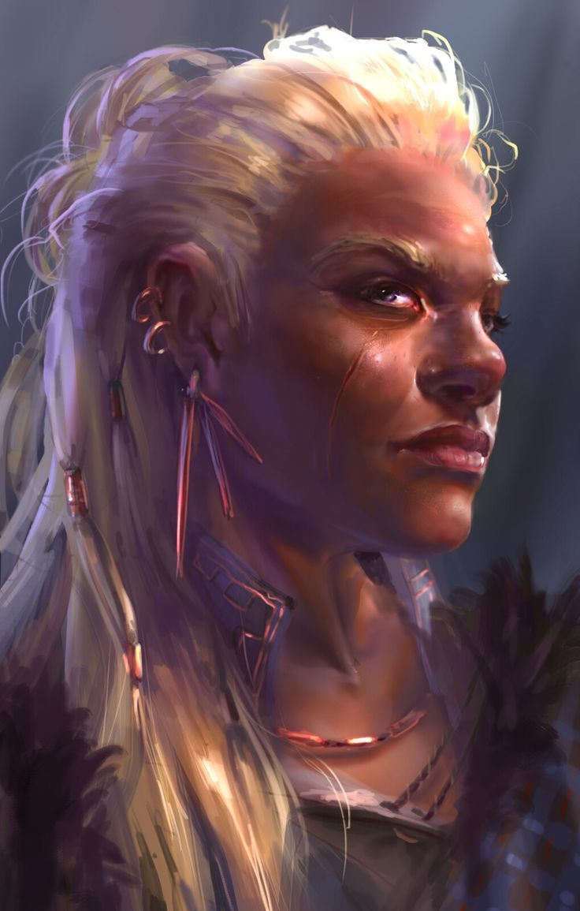

%%
[[Dwarf]]
[[Currentbending]]
[[Tizin-Kol]]
[[Mamus Rolim]]
%%

    <h4 class="wiki-header">Magda Bazena Nib</h4>
    

        <strong>Occupation</strong>
        Chair of the Council, Symposar & Mineralist
    

    

        <strong>Culture</strong>
        <a href="Dwarf" class="internal-link">Dwarf</a>
    

    

        <strong>Born</strong>
        771PA, Tizin-Kol
	    

    

        <strong>Died</strong>
         911PA, Tizin-Kol
    

    

        <strong>Cause of Death</strong>
        Natural Causes 140 years of Age
    

    

    

        <strong>Field of Research</strong>
        <a href="Currentbending" class="internal-link"> Strikestone Currentbending</a>
    

    

        <strong>Allegiance</strong>
        <a href="Tizin-Kol" class="internal-link">Tizin-Kol</a>
    

    

        <strong>Known Students</strong>
        Brean Eduak
    

    

     

Magda Bazena Nib was a dwarven Symposar and mineralist scholar, famous for the so called "Taming of Strikestone"  and her following parts in the development of <a href="Currentbending" class="internal-link">Currentbending</a>, she served as a Chair of the Council between 886 and 907PA before her health began to decline and she largely retired from public office, dying at the age of 140 in 911PA.

As a member of the Symposium and one of the two public "faces" of Currentbending, alongside <a href="Mamus Rolim" class="internal-link">Mamus Rolim</a> himself, she led the so called Practicalists faction of the increasingly Currentbending dominated Wing within the Symposium, contributing personally to inventions such as the first Osmiumthrower Mk. 1, and taking a science first approach in regards to ethical concerns raised by others.

Following the tragic Events of the so called Crisis of the Untouched, Nib became one of the political leaders and representatives of a new Tizin-Kol, and is largely credited for policy made in regards to the secularism and empowering of the Symposium and the Workshops of the late 9th and early 10th century. However it is often said that the death of her old colleague Rolim at the end of the Crisis may have steered her into a less radical direction, when considering the security Mandates imposed on both the Deepforge Silver Mining practices as well as the development guidelines of new arms technology during her terms.

Magda’s most famous student, Brean Eduak, would eventually turn into a harsh critic of her for those more conservative policies and has himself come under a new wave of post religious criticism concerning his risky and volatile experiments, albeit none can deny his credentials or achievements.

