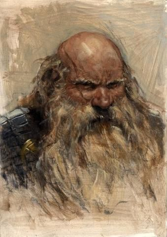

%%
[[Dwarf]]
[[Currentbending]]
[[Tizin-Kol]]
[[Magda Bazena Nib]]
%%

    <h4 class="wiki-header">Mamus Rolim</h4>
    

        <strong>Occupation</strong>
        Symposar & Mineralist
    

    

        <strong>Culture</strong>
        <a href="Dwarf" class="internal-link">Dwarf</a>
    

    

        <strong>Born</strong>
        760PA, Tizin-Kol
	    

    

        <strong>Died</strong>
         882PA, Tizin-Kol
    

    

        <strong>Cause of Death</strong>
        Laceration 122 years of Age
    

    

    

        <strong>Field of Research</strong>
        <a href="Currentbending" class="internal-link">Currentbending</a>
    

    

        <strong>Allegiance</strong>
        <a href="Tizin-Kol" class="internal-link">Tizin-Kol</a>
    

    

        <strong>Known Students</strong>
        <a href="Magda Bazena Nib" class="internal-link">Magda Bazena Nib</a>, Mex Harfal
    

    

     

Mamus Rolim was a dwarven Symposar and mineralist scholar, famous for the discovery of what he dubbed "the Current" and his following part in the development of <a href="Currentbending" class="internal-link">Currentbending</a>. He lived during the 8th and 9th century and is considered by modern standards one of the great founders of Currentbending, alongside figures such as <a href="Magda Bazena Nib" class="internal-link">Magda Bazena Nib</a>. 

For most of his life Rolim served and worked as a Member of the Mineralist Symposium although he largely remained in the realm of theoretical Currentbending and efficiency, as well as shifting to a more ethics orientated philosophy later in his life.

During the Crisis of the Untouched, Rolim who always held to more collaborative and traditionalist concerns himself, acted as a peaceful and diplomatic figure on the side of the new Wave of Currentbenders, that were increasingly politically and later violently opposed by religious traditionalists. Tragically he was nonetheless slain by a radicalised religious terrorist in 882PA, with his death ultimately leading to the greater embracement of Currentbending and strict religious reforms within <a href="Tizin-Kol" class="internal-link">Tizin-Kol</a> itself. His partial martyrdom, coupled with his great contributions to the Symposium and the arts across his lifetime, elevated his standing amidst progressives to even greater heights. There are rumours his death was orchestrated by members of his own faction or the later political movements that reformed the Hold however, who posit the possibility of a false flag operation, turning the moderate and well respected Rolim into a martyr for their cause. While these are unsubstantiated, if true whoever conceived this plan would have been remarkably successful in the end.

Mex Harfal, Rolims lifelong student and admirer, would become known as one of the other fathers of a new Age in Tizin-Kol as he became known for his various civil applications of Currentbending, most famously the Everlock and the reservoir Rings.
