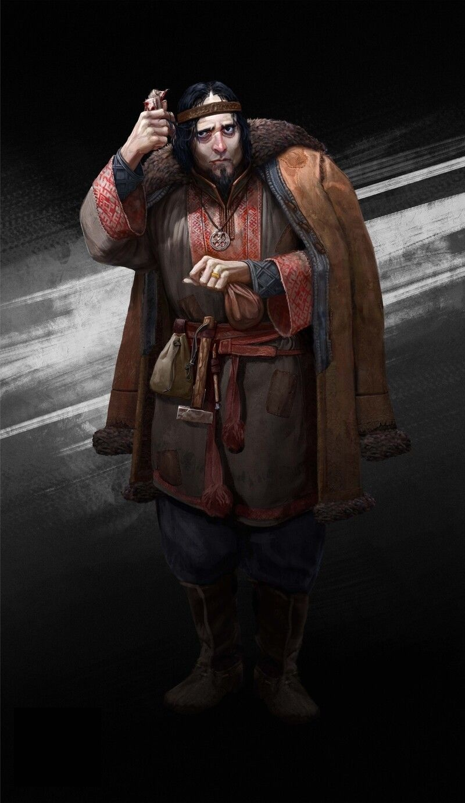

%%  
[[Ral]]  
[[Shifting]]  
[[Lycanthropy]]  
[[Azuvke]]  
[[Kheri]]  
[[Kherovan Inquisition]]  
[[Sadizka Ovoletru]]  
%%  

  
 <h4 class="wiki-header">Rivid Tepor</h4>  
 
  
 <strong>Occupation</strong>  
 Traveller & Chronicler  
 
  
 
  
 <strong>Culture</strong>  
 Kurini <a href="Kheri" class="internal-link">Kheri</a>  
 
  
 
  
 <strong>Born</strong>  
 721PA, <a href="Azuvke" class="internal-link">Azuvke</a>  
 
  
 
  
 <strong>Died</strong>  
768PA, the <a href="Blodrise Dark" class="internal-link">Blodrise Dark</a>
 
  
 
  
 <strong>Cause of Death</strong>  
 Killed by a werewolf 47 years of Age  
 
  
 
  
 
  
 <strong>Field of Research</strong>  
 The <a href="Ral" class="internal-link">Ral</a>, <a href="Shifting" class="internal-link">Shifting</a>  
 
  
 
  
 <strong>Important Works</strong>  
 Between Fang and Finger: My Journeys with the Ral, 763PA  
 
  
 

     

  

Rivid Tepor was a Kheri traveller and chronicler from <a href="Azuvke" class="internal-link">Azuvke</a>, who spent nearly twenty years among the <a href="Ral" class="internal-link">Ral</a> shifters of southern Nirydia and wrote the first close account of their ways, Between Fang and Finger: My Journeys with the Ral. He is remembered as much for his death as for his book, for he was killed by one of the werewolves of the Blodrise Dark while trying to prove that they were not Ral at all.
  
<h2>Life and Journeys</h2>  

Born in Azuvke in 721PA, Tepor was a Kurini of the coast, raised in the Kethric faith and in a city that knew the Ral only as trackers for hire and figures of fear. How he first came to travel with a Ral clan is not recorded, but by his own account he spent the better part of two decades living among several of them, along the Velvet Road and in the lands of the Ganoans, sharing their fires, their hunts and their long silences.
  
<h2>Between Fang and Finger</h2>  

Published in 763PA, his book records what no outsider had set down before. He describes how young Ral learn to take a part of a beast before the whole of it, and claws before anything else; how the Ral eat like no other people after a hunt; and how the tracks of a shifted Ral wolf sank as deep into the mud as a man's, so that he came to believe a shifter keeps their own weight in any shape, which he offered as a way to tell a shifted Ral from a beast of the woods. He writes of their reverence for their own blood, of warriors who feared bleeding more than death and burned every bloodied cloth, and of a rite performed upon newborns that no clan ever allowed him to witness. He held that the songs a clan sings over a returning shifter are what call it back into its human shape.
  

The book's most lasting argument concerns the Blodrise Dark. Tepor insisted that its werewolves could not be Ral, for every Ral he had known returned from the beast and the afflicted of the Blodrise could not, and he noted that no telling of the Blodrise curse he could find was older than the hatred of the Ral it was used to justify. In Kethric Azuvke the book was received coldly, and it is said that the <a href="Kherovan Inquisition" class="internal-link">Inquisition</a> kept a watch on those who copied it.
  
<h2>Death</h2>  

In 768PA Tepor went into the Blodrise Dark to prove his argument by observing its beasts himself, and did not come out; his remains were found by woodsmen and identified by his journals. In the south his death was taken as proof of exactly what he had denied, and his book has been read there ever since as the folly of a man who trusted the Ral. Later scholars, <a href="Sadizka Ovoletru" class="internal-link">Sadizka Ovoletru</a> among them, have treated it as the foundation of any serious study of <a href="Shifting" class="internal-link">Shifting</a>.
  
