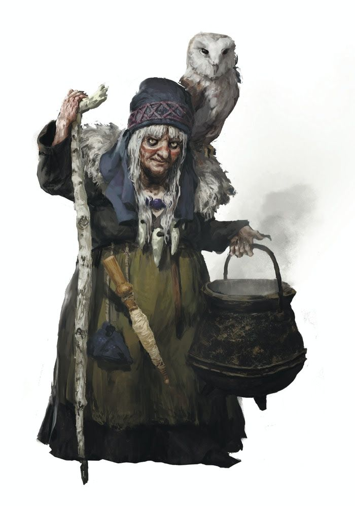

%%
[[Loomman]]
[[Jan of Kolglade]]
%%

    <h4 class="wiki-header">Direnna</h4>
    

        <strong>Occupation</strong>
        Witch of Eelers Inn
    

    

        <strong>Culture</strong>
        <a href="Vihri" class="internal-link">Grachi</a> <a href="Human" class="internal-link">Human</a>
    

    

        <strong>Born</strong>
        880PA, northern Grachwoods
	    

    

        <strong>Died</strong>
        927PA, Eelers Inn
    

    

        <strong>Cause of Death</strong>
        Shot the Archer Danusz 47 years of Age
    

    

    

        <strong>Allegiance</strong>
        <a href="Loomman" class="internal-link">The Loomman</a>
    

    

	 

Direnna, sometimes referred as Direnna the Witch of Eelers Inn, was a treacherous servant of the Feylord commonly known as <a href="Loomman" class="internal-link">the Loomman</a> that preyed on her victims in the abandoned Eelers Inn, north-east of <a href="Kharnov" class="internal-link">Kharnov</a>. She used her fey-given boons to entrance innocent travellers into eternal nightmare, sapping on their fears, doubts and regrets and cooking these negative emotions up as a stewborn offering to her patron.

Direnna lived alone but was accompanied by various familiars, spirits of the Loomman she commanded and had do her bidding, among them a snow white Owl, a hungry animated Keg and various ferocious animated Brooms. Her own appearance took a heavy toll from the magicks she had been using, appearing much older and weaker, especially when it had been some time since her latest offering.

Following the murder of the Boyar Lenkov, his killers, the Knight Hildegard and the Fencer <a href="Jan of Kolglade" class="internal-link">Jan</a>, led their pursuers into the maw of Direnna, they themselves falling into the trappings of the Witch. To Dirennas surprise however, the druid Havu, the Archer Danusz, the Knight <a href="Ranni Grevil" class="internal-link">Ranni</a> and the Tracker Sidris followed Jan and Hildegard and interrupted her ritual. After hectic combat and the death of Ranni and Sidris, a combined effort by almost all the remaining heroes, excluding Jan who had ran away in cold sweat, Direnna finally fell to final death when the Arrows of Danusz struck true, that she had initially suspended within her cauldron.
