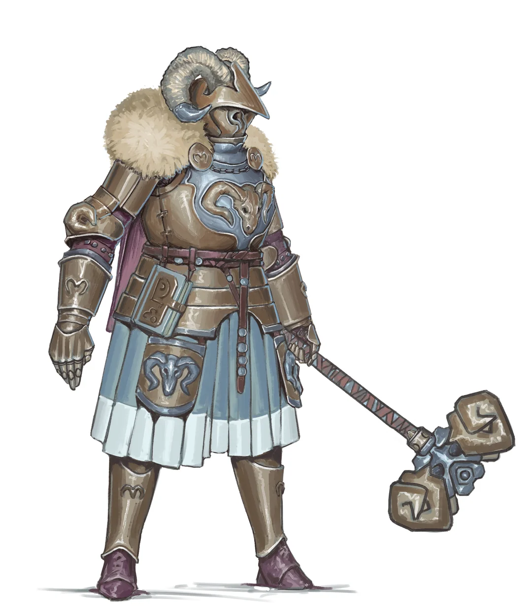

%%
[[Dalniz]]
[[Vihri]]
[[Orlatz]]
[[Nabil]]
%%

    <h4 class="wiki-header">Provost zi Mihun</h4>
    

        <strong>Epiteth</strong>
        the Ram
    

    

        <strong>Occupation</strong>
        former Count of Retsky, Sword for Hire
    

    

        <strong>Culture</strong>
        <a href="Vihri" class="internal-link">Sarloni</a> <a href="Human" class="internal-link">Human</a>
    

    

        <strong>Born</strong>
        881PA, Retsky
    

    

        <strong>Died</strong>
        927PA, <a href="Nabil" class="internal-link">Nabil Oasis</a>
    

    

        <strong>Cause of Death</strong>
        Eviscerated by <a href="Orlatz" class="internal-link">Orlatz</a>, 46 Years of Age
    

    

        <strong>Issue</strong>
        Yeliza Mihun
    

    

        <strong>Dynasty</strong>
        Mihun
    

    

        <strong>Allegiance</strong>
        <a href="Dalniz" class="internal-link">Rascy zi Dalniz</a>
    

    
    

	 

Provost Mihun, better known as "the Ram" is the exiled Count of Retsky and formerly part of the highest ranks of the Dalnizi Nobility. In 918, the then acting Count of the important trade city of Retsky was discovered to be a major facilitator in the Sarloni Drug trade, flowing from Nirydia and southern Behera into Vihr and greater Ilrakhan, as well as having ordered the murder of multiple noble and common born men to protect his business, he was brought in connection with the infamous Criminal <a href="Marosz Kirelli" class="internal-link">Marosz Kirelli</a> , who had apparently been bankrolling Provost after he fell on hard times, in exchange for his good name and connections within the Dalzini establishment and beyond. 

Owing to his standing and the reputation of his family, Provost was exiled in disgrace instead of executed like many of his captured accomplices with his young daughter, Yeliza zi Mihun, succeeding him as the acting Countess of Retsky at the age of merely 8, her father would never see Yeliza again.

In the years following his exile, Provost made use of his considerable talents and macabre reputation acting as a celebrity duellist, prestigious sword for hire and nobleman bodyguard for the rich and powerful in Rean, Kherova and northern Behera, calling himself "the Ram" in lieu of his ancestral armour and the old sigil of House Mihun, barring the Rams symbol.

He began travelling with an Entourage of his own, including Huan, a Hawk Shifter from the southern Deserts of Yorgos, Bak a local Archer and Imag a Desert Sorcerer. They fulfilled various high value contracts, usually illicit activities and murderous tendencies, and established a base of operations on Razborg Island. Following the theft of his masterwork artifact, <a href="Hunters Edge" class="internal-link"> the Hunters Edge</a>, the almadi half-elf<a href="Xarvin Jiballo" class="internal-link">Jiballo</a> hired him for an extraordinary sum to bring the weapon back and kill or apprehend the Goblin Perzuk uz-Kram. Finally tracking him down at Nabil Oasis, it turned out Provost was led into a trap, baited by an even more cunning agent, Orlatz of Torry, and slaughtered on the streets of Nabil, his ring of storing with valuable information fell into the vihris hands and the only survivors of his troupe were the now 1 handed Bak and a vengeful Huan.
